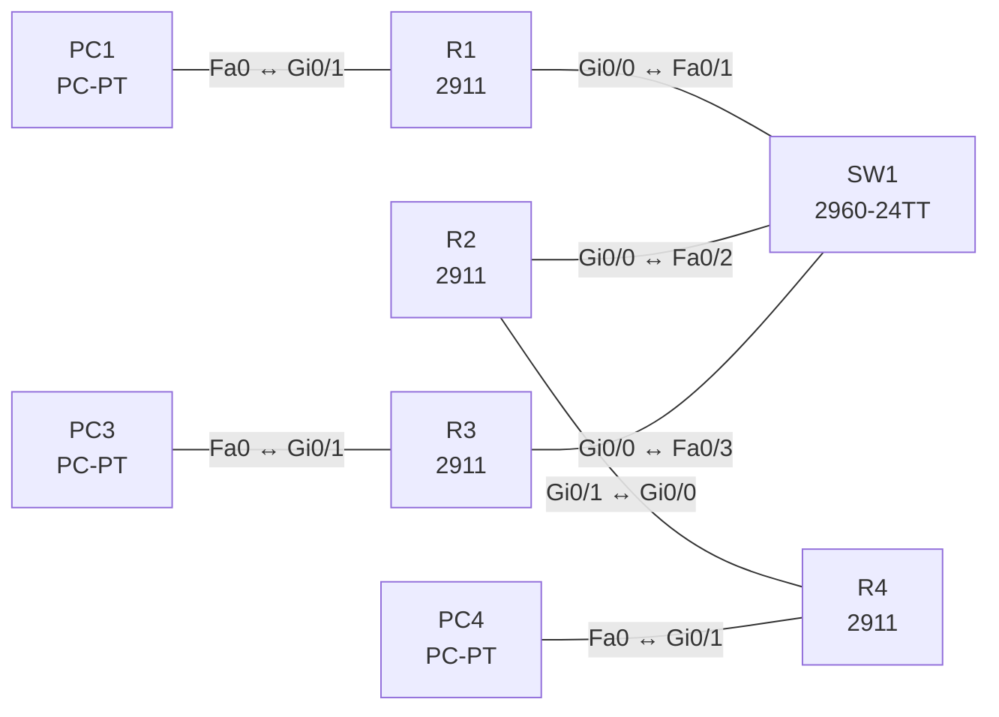

# Lab 16 – OSPFv2 Single Area: Nachbarn, DR/BDR, Router-ID

**Dauer:** 90 min · **Niveau:** mittel

Vier Router in Area 0: drei an einem gemeinsamen Switch (Broadcast-Netz mit DR/BDR-Wahl), ein Router per Punkt-zu-Punkt-Link. Du setzt Router-IDs, steuerst die DR-Wahl per Priorität, stellst Passive Interfaces ein und findest typische Adjazenz-Fehler.

**Lernziele:** Nach diesem Lab kannst du …

- OSPFv2 in einer Area mit festen Router-IDs und Passive Interfaces aufbauen.
- Die DR/BDR-Wahl vorhersagen und steuern.
- Adjazenz-Fehler (Router-ID, Area, Timer, `network`-Statement) finden.

| CCNA-Ziel | Thema |
|---|---|
| 3.4 | OSPFv2 Single Area |
| 3.1 | Routing-Tabelle lesen |

**So arbeitest du:** Teil A = Bauen, Teil B = Reparieren, Teil C = Üben. Die Konfigurationsdateien liegen in `build/` (Ausgangszustand zum Einfügen in die CLI), `repair/` (fertig gebaut, mit Fehlern) und `solutions/` (Musterlösung und Fehlerliste, erst nach eigenem Versuch öffnen). Anleitung zum Einfügen: siehe [Arbeiten mit den Dateien](../README.md#arbeiten-mit-den-dateien).

## Topologie



Soll-Zustand: R1 = DR (Priorität 200), R2 = BDR (100), R3 = DROther (0). Die Verbindung R2–R4 läuft als `point-to-point` ohne DR-Wahl.

### Geräte

| Gerät | Modell in Packet Tracer | Rolle |
|---|---|---|
| R1 | 2911 | DR im Broadcast-Segment |
| R2 | 2911 | BDR, Übergang zu R4 |
| R3 | 2911 | DROther |
| R4 | 2911 | Stub-Router am P2P-Link |
| SW1 | 2960-24TT | Switch für das Broadcast-Segment |
| PC1 | PC-PT | LAN R1 |
| PC3 | PC-PT | LAN R3 |
| PC4 | PC-PT | LAN R4 |

### Verkabelung

| Von | Port | Nach | Port | Kabel |
|---|---|---|---|---|
| R1 | Gi0/0 | SW1 | Fa0/1 | Copper Straight-Through |
| R2 | Gi0/0 | SW1 | Fa0/2 | Copper Straight-Through |
| R3 | Gi0/0 | SW1 | Fa0/3 | Copper Straight-Through |
| R2 | Gi0/1 | R4 | Gi0/0 | Copper Cross-Over |
| PC1 | Fa0 | R1 | Gi0/1 | Copper Cross-Over |
| PC3 | Fa0 | R3 | Gi0/1 | Copper Cross-Over |
| PC4 | Fa0 | R4 | Gi0/1 | Copper Cross-Over |

### Adressplan (Ausgangszustand)

| Gerät | Interface | Adresse | Maske | Gateway | DNS |
|---|---|---|---|---|---|
| R1 | Gi0/0 | 10.16.0.1 | 255.255.255.0 | | |
| R1 | Gi0/1 | 192.168.1.1 | 255.255.255.0 | | |
| R2 | Gi0/0 | 10.16.0.2 | 255.255.255.0 | | |
| R2 | Gi0/1 | 10.16.24.1 | 255.255.255.252 | | |
| R3 | Gi0/0 | 10.16.0.3 | 255.255.255.0 | | |
| R3 | Gi0/1 | 192.168.3.1 | 255.255.255.0 | | |
| R4 | Gi0/0 | 10.16.24.2 | 255.255.255.252 | | |
| R4 | Gi0/1 | 192.168.4.1 | 255.255.255.0 | | |
| PC1 | Fa0 (GUI) | 192.168.1.11 | 255.255.255.0 | 192.168.1.1 |  |
| PC3 | Fa0 (GUI) | 192.168.3.11 | 255.255.255.0 | 192.168.3.1 |  |
| PC4 | Fa0 (GUI) | 192.168.4.11 | 255.255.255.0 | 192.168.4.1 |  |


## Teil A – Bauen

Arbeite die Schritte der Reihe nach ab. Jeder Schritt sagt dir, was du tust, woran du den Erfolg erkennst (**Prüfen**) und worüber du nachdenken sollst (**Denkfrage**). Die Antworten auf die Denkfragen stehen am Ende von Teil A.

1. **Basis.** Verkabeln, `build/` einfügen und die PCs einstellen.
2. **OSPF aktivieren.** `router ospf 1`, Router-ID von Hand (R1 1.1.1.1 bis R4 4.4.4.4) und `network … area 0` für Links und LANs.
   - **Prüfen:** `show ip ospf neighbor` zeigt auf R2 die Nachbarn R1, R3 und R4.
   - **Denkfrage:** Warum setzt man die Router-ID von Hand?
3. **Passive Interfaces.** Setze die LAN-Ports zu den PCs auf `passive-interface`.
   - **Prüfen:** `show ip protocols` listet sie unter „Passive Interface(s)“, die LAN-Netze stehen trotzdem bei den anderen Routern in der Tabelle.
4. **DR und BDR.** Sieh dir auf R3 `show ip ospf neighbor` an. Setze dann am LAN-Interface `ip ospf priority 200` auf R1, `100` auf R2 und `0` auf R3. Starte die Wahl mit `clear ip ospf process` neu.
   - **Prüfen:** R1 ist DR, R2 BDR, R3 DROTHER.
   - **Denkfrage:** Warum ändert sich ohne Neustart nichts?
5. **Punkt-zu-Punkt.** Setze auf beiden Seiten von R2–R4 `ip ospf network point-to-point`.
   - **Prüfen:** `show ip ospf neighbor` zeigt R4 als `FULL/-`.
   - **Denkfrage:** Was ändert sich gegenüber Broadcast?
6. **Kosten.** Setze auf allen Routern `auto-cost reference-bandwidth 1000`.
   - **Prüfen:** `show ip route ospf` zeigt höhere Kosten als vorher.
   - **Denkfrage:** Warum auf allen Routern gleich?
7. **Bonus: Default verteilen.** R3 verteilt mit `default-information originate` eine Default-Route.
   - **Prüfen:** Die anderen Router zeigen `O*E2 0.0.0.0/0`, sobald R3 selbst eine Default-Route hat.

<details><summary>Antworten zu den Denkfragen</summary>

- **Zu 2:** Die Router-ID identifiziert den Router in jedem LSA und entscheidet bei der DR-Wahl mit. Von Hand gesetzt bleibt sie stabil, auch wenn Interfaces dazukommen oder ausfallen.
- **Zu 4:** Die DR-Wahl ist nicht präemptiv. Ein gewählter DR bleibt, bis er ausfällt oder OSPF neu startet.
- **Zu 5:** Auf Punkt-zu-Punkt gibt es keine DR-Wahl, beide Router werden direkt FULL. Die Timer bleiben 10/40 s.
- **Zu 6:** Mit der Standardreferenz von 100 Mbit/s haben FastEthernet und GigabitEthernet beide Kosten 1, OSPF unterscheidet sie also nicht. Ist die Referenz auf den Routern verschieden, rechnen sie mit verschiedenen Kosten, und die Pfadwahl wird uneinheitlich.

</details>

## Teil B – Reparieren

Baue die Topologie wie oben (oder behalte deine aus Teil A), setze alle Geräte zurück (`erase startup-config`, `reload` bzw. neues Gerät) und füge dann die Dateien aus `repair/` ein. Es stecken **5 Fehler** drin. Behandle jede Meldung als Ticket: erst Symptom nachstellen, dann Layer für Layer eingrenzen, beheben und beweisen. Ändere nur, was kaputt ist.

**Ticket 1:** Im Log erscheint `%OSPF-4-DUP_RTRID_NBR`, LSAs werden inkonsistent, einzelne Routen verschwinden.

**Ticket 2:** R4 wird nicht FULL zu R2; `show ip ospf neighbor` ist auf R2 und R4 leer, PC4 erreicht niemanden.

**Ticket 3:** PC3 erreicht seine Nachbarn nicht und LAN 192.168.3.0/24 fehlt in den Routingtabellen der anderen Router.

**Ticket 4:** R2 und R4 bilden keine Nachbarschaft: `show ip ospf interface gi0/1` zeigt Hello 5, R4 hat 10.

**Ticket 5:** Im Segment ist R2 DR, R1 nur DROTHER; die Rollen stimmen nicht mit dem Entwurf überein.

## Verifikation

```
show ip ospf neighbor
show ip ospf interface brief
show ip ospf interface gi0/0
show ip protocols
show ip route ospf
```

| Prüfung | Das solltest du sehen |
|---|---|
| `show ip ospf neighbor` auf R3 | R1 als `FULL/DR`, R2 als `FULL/BDR` |
| `show ip ospf neighbor` auf R1 | R2 als `FULL/BDR`, R3 als `FULL/DROTHER` |
| `show ip ospf neighbor` auf R2 | R4 als `FULL/-` (Punkt-zu-Punkt) |
| Ping zwischen PC1, PC3 und PC4 | Antworten |

## Teil C – Üben

Beantworte zuerst selbst, dann klappe die Antwort auf.

1. Warum gibt es nur in Broadcast-Segmenten einen DR?
<details><summary>Antwort</summary>

**Damit nicht jeder Router mit jedem eine volle Adjazenz bilden muss.** Ohne DR wären das n(n−1)/2 Adjazenzen. Mit DR spricht jeder nur mit DR und BDR. Auf einem Punkt-zu-Punkt-Link gibt es ohnehin nur zwei Router.

</details>

2. Router A hat Hello 10, Router B Hello 5. Was passiert?
<details><summary>Antwort</summary>

**Sie werden keine Nachbarn.** Hello- und Dead-Timer müssen auf beiden Seiten gleich sein.

</details>

3. Wie legt OSPF die Router-ID fest?
<details><summary>Antwort</summary>

**Erst `router-id`, sonst die höchste Loopback-Adresse, sonst die höchste Adresse eines aktiven Interfaces.**

</details>

4. Was bedeutet `2WAY/DROTHER`?
<details><summary>Antwort</summary>

**Beide sind weder DR noch BDR und bleiben deshalb bei 2-Way.** Das ist korrekt. LSAs tauschen sie über DR und BDR aus.

</details>

5. Wann ändert eine neue Priorität den DR?
<details><summary>Antwort</summary>

**Erst bei der nächsten Wahl.** Die DR-Rolle ist nicht präemptiv. Neu gewählt wird nach einem OSPF-Neustart oder wenn der DR ausfällt.

</details>

6. Wie berechnet OSPF die Kosten?
<details><summary>Antwort</summary>

**Referenzbandbreite ÷ Interface-Bandbreite.** Standard ist 100 Mbit/s. FastEthernet und GigabitEthernet bekommen beide 1, deshalb setzt man die Referenz höher.

</details>

## Prüfungsbezug

- OSPF: Link-State, SPF (Dijkstra), Kosten = Referenz ÷ Bandbreite (Standard 100 Mbit/s), AD 110.
- Nachbarschaft braucht gleich: Area, Subnetz, Hello/Dead, Authentisierung, MTU, Stub-Flag. Die Router-ID muss eindeutig sein.
- Router-ID: manuell, dann höchste Loopback, dann höchste aktive Interface-IP.
- DR/BDR nur in Broadcast-Netzen: höchste Priorität, dann höchste Router-ID, nicht präemptiv. Priorität 0 = nie DR.
- Hello/Dead 10/40 s (Broadcast, P2P), 30/120 s (NBMA). 224.0.0.5 alle OSPF-Router, 224.0.0.6 DR/BDR.

## Lösungen

- `solutions/<Gerät>.cfg`: Konfiguration zu Teil A (ohne Basis-Adressen)
- `solutions/FAULTS.md`: Fehlerliste zu Teil B (Spoiler!)
