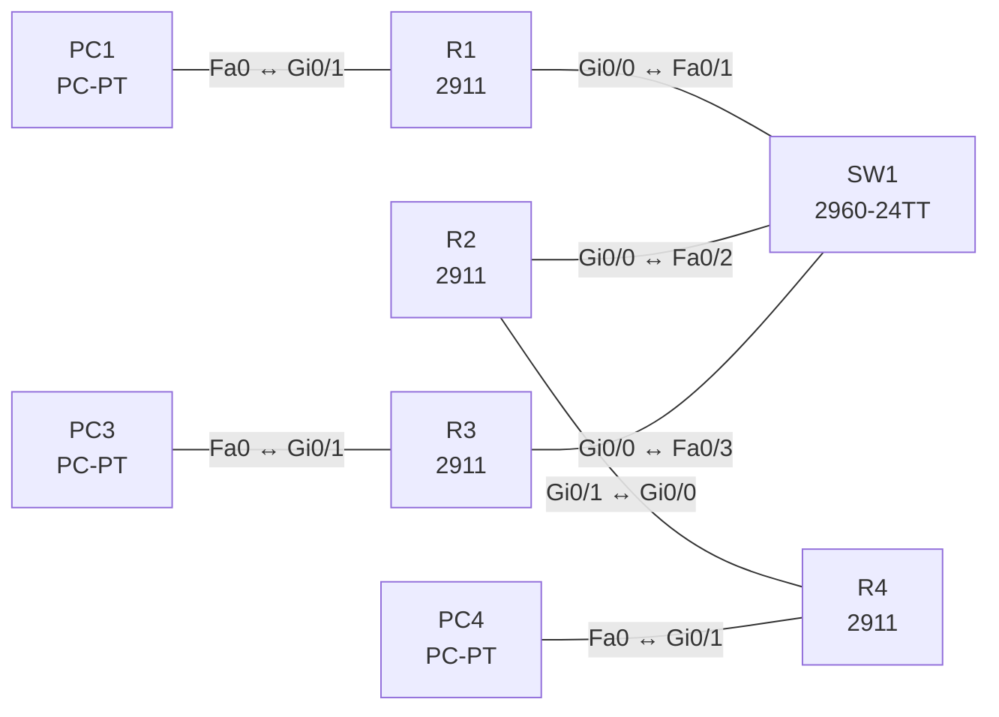

# Lab 16 – OSPFv2 Single Area: Nachbarn, DR/BDR, Router-ID

**Dauer:** 90 min · **Niveau:** mittel

Vier Router in Area 0: drei an einem gemeinsamen Switch (Broadcast-Netz mit DR/BDR-Wahl), ein Router per Punkt-zu-Punkt-Link. Du setzt Router-IDs, steuerst die DR-Wahl per Priorität, stellst Passive Interfaces ein und findest typische Adjazenz-Fehler.

| CCNA-Ziel | Thema |
|---|---|
| 3.4 | OSPFv2 Single Area |
| 3.1 | Routing-Tabelle lesen |

**So arbeitest du:** Teil A = Bauen, Teil B = Reparieren, Teil C = Üben. Die Konfigurationsdateien liegen in `build/` (Ausgangszustand zum Einfügen in die CLI), `repair/` (fertig gebaut, mit Fehlern) und `solutions/` (Musterlösung und Fehlerliste, erst nach eigenem Versuch öffnen). Anleitung zum Einfügen: siehe [Arbeiten mit den Dateien](../README.md#arbeiten-mit-den-dateien).

## Topologie



Soll-Zustand: R1 = DR (Priorität 200), R2 = BDR (100), R3 = DROther (0). Die Verbindung R2–R4 läuft als `point-to-point` ohne DR-Wahl.

### Geräte

| Gerät | Modell in Packet Tracer | Rolle |
|---|---|---|
| R1 | 2911 | DR im Broadcast-Segment |
| R2 | 2911 | BDR, Übergang zu R4 |
| R3 | 2911 | DROther |
| R4 | 2911 | Stub-Router am P2P-Link |
| SW1 | 2960-24TT | Switch für das Broadcast-Segment |
| PC1 | PC-PT | LAN R1 |
| PC3 | PC-PT | LAN R3 |
| PC4 | PC-PT | LAN R4 |

### Verkabelung

| Von | Port | Nach | Port | Kabel |
|---|---|---|---|---|
| R1 | Gi0/0 | SW1 | Fa0/1 | Copper Straight-Through |
| R2 | Gi0/0 | SW1 | Fa0/2 | Copper Straight-Through |
| R3 | Gi0/0 | SW1 | Fa0/3 | Copper Straight-Through |
| R2 | Gi0/1 | R4 | Gi0/0 | Copper Cross-Over |
| PC1 | Fa0 | R1 | Gi0/1 | Copper Cross-Over |
| PC3 | Fa0 | R3 | Gi0/1 | Copper Cross-Over |
| PC4 | Fa0 | R4 | Gi0/1 | Copper Cross-Over |

### Adressplan (Ausgangszustand)

| Gerät | Interface | Adresse | Maske | Gateway | DNS |
|---|---|---|---|---|---|
| R1 | Gi0/0 | 10.16.0.1 | 255.255.255.0 | | |
| R1 | Gi0/1 | 192.168.1.1 | 255.255.255.0 | | |
| R2 | Gi0/0 | 10.16.0.2 | 255.255.255.0 | | |
| R2 | Gi0/1 | 10.16.24.1 | 255.255.255.252 | | |
| R3 | Gi0/0 | 10.16.0.3 | 255.255.255.0 | | |
| R3 | Gi0/1 | 192.168.3.1 | 255.255.255.0 | | |
| R4 | Gi0/0 | 10.16.24.2 | 255.255.255.252 | | |
| R4 | Gi0/1 | 192.168.4.1 | 255.255.255.0 | | |
| PC1 | Fa0 (GUI) | 192.168.1.11 | 255.255.255.0 | 192.168.1.1 |  |
| PC3 | Fa0 (GUI) | 192.168.3.11 | 255.255.255.0 | 192.168.3.1 |  |
| PC4 | Fa0 (GUI) | 192.168.4.11 | 255.255.255.0 | 192.168.4.1 |  |


## Teil A – Bauen

1. **Basis.** Verkabeln, `build/` einfügen, PCs setzen.
2. **OSPF aktivieren.** `router ospf 1`, `router-id` manuell (R1 1.1.1.1 … R4 4.4.4.4), `network … area 0` für die Link- und LAN-Netze. Warum ist die Router-ID wichtig (Wahlkriterium, Stabilität)?
3. **Passive Interfaces.** LAN-Ports zu den PCs `passive-interface`, damit keine Hellos dorthin laufen, die Netze aber im OSPF bleiben.
4. **DR/BDR.** `show ip ospf neighbor` auf R3: Welche Rollen siehst du (DR, BDR, DROTHER)? Setze `ip ospf priority 200` auf R1 und `100` auf R2, `0` auf R3 (Prioritätsänderung wirkt erst nach neuer Wahl: `clear ip ospf process` oder Interface bounce). Wer hat gewonnen?
5. **Punkt-zu-Punkt.** `ip ospf network point-to-point` an beiden Seiten von R2–R4. Unterschied zu Broadcast (Hello 10 s/Dead 40 s, keine DR-Wahl, Hello an 224.0.0.5).
6. **Kosten.** `auto-cost reference-bandwidth 1000` auf allen Routern (einheitlich!). Notiere den Pfad-Kostenwert PC1 → PC4 in `show ip route`.
7. **Default.** (Bonus) R3 originiert mit `default-information originate` einen Default; wirkt, wenn R3 selbst eine Default-Route hat.

## Teil B – Reparieren

Baue die Topologie wie oben (oder behalte deine aus Teil A), setze alle Geräte zurück (`erase startup-config`, `reload` bzw. neues Gerät) und füge dann die Dateien aus `repair/` ein. Es stecken **5 Fehler** drin. Behandle jede Meldung als Ticket: erst Symptom nachstellen, dann Layer für Layer eingrenzen, beheben und beweisen. Ändere nur, was kaputt ist.

**Ticket 1:** Im Log erscheint `%OSPF-4-DUP_RTRID_NBR`, LSAs werden inkonsistent, einzelne Routen verschwinden.

**Ticket 2:** R4 wird nicht FULL zu R2; `show ip ospf neighbor` ist auf R2 und R4 leer, PC4 erreicht niemanden.

**Ticket 3:** PC3 erreicht seine Nachbarn nicht und LAN 192.168.3.0/24 fehlt in den Routingtabellen der anderen Router.

**Ticket 4:** R2 und R4 bilden keine Nachbarschaft: `show ip ospf interface gi0/1` zeigt Hello 5, R4 hat 10.

**Ticket 5:** Im Segment ist R2 DR, R1 nur DROTHER; die Rollen stimmen nicht mit dem Entwurf überein.

## Verifikation

```
show ip ospf neighbor
show ip ospf interface brief
show ip ospf interface gi0/0
show ip protocols
show ip route ospf
```
Erwartet: Auf R3 erscheinen R1 als `FULL/DR` und R2 als `FULL/BDR`. Auf R1 steht R2 als `FULL/BDR` und R3 als `FULL/DROTHER`; R2 und R4 sind `FULL/-` (Punkt-zu-Punkt). PC1, PC3 und PC4 pingen sich gegenseitig.

## Teil C – Üben

Beantworte zuerst selbst, dann klappe die Antwort auf.

1. Warum wird nur im Broadcast-Segment ein DR gewählt?
<details><summary>Antwort</summary>

Um die Zahl der Adjazenzen von n(n−1)/2 auf Verbindungen zu DR/BDR zu begrenzen und Flooding zu bündeln. P2P-Links brauchen das nicht.

</details>

2. Router A hat Hello 10, Router B Hello 5. Was passiert?
<details><summary>Antwort</summary>

Keine Nachbarschaft: Hello-/Dead-Timer müssen übereinstimmen.

</details>

3. Wie legt OSPF die Router-ID fest?
<details><summary>Antwort</summary>

Konfigurierter `router-id`, sonst höchste Loopback-IP, sonst höchste IP aktiver physischer Interfaces.

</details>

4. Was bedeutet `2-WAY/DROTHER`?
<details><summary>Antwort</summary>

Beide Router sind keine DR/BDR: Sie bleiben im Zustand 2-Way und tauschen LSAs nur über DR/BDR aus (kein FULL).

</details>

5. Wann ändert eine Prioritätsänderung den DR?
<details><summary>Antwort</summary>

Nicht sofort: Der DR ist nicht präemptiv und bleibt, bis die Wahl neu stattfindet (OSPF-Neustart, Interface-Flap).

</details>

6. Wie wird die Kosten-Metrik berechnet?
<details><summary>Antwort</summary>

Cost = Referenzbandbreite / Interface-Bandbreite (Standard 10^8 bps); FastEthernet 1, GigabitEthernet 1 (gerundet), daher Referenz anpassen.

</details>

## Prüfungsbezug

OSPF: Link-State, Dijkstra, Kosten = Referenzbandbreite/Bandbreite (Standard 100 Mbit/s), AD 110. Nachbarschaft braucht gleiche Area, Subnetz, Hello/Dead-Timer, Authentisierung, MTU, Stub-Flag. Router-ID: manuell > höchste Loopback > höchste aktive Interface-IP. Broadcast-Netze wählen DR/BDR (Priorität, dann Router-ID, nicht-präemptiv; Priorität 0 = kandidiert nicht). Hello 10 s/Dead 40 s (Broadcast/P2P), 30/120 (NBMA). Multicast 224.0.0.5 (alle OSPF-Router), 224.0.0.6 (DR/BDR).

## Lösungen

- `solutions/<Gerät>.cfg`: Konfiguration zu Teil A (ohne Basis-Adressen)
- `solutions/FAULTS.md`: Fehlerliste zu Teil B (Spoiler!)
