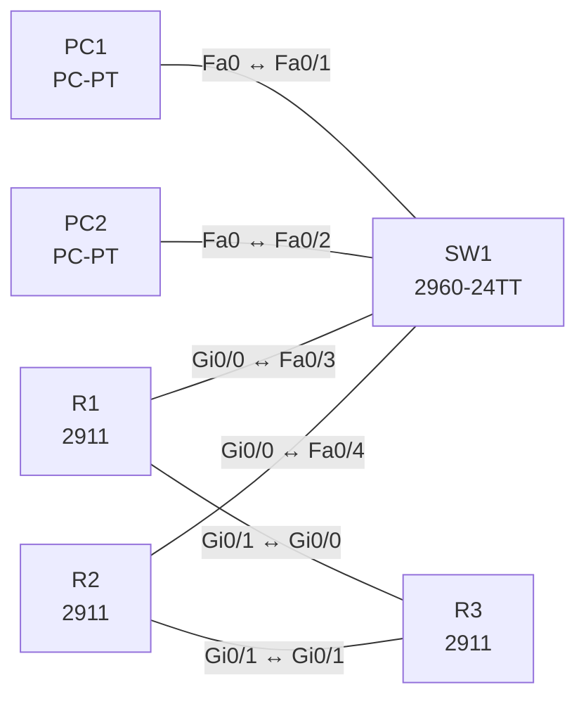

# Lab 17 – First Hop Redundancy: HSRP mit Preempt und Tracking

**Dauer:** 75 min · **Niveau:** mittel

Zwei Router teilen sich als virtuelles Gateway 10.17.1.1 (HSRP). Du konfigurierst Priorität, Preempt und Interface-Tracking und testest den Failover. VRRP und GLBP vergleichst du konzeptionell.

| CCNA-Ziel | Thema |
|---|---|
| 3.5 | First Hop Redundancy Protocols |

**So arbeitest du:** Teil A = Bauen, Teil B = Reparieren, Teil C = Üben. Die Konfigurationsdateien liegen in `build/` (Ausgangszustand zum Einfügen in die CLI), `repair/` (fertig gebaut, mit Fehlern) und `solutions/` (Musterlösung und Fehlerliste, erst nach eigenem Versuch öffnen). Anleitung zum Einfügen: siehe [Arbeiten mit den Dateien](../README.md#arbeiten-mit-den-dateien).

## Topologie



R1 ist bevorzugter Active-Router (Priorität 110), R2 Standby (100). R3 simuliert das Internet (Loopback 8.8.8.8).

### Geräte

| Gerät | Modell in Packet Tracer | Rolle |
|---|---|---|
| R1 | 2911 | Active-Router |
| R2 | 2911 | Standby-Router |
| R3 | 2911 | Internet-Simulation |
| SW1 | 2960-24TT | LAN-Switch |
| PC1 | PC-PT | Client |
| PC2 | PC-PT | Client |

### Verkabelung

| Von | Port | Nach | Port | Kabel |
|---|---|---|---|---|
| PC1 | Fa0 | SW1 | Fa0/1 | Copper Straight-Through |
| PC2 | Fa0 | SW1 | Fa0/2 | Copper Straight-Through |
| R1 | Gi0/0 | SW1 | Fa0/3 | Copper Straight-Through |
| R2 | Gi0/0 | SW1 | Fa0/4 | Copper Straight-Through |
| R1 | Gi0/1 | R3 | Gi0/0 | Copper Cross-Over |
| R2 | Gi0/1 | R3 | Gi0/1 | Copper Cross-Over |

### Adressplan (Ausgangszustand)

| Gerät | Interface | Adresse | Maske | Gateway | DNS |
|---|---|---|---|---|---|
| R1 | Gi0/0 | 10.17.1.2 | 255.255.255.0 | | |
| R1 | Gi0/1 | 10.17.13.1 | 255.255.255.252 | | |
| R2 | Gi0/0 | 10.17.1.3 | 255.255.255.0 | | |
| R2 | Gi0/1 | 10.17.23.1 | 255.255.255.252 | | |
| R3 | Gi0/0 | 10.17.13.2 | 255.255.255.252 | | |
| R3 | Gi0/1 | 10.17.23.2 | 255.255.255.252 | | |
| R3 | Loopback0 | 8.8.8.8 | 255.255.255.255 | | |
| PC1 | Fa0 (GUI) | 10.17.1.11 | 255.255.255.0 | 10.17.1.1 |  |
| PC2 | Fa0 (GUI) | 10.17.1.12 | 255.255.255.0 | 10.17.1.1 |  |


> **Packet-Tracer-Hinweis:** HSRP gibt es in Packet Tracer auf den Routern (`standby`). VRRP/GLBP sind nicht verfügbar; die Konzepte stehen in Teil C. Wird `standby version 2` abgelehnt, lass die Zeile weg (HSRP Version 1, virtuelle MAC 0000.0c07.ac01). Das Tracking mit `standby 1 track <Interface> <Abzug>` ist die klassische Form; falls es fehlt, nutze `track 1 interface … line-protocol` und `standby 1 track 1 decrement 20`.

## Teil A – Bauen

1. **Basis.** Verkabeln, `build/` einfügen. PCs mit Gateway **10.17.1.1** (virtuelle Adresse!). Warum darf das Gateway nicht die reale Router-IP sein?
2. **HSRP.** Auf Gi0/0 beider Router `standby version 2`, `standby 1 ip 10.17.1.1`, R1 `standby 1 priority 110` + `standby 1 preempt`, R2 Standard 100. `show standby brief`: wer ist Active?
3. **Virtuelle MAC.** `show standby` zeigt `0000.0c9f.f001` (v2) bzw. `0000.0c07.ac01` (v1). Wozu eine virtuelle MAC (ARP-Cache der Hosts ändert sich beim Failover nicht)?
4. **Failover testen.** Ping von PC1 zu 8.8.8.8 dauerhaft (`ping -t`), dann R1 Gi0/0 `shutdown`: R2 wird Active. Wie viele Pakete gehen verloren? Danach R1 wieder hoch: Warum übernimmt R1 mit `preempt` zurück?
5. **Tracking.** `standby 1 track GigabitEthernet0/1 20` auf R1: Fällt der Uplink Gi0/1, sinkt die Priorität auf 90 und R2 (100) wird Active. Warum reicht ohne Tracking der Ausfall des Uplinks nicht aus?
6. **Vergleich.** Tabelle HSRP (Cisco, Active/Standby, 224.0.0.2/224.0.0.102), VRRP (IETF, Master/Backup, 224.0.0.18), GLBP (Cisco, Lastverteilung pro Host über mehrere virtuelle MACs).

## Teil B – Reparieren

Baue die Topologie wie oben (oder behalte deine aus Teil A), setze alle Geräte zurück (`erase startup-config`, `reload` bzw. neues Gerät) und füge dann die Dateien aus `repair/` ein und stelle die Endgeräte laut Tabelle unten ein. Es stecken **4 Fehler** drin. Behandle jede Meldung als Ticket: erst Symptom nachstellen, dann Layer für Layer eingrenzen, beheben und beweisen. Ändere nur, was kaputt ist.

**Endgeräte im Repair-Zustand:**

| Gerät | IP | Maske | Gateway | DNS |
|---|---|---|---|---|
| PC1 | 10.17.1.11 | 255.255.255.0 | 10.17.1.1 |  |
| PC2 | 10.17.1.12 | 255.255.255.0 | 10.17.1.2 |  |

**Ticket 1:** `show standby brief` zeigt auf beiden Routern `Active`, unterschiedliche virtuelle IPs (…1 und …11); `%HSRP-4-DIFFVIP1` im Log.

**Ticket 2:** Nach der Rückkehr von R1 bleibt R2 Active; R1 bleibt Standby, obwohl er höhere Priorität hat.

**Ticket 3:** Beim Ausfall von R1 Gi0/1 bleibt R1 Active und der Internet-Verkehr der PCs läuft ins Leere.

**Ticket 4:** PC2 verliert die Verbindung ins Internet, sobald R1 ausfällt, PC1 nicht.

## Verifikation

```
show standby brief
show standby
show ip route         (R3)
```
Erwartet: R1 `Active`, R2 `Standby`, virtuelle IP 10.17.1.1. Nach Uplink-Ausfall auf R1 wechselt die Rolle.

## Teil C – Üben

Beantworte zuerst selbst, dann klappe die Antwort auf.

1. Was ist der Unterschied zwischen HSRP und VRRP?
<details><summary>Antwort</summary>

HSRP ist Cisco-proprietär (Active/Standby), VRRP offen (RFC 5798, Master/Backup); weitere Details: andere Multicast-Adressen und Default-Preempt-Verhalten.

</details>

2. Wozu dient Preempt?
<details><summary>Antwort</summary>

Mit Preempt übernimmt ein Router mit höherer Priorität wieder die aktive Rolle, sobald er zurückkehrt.

</details>

3. Was passiert, wenn der Uplink ausfällt, aber der LAN-Port up bleibt?
<details><summary>Antwort</summary>

Ohne Tracking bleibt der Router Active und wirft den Verkehr weg. Mit Tracking sinkt die Priorität, der Standby übernimmt.

</details>

4. Wie unterscheidet sich GLBP?
<details><summary>Antwort</summary>

GLBP verteilt die Last: Der AVG antwortet auf ARP-Anfragen reihum mit verschiedenen virtuellen MACs der AVFs.

</details>

5. Warum zeigt ein HSRP-Paar manchmal zweimal `Active`?
<details><summary>Antwort</summary>

Hellos kommen nicht an (Layer-2-Problem, falsche Gruppe/Version/virtuelle IP): Jeder Router sieht sich allein.

</details>

## Prüfungsbezug

FHRP stellt eine virtuelle Gateway-IP/MAC bereit, damit Hosts bei Router-Ausfall unverändert bleiben. HSRP: Active/Standby, Default-Priorität 100, Hello 3 s/Hold 10 s, Preempt standardmässig aus. VRRP: offener Standard, Master/Backup, Preempt Standard an. GLBP: Active Virtual Gateway verteilt per ARP verschiedene virtuelle MACs an Clients (Lastverteilung). Tracking senkt die Priorität bei Uplink-Ausfall.

## Lösungen

- `solutions/<Gerät>.cfg`: Konfiguration zu Teil A (ohne Basis-Adressen)
- `solutions/FAULTS.md`: Fehlerliste zu Teil B (Spoiler!)
