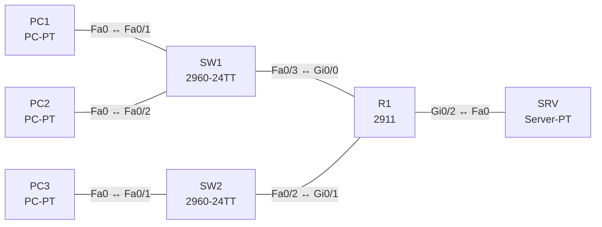

# Lab 18 – DHCP (Router, Server, Relay) und DNS

**Dauer:** 90 min · **Niveau:** mittel

Ein Router vergibt Adressen selbst (LAN A), leitet DHCP-Anfragen von LAN B per Relay (`ip helper-address`) an einen Server weiter und verweist Clients auf einen DNS-Server. Du beobachtest DORA und findest typische DHCP-Fehler.

| CCNA-Ziel | Thema |
|---|---|
| 4.3 | DHCP und DNS: Rollen im Netz |
| 4.6 | DHCP-Client und Relay |
| 1.10 | IP-Parameter auf Windows, macOS und Linux prüfen |

**So arbeitest du:** Teil A = Bauen, Teil B = Reparieren, Teil C = Üben. Die Konfigurationsdateien liegen in `build/` (Ausgangszustand zum Einfügen in die CLI), `repair/` (fertig gebaut, mit Fehlern) und `solutions/` (Musterlösung und Fehlerliste, erst nach eigenem Versuch öffnen). Anleitung zum Einfügen: siehe [Arbeiten mit den Dateien](../README.md#arbeiten-mit-den-dateien).

## Topologie




### Geräte

| Gerät | Modell in Packet Tracer | Rolle |
|---|---|---|
| R1 | 2911 | Gateway, DHCP-Server (LAN A), Relay (LAN B) |
| SW1 | 2960-24TT | Switch LAN A |
| SW2 | 2960-24TT | Switch LAN B |
| PC1 | PC-PT | LAN A |
| PC2 | PC-PT | LAN A |
| PC3 | PC-PT | LAN B |
| SRV | Server-PT | DHCP für LAN B und DNS |

### Verkabelung

| Von | Port | Nach | Port | Kabel |
|---|---|---|---|---|
| PC1 | Fa0 | SW1 | Fa0/1 | Copper Straight-Through |
| PC2 | Fa0 | SW1 | Fa0/2 | Copper Straight-Through |
| SW1 | Fa0/3 | R1 | Gi0/0 | Copper Straight-Through |
| PC3 | Fa0 | SW2 | Fa0/1 | Copper Straight-Through |
| SW2 | Fa0/2 | R1 | Gi0/1 | Copper Straight-Through |
| R1 | Gi0/2 | SRV | Fa0 | Copper Cross-Over |

### Adressplan (Ausgangszustand)

| Gerät | Interface | Adresse | Maske | Gateway | DNS |
|---|---|---|---|---|---|
| R1 | Gi0/0 | 10.18.1.1 | 255.255.255.0 | | |
| R1 | Gi0/1 | 10.18.2.1 | 255.255.255.0 | | |
| R1 | Gi0/2 | 10.18.3.1 | 255.255.255.0 | | |
| PC1 | Fa0 (GUI) | DHCP |  |  |  |
| PC2 | Fa0 (GUI) | DHCP |  |  |  |
| PC3 | Fa0 (GUI) | DHCP |  |  |  |
| SRV | Fa0 (GUI) | 10.18.3.10 | 255.255.255.0 | 10.18.3.1 | 10.18.3.10 |


> **Packet-Tracer-Hinweis:** Server-PT: Services → DHCP, Pool für LAN B anlegen (Default Gateway 10.18.2.1, DNS 10.18.3.10, Start-IP 10.18.2.11, Maske 255.255.255.0, Max. 50). Services → DNS: A-Record `www.lab.local` → 10.18.3.10.

## Teil A – Bauen

1. **Basis.** Verkabeln, `build/` einfügen, PC1–PC3 auf **DHCP**, SRV statisch.
2. **Router-DHCP (LAN A).** `ip dhcp excluded-address 10.18.1.1 10.18.1.10`, Pool `LAN-A` mit Netz, Gateway, DNS. `show ip dhcp binding`: Wer hat welche Adresse? Beobachte DORA im Simulationsmodus (Discover/Offer/Request/Ack): Welche IP-Adressen und Ports (UDP 67/68) erscheinen?
3. **DHCP-Relay (LAN B).** Auf Gi0/1 des Routers: `ip helper-address 10.18.3.10`. Warum erreicht ein Broadcast den Server in einem anderen Subnetz nicht ohne Relay? Welche Giaddr trägt die weitergeleitete Anfrage?
4. **Server-Pool.** Pool für LAN B auf dem Server. PC3 erhält eine Adresse aus 10.18.2.x.
5. **DNS.** `ping www.lab.local` am PC: Welche Auflösungsschritte (lokaler Cache, hosts, DNS-Server)? Record-Typen: A, AAAA, CNAME, MX, NS, PTR.
6. **Lease.** `show ip dhcp pool`, Lease-Zeit (`lease 1`), Freigabe/Erneuerung am PC (`ipconfig /release`, `/renew`). Was passiert bei Adresskonflikt?

## Teil B – Reparieren

Baue die Topologie wie oben (oder behalte deine aus Teil A), setze alle Geräte zurück (`erase startup-config`, `reload` bzw. neues Gerät) und füge dann die Dateien aus `repair/` ein. Es stecken **4 Fehler** drin. Behandle jede Meldung als Ticket: erst Symptom nachstellen, dann Layer für Layer eingrenzen, beheben und beweisen. Ändere nur, was kaputt ist.

**Ticket 1:** PC3 (LAN B) erhält keine Adresse (169.254.x.x), PC1/PC2 funktionieren.

**Ticket 2:** PC1/PC2 haben eine Adresse, erreichen aber nichts ausserhalb von LAN A; `ipconfig` zeigt Gateway 10.18.1.254.

**Ticket 3:** PC1 erreicht `www.lab.local` nicht per Namen, per IP schon.

**Ticket 4:** PC2 erhält nach PC1 keine Adresse mehr, `show ip dhcp pool` zeigt keine freien Adressen.

## Verifikation

```
show ip dhcp binding
show ip dhcp pool
show ip dhcp conflict
show ip interface gi0/1 | include Helper
```
Am PC: `ipconfig /all` (Gateway, DNS, DHCP-Server, Lease); `nslookup www.lab.local`.

## Teil C – Üben

Beantworte zuerst selbst, dann klappe die Antwort auf.

1. Warum braucht ein Client in einem anderen Subnetz einen Relay?
<details><summary>Antwort</summary>

Das DHCP-Discover ist ein Broadcast, den Router nicht weiterleiten. Der Relay wandelt ihn in ein Unicast an den Server um (mit Giaddr = Subnetz des Clients).

</details>

2. Wofür dient `ip dhcp excluded-address`?
<details><summary>Antwort</summary>

Es nimmt Adressen (z. B. Gateways, Server, Drucker) aus dem Pool, damit sie nicht an Clients vergeben werden.

</details>

3. Welche Parameter liefert DHCP ausser der IP?
<details><summary>Antwort</summary>

Subnetzmaske, Default-Gateway, DNS-Server, Domänenname, Lease-Zeit, ggf. Option 43/66/150.

</details>

4. Ein Client bekommt 169.254.x.x. Was bedeutet das?
<details><summary>Antwort</summary>

Kein DHCP-Server erreichbar (Pool leer, Relay fehlt, VLAN/Layer-2-Problem).

</details>

5. Wie läuft eine DNS-Auflösung ab?
<details><summary>Antwort</summary>

Lokaler Cache → hosts-Datei → konfigurierter rekursiver DNS-Server (fragt Root/TLD/autoritative Server) → Antwort wird gecacht (TTL).

</details>

## Prüfungsbezug

DHCP: DORA (Discover, Offer, Request, Ack), UDP 67 (Server) / 68 (Client), Broadcast beim Start. Relay: `ip helper-address <Server>` an dem Interface, an dem Clients hängen. `ip dhcp excluded-address` schützt statische Adressen. DNS löst Namen zu IP auf (UDP/53, TCP/53 für grosse Antworten); Records: A (IPv4), AAAA (IPv6), CNAME (Alias), MX (Mail), NS, PTR (Reverse).

## Lösungen

- `solutions/<Gerät>.cfg`: Konfiguration zu Teil A (ohne Basis-Adressen)
- `solutions/FAULTS.md`: Fehlerliste zu Teil B (Spoiler!)
