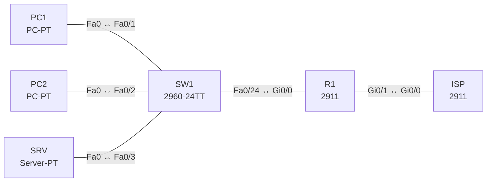

# Lab 19 – Inside Source NAT: statisch, Pool und PAT

**Dauer:** 75 min · **Niveau:** mittel

Ein Edge-Router übersetzt private LAN-Adressen. Du baust PAT (Overload), dynamisches NAT mit Pool und statisches NAT für einen Server und liest die vier NAT-Adressbegriffe aus `show ip nat translations`.

| CCNA-Ziel | Thema |
|---|---|
| 4.1 | Inside Source NAT |

**So arbeitest du:** Teil A = Bauen, Teil B = Reparieren, Teil C = Üben. Die Konfigurationsdateien liegen in `build/` (Ausgangszustand zum Einfügen in die CLI), `repair/` (fertig gebaut, mit Fehlern) und `solutions/` (Musterlösung und Fehlerliste, erst nach eigenem Versuch öffnen). Anleitung zum Einfügen: siehe [Arbeiten mit den Dateien](../README.md#arbeiten-mit-den-dateien).

## Topologie



Öffentliche Adressen aus dem Dokumentationsbereich: Link 198.51.100.0/30, NAT-Pool und Server-Adresse aus 203.0.113.0/24 (der ISP routet das /24 zu R1).

### Geräte

| Gerät | Modell in Packet Tracer | Rolle |
|---|---|---|
| R1 | 2911 | Edge-Router mit NAT |
| ISP | 2911 | Internet-Simulation |
| SW1 | 2960-24TT | LAN-Switch |
| PC1 | PC-PT | Client |
| PC2 | PC-PT | Client |
| SRV | Server-PT | Webserver (HTTP an) |

### Verkabelung

| Von | Port | Nach | Port | Kabel |
|---|---|---|---|---|
| PC1 | Fa0 | SW1 | Fa0/1 | Copper Straight-Through |
| PC2 | Fa0 | SW1 | Fa0/2 | Copper Straight-Through |
| SRV | Fa0 | SW1 | Fa0/3 | Copper Straight-Through |
| SW1 | Fa0/24 | R1 | Gi0/0 | Copper Straight-Through |
| R1 | Gi0/1 | ISP | Gi0/0 | Copper Cross-Over |

### Adressplan (Ausgangszustand)

| Gerät | Interface | Adresse | Maske | Gateway | DNS |
|---|---|---|---|---|---|
| R1 | Gi0/0 | 192.168.19.1 | 255.255.255.0 | | |
| R1 | Gi0/1 | 198.51.100.1 | 255.255.255.252 | | |
| ISP | Gi0/0 | 198.51.100.2 | 255.255.255.252 | | |
| ISP | Loopback0 | 8.8.8.8 | 255.255.255.255 | | |
| PC1 | Fa0 (GUI) | 192.168.19.11 | 255.255.255.0 | 192.168.19.1 |  |
| PC2 | Fa0 (GUI) | 192.168.19.12 | 255.255.255.0 | 192.168.19.1 |  |
| SRV | Fa0 (GUI) | 192.168.19.100 | 255.255.255.0 | 192.168.19.1 |  |


## Teil A – Bauen

1. **Problem sehen.** PC1 pingt 8.8.8.8: erfolglos. Warum (private Quelladresse wird im Internet nicht zurückgeroutet)? `debug ip icmp` auf dem ISP zeigt die private Quelle.
2. **PAT.** `ip nat inside`/`outside` an den Interfaces, ACL 1 für 192.168.19.0/24, `ip nat inside source list 1 interface Gi0/1 overload`. `show ip nat translations`: Wie erkennt man die einzelnen Verbindungen (Ports)?
3. **Vier Adressbegriffe.** Ordne in einer Übersetzung *inside local*, *inside global*, *outside local*, *outside global* zu. Welche ändert NAT?
4. **Statisches NAT.** `ip nat inside source static 192.168.19.100 203.0.113.10`. Vom ISP aus `ping 203.0.113.10` (er soll den Server im LAN erreichen). Bidirektional?
5. **Dynamisches NAT mit Pool.** Ersetze PAT testweise: `ip nat pool POOL 203.0.113.20 203.0.113.22 netmask 255.255.255.0`, `ip nat inside source list 1 pool POOL`. Starte drei Hosts: Was passiert beim vierten (Pool erschöpft)? Warum löst `overload` das?
6. **Aufräumen/Debug.** `clear ip nat translation *`, `show ip nat statistics`, `debug ip nat` (kurz). Welche Sitzungen unterbricht `clear`?

## Teil B – Reparieren

Baue die Topologie wie oben (oder behalte deine aus Teil A), setze alle Geräte zurück (`erase startup-config`, `reload` bzw. neues Gerät) und füge dann die Dateien aus `repair/` ein. Es stecken **4 Fehler** drin. Behandle jede Meldung als Ticket: erst Symptom nachstellen, dann Layer für Layer eingrenzen, beheben und beweisen. Ändere nur, was kaputt ist.

**Ticket 1:** Weder PC1 noch PC2 erreichen 8.8.8.8, `show ip nat translations` ist leer.

**Ticket 2:** NAT scheint konfiguriert, aber keine Übersetzung; der ISP sieht private Quellen.

**Ticket 3:** PC1 kommt hinaus, PC2 danach nicht mehr; `show ip nat statistics` zählt Misses.

**Ticket 4:** Der ISP erreicht 203.0.113.10 (Webserver) nicht.

## Verifikation

```
show ip nat translations
show ip nat statistics
show access-lists
show running-config | include nat
```
Erwartet: PC1/PC2 erscheinen als `198.51.100.1:Port` (PAT), der Server statisch auf 203.0.113.10. Statistik: Hits/Misses, Inside/Outside-Interfaces.

## Teil C – Üben

Beantworte zuerst selbst, dann klappe die Antwort auf.

1. Wie gross darf das Netz hinter PAT sein, wenn nur eine öffentliche Adresse existiert?
<details><summary>Antwort</summary>

Im Prinzip bis zu ca. 65 000 gleichzeitige Verbindungen pro Adresse (Portraum), unabhängig von der Hostzahl.

</details>

2. Unterschied statisches NAT vs. dynamisches NAT?
<details><summary>Antwort</summary>

Statisch: feste 1:1-Zuordnung, von aussen initiierbar. Dynamisch: Zuordnung bei Bedarf aus einem Pool, nur von innen angestossen.

</details>

3. Welche Adresse ist ‚Inside Global‘ eines Clients?
<details><summary>Antwort</summary>

Die öffentliche Adresse (hier 198.51.100.1 bzw. aus dem Pool), unter der die Pakete nach aussen sichtbar sind.

</details>

4. Ein PC erreicht das Internet nicht. Welche vier NAT-Punkte prüfst du?
<details><summary>Antwort</summary>

`ip nat inside/outside` an den Interfaces, ACL-Match, Pool/Overload, Routing (Default und Rückroute des ISP).

</details>

5. Was bedeutet `ip nat inside source list 1 interface Gi0/1 overload`?
<details><summary>Antwort</summary>

Adressen, die ACL 1 erlaubt, werden auf die Adresse von Gi0/1 übersetzt; `overload` unterscheidet Sitzungen über Ports (PAT).

</details>

## Prüfungsbezug

Inside Local = interne Adresse des Hosts, Inside Global = öffentliche Adresse des Hosts, Outside Global = Adresse des Ziels im Internet, Outside Local = Sicht des Ziels im internen Netz (meist gleich Outside Global). NAT-Arten: statisch (1:1), dynamisch mit Pool (n:m), PAT/Overload (n:1 mit Ports). `ip nat inside`/`outside` pro Interface, ACL bestimmt, was übersetzt wird. Ohne Overload ist der Pool schnell leer.

## Lösungen

- `solutions/<Gerät>.cfg`: Konfiguration zu Teil A (ohne Basis-Adressen)
- `solutions/FAULTS.md`: Fehlerliste zu Teil B (Spoiler!)
