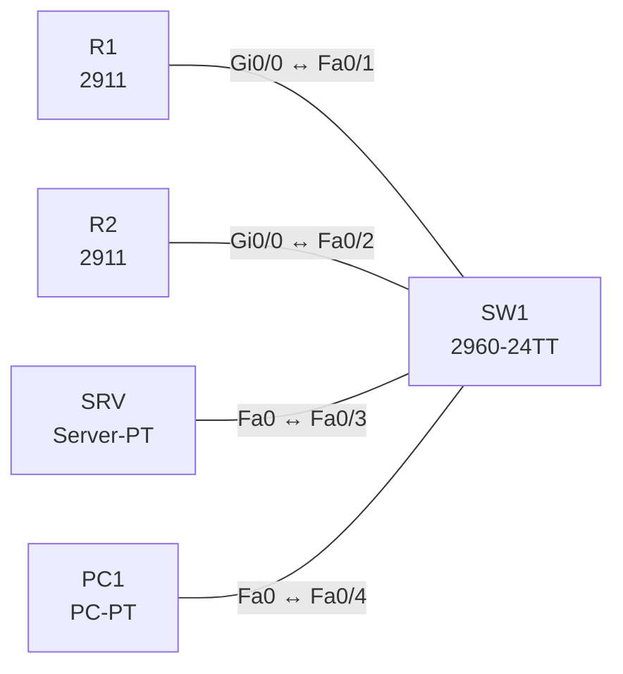

# Lab 20 – NTP, Syslog und SNMP

**Dauer:** 75 min · **Niveau:** mittel

Ein Router liefert die Zeit (NTP-Server), der zweite synchronisiert sich, beide senden Syslog-Meldungen an einen Server und lassen sich per SNMP abfragen. Du ordnest Severity-Level zu und liest SNMP-Grundbegriffe (Manager, Agent, MIB, Community, Trap).

| CCNA-Ziel | Thema |
|---|---|
| 4.2 | NTP (Client und Server) |
| 4.4 | SNMP |
| 4.5 | Syslog (Facilities und Severity) |

**So arbeitest du:** Teil A = Bauen, Teil B = Reparieren, Teil C = Üben. Die Konfigurationsdateien liegen in `build/` (Ausgangszustand zum Einfügen in die CLI), `repair/` (fertig gebaut, mit Fehlern) und `solutions/` (Musterlösung und Fehlerliste, erst nach eigenem Versuch öffnen). Anleitung zum Einfügen: siehe [Arbeiten mit den Dateien](../README.md#arbeiten-mit-den-dateien).

## Topologie




### Geräte

| Gerät | Modell in Packet Tracer | Rolle |
|---|---|---|
| R1 | 2911 | NTP-Master, Syslog-Client, SNMP-Agent |
| R2 | 2911 | NTP-Client, Syslog-Client, SNMP-Agent |
| SW1 | 2960-24TT | Switch |
| SRV | Server-PT | Syslog-Server |
| PC1 | PC-PT | SNMP-Manager (MIB Browser) |

### Verkabelung

| Von | Port | Nach | Port | Kabel |
|---|---|---|---|---|
| R1 | Gi0/0 | SW1 | Fa0/1 | Copper Straight-Through |
| R2 | Gi0/0 | SW1 | Fa0/2 | Copper Straight-Through |
| SRV | Fa0 | SW1 | Fa0/3 | Copper Straight-Through |
| PC1 | Fa0 | SW1 | Fa0/4 | Copper Straight-Through |

### Adressplan (Ausgangszustand)

| Gerät | Interface | Adresse | Maske | Gateway | DNS |
|---|---|---|---|---|---|
| R1 | Gi0/0 | 10.20.1.1 | 255.255.255.0 | | |
| R2 | Gi0/0 | 10.20.1.2 | 255.255.255.0 | | |
| SRV | Fa0 (GUI) | 10.20.1.100 | 255.255.255.0 | 10.20.1.1 |  |
| PC1 | Fa0 (GUI) | 10.20.1.11 | 255.255.255.0 | 10.20.1.1 |  |


> **Packet-Tracer-Hinweis:** Server-PT: Services → SYSLOG einschalten; NTP-Dienst brauchst du nicht (R1 ist Master). SNMP-Abfrage: PC1 → Desktop → MIB Browser (Community `LabRO`).

## Teil A – Bauen

1. **Basis.** Verkabeln, `build/` einfügen. Prüfe: `show clock` auf R1 und R2 (Zeitunterschied?).
2. **NTP.** R1: `ntp master 3` (Stratum 3), R2: `ntp server 10.20.1.1`. `show ntp status` / `show ntp associations`: Wann ist R2 `synchronized`? Was ist Stratum?
3. **Syslog.** Auf beiden Routern: `service timestamps log datetime msec`, `logging host 10.20.1.100`, `logging trap informational`, `logging buffered 8192`. Löse ein Ereignis aus (Interface `shutdown`/`no shutdown`): Meldung im Syslog-Server unter Services → SYSLOG. Wie lautet das Format (`%FACILITY-SEVERITY-MNEMONIC: text`)?
4. **Severity.** Ordne 0–7 (Emergency, Alert, Critical, Error, Warning, Notice, Informational, Debug). Welche Stufen sendet `logging trap warnings`?
5. **SNMP.** `snmp-server community LabRO RO`, `snmp-server location Lab`, `snmp-server contact admin@lab.local`. Frage mit dem MIB Browser `sysName`/`sysUpTime` (OID 1.3.6.1.2.1.1.5.0 / 1.3.6.1.2.1.1.3.0) ab. Was ist der Unterschied zwischen GET, GETNEXT, SET und Trap?
6. **Sicherheit.** Warum ist SNMPv2c mit Community unsicher, und was bringt SNMPv3 (Authentisierung `authNoPriv`, Verschlüsselung `authPriv`)?

## Teil B – Reparieren

Baue die Topologie wie oben (oder behalte deine aus Teil A), setze alle Geräte zurück (`erase startup-config`, `reload` bzw. neues Gerät) und füge dann die Dateien aus `repair/` ein. Es stecken **4 Fehler** drin. Behandle jede Meldung als Ticket: erst Symptom nachstellen, dann Layer für Layer eingrenzen, beheben und beweisen. Ändere nur, was kaputt ist.

**Ticket 1:** `show ntp status` auf R2 meldet `Clock is unsynchronized`.

**Ticket 2:** Meldungen von R1 erscheinen im Syslog-Server, solche von R2 nicht.

**Ticket 3:** Auf dem Syslog-Server fehlen die Link-Up/Down-Meldungen (Level 5/6) von R1; nur Fehler ab Level 3 kommen an.

**Ticket 4:** Der MIB-Browser erhält von R2 keine Antwort (Timeout), von R1 schon.

## Verifikation

```
show ntp status
show ntp associations
show clock detail
show logging
show snmp
show snmp community
```
Erwartet: R2 `Clock is synchronized, stratum 4`, Syslog-Meldungen beim Server, MIB-Browser liefert `sysName = R2`.

## Teil C – Üben

Beantworte zuerst selbst, dann klappe die Antwort auf.

1. Was bedeutet `logging trap warnings`?
<details><summary>Antwort</summary>

Alle Meldungen bis Level 4 (Warning) und darunter (0–4) werden an den Syslog-Server gesendet, Level 5–7 nicht.

</details>

2. Wozu dient Stratum bei NTP?
<details><summary>Antwort</summary>

Es gibt den Abstand zur Referenzuhr an; niedrigere Stratum-Zahlen sind genauer, Clients synchronisieren sich auf die niedrigste verfügbare.

</details>

3. Warum sind korrekte Zeitstempel für Syslog wichtig?
<details><summary>Antwort</summary>

Zur Korrelation von Ereignissen über mehrere Geräte und für Forensik/Compliance.

</details>

4. Trap vs. Poll bei SNMP?
<details><summary>Antwort</summary>

Poll: Manager fragt den Agenten (GET). Trap: Agent meldet selbständig ein Ereignis an den Manager (UDP 162).

</details>

5. Wie lautet das Syslog-Format der Meldung `%LINK-3-UPDOWN: Interface Gi0/0, changed state to down`?
<details><summary>Antwort</summary>

Facility LINK, Severity 3 (Error), Mnemonic UPDOWN, danach Text.

</details>

## Prüfungsbezug

NTP: UDP/123, Stratum-Hierarchie (Stratum 0 = Referenzuhr, jeder Hop +1, 16 = nicht synchronisiert), `ntp server` (Client), `ntp master` (Server ohne externe Quelle). Syslog: UDP/514, Severity 0–7 (0 Emergency, 1 Alert, 2 Critical, 3 Error, 4 Warning, 5 Notice, 6 Informational, 7 Debug); `logging trap <level>` sendet diese Stufe und alle niedrigeren Zahlen (schwerere). SNMP: Manager, Agent, MIB/OID; v1/v2c mit Community (Klartext), v3 mit Benutzer, Authentisierung und Verschlüsselung; Traps/Informs asynchron, GET/SET pull (UDP 161, Traps 162).

## Lösungen

- `solutions/<Gerät>.cfg`: Konfiguration zu Teil A (ohne Basis-Adressen)
- `solutions/FAULTS.md`: Fehlerliste zu Teil B (Spoiler!)
