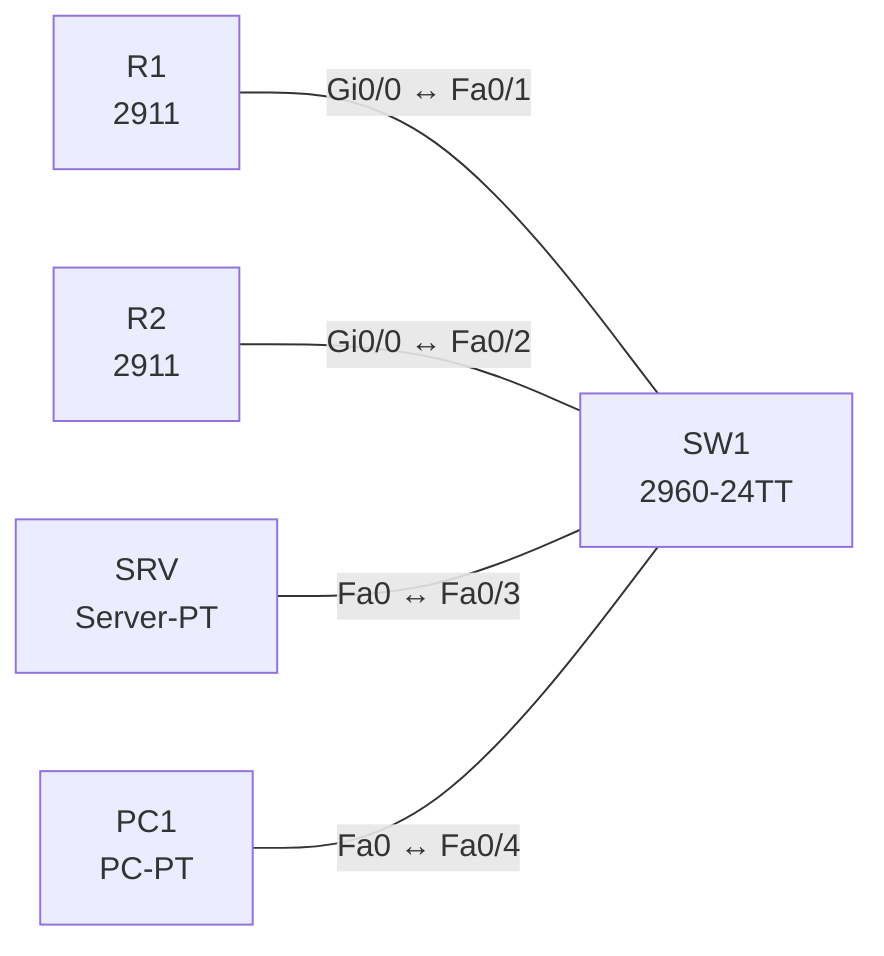

# Lab 20 – NTP, Syslog und SNMP

**Dauer:** 75 min · **Niveau:** mittel

Ein Router liefert die Zeit (NTP-Server), der zweite synchronisiert sich, beide senden Syslog-Meldungen an einen Server und lassen sich per SNMP abfragen. Du ordnest Severity-Level zu und liest SNMP-Grundbegriffe (Manager, Agent, MIB, Community, Trap).

**Lernziele:** Nach diesem Lab kannst du …

- NTP mit Server und Client aufbauen und den Synchronisationszustand lesen.
- Syslog an einen Server senden und Severity-Level gezielt filtern.
- SNMP abfragen und erklären, was v3 gegenüber v2c besser macht.

| CCNA-Ziel | Thema |
|---|---|
| 4.2 | NTP (Client und Server) |
| 4.4 | SNMP |
| 4.5 | Syslog (Facilities und Severity) |

**So arbeitest du:** Teil A = Bauen, Teil B = Reparieren, Teil C = Üben. Die Konfigurationsdateien liegen in `build/` (Ausgangszustand zum Einfügen in die CLI), `repair/` (fertig gebaut, mit Fehlern) und `solutions/` (Musterlösung und Fehlerliste, erst nach eigenem Versuch öffnen). Anleitung zum Einfügen: siehe [Arbeiten mit den Dateien](../README.md#arbeiten-mit-den-dateien).

## Topologie




### Geräte

| Gerät | Modell in Packet Tracer | Rolle |
|---|---|---|
| R1 | 2911 | NTP-Master, Syslog-Client, SNMP-Agent |
| R2 | 2911 | NTP-Client, Syslog-Client, SNMP-Agent |
| SW1 | 2960-24TT | Switch |
| SRV | Server-PT | Syslog-Server |
| PC1 | PC-PT | SNMP-Manager (MIB Browser) |

### Verkabelung

| Von | Port | Nach | Port | Kabel |
|---|---|---|---|---|
| R1 | Gi0/0 | SW1 | Fa0/1 | Copper Straight-Through |
| R2 | Gi0/0 | SW1 | Fa0/2 | Copper Straight-Through |
| SRV | Fa0 | SW1 | Fa0/3 | Copper Straight-Through |
| PC1 | Fa0 | SW1 | Fa0/4 | Copper Straight-Through |

### Adressplan (Ausgangszustand)

| Gerät | Interface | Adresse | Maske | Gateway | DNS |
|---|---|---|---|---|---|
| R1 | Gi0/0 | 10.20.1.1 | 255.255.255.0 | | |
| R2 | Gi0/0 | 10.20.1.2 | 255.255.255.0 | | |
| SRV | Fa0 (GUI) | 10.20.1.100 | 255.255.255.0 | 10.20.1.1 |  |
| PC1 | Fa0 (GUI) | 10.20.1.11 | 255.255.255.0 | 10.20.1.1 |  |


> **Packet-Tracer-Hinweis:** Server-PT: Services → SYSLOG einschalten; NTP-Dienst brauchst du nicht (R1 ist Master). SNMP-Abfrage: PC1 → Desktop → MIB Browser (Community `LabRO`).

## Teil A – Bauen

Arbeite die Schritte der Reihe nach ab. Jeder Schritt sagt dir, was du tust, woran du den Erfolg erkennst (**Prüfen**) und worüber du nachdenken sollst (**Denkfrage**). Die Antworten auf die Denkfragen stehen am Ende von Teil A.

1. **Basis.** Verkabeln und `build/` einfügen.
   - **Prüfen:** `show clock` auf R1 und R2 zeigt verschiedene Zeiten.
2. **NTP.** R1: `ntp master 3`. R2: `ntp server 10.20.1.1`.
   - **Prüfen:** Nach einigen Minuten meldet `show ntp status` auf R2 „Clock is synchronized, stratum 4“.
   - **Denkfrage:** Was ist Stratum, und warum hat R2 Stratum 4?
3. **Syslog.** Auf beiden Routern: `service timestamps log datetime msec`, `logging host 10.20.1.100`, `logging trap informational`, `logging buffered 8192`. Schalte ein Interface aus und wieder ein.
   - **Prüfen:** Auf dem Server erscheint unter Services → SYSLOG die Meldung mit Zeitstempel.
   - **Denkfrage:** Wie ist eine Syslog-Meldung aufgebaut?
4. **Severity.** Ordne die Level 0 bis 7 ihren Namen zu.
   - **Denkfrage:** Welche Level sendet `logging trap warnings`?
5. **SNMP.** `snmp-server community LabRO RO`, `snmp-server location Lab`, `snmp-server contact admin@lab.local`. Frag im MIB Browser auf PC1 `sysName` (1.3.6.1.2.1.1.5.0) und `sysUpTime` (1.3.6.1.2.1.1.3.0) ab.
   - **Prüfen:** Der MIB Browser zeigt `R1` bzw. `R2` und die Laufzeit.
   - **Denkfrage:** Was unterscheidet GET, GETNEXT, SET und Trap?
6. **Sicherheit.** Überlege, was ein Angreifer mit v2c anfangen kann.
   - **Denkfrage:** Was bringt SNMPv3 mit `authNoPriv` und mit `authPriv`?

<details><summary>Antworten zu den Denkfragen</summary>

- **Zu 2:** Stratum zählt die Stufen bis zur Referenzuhr. R1 ist mit `ntp master 3` Stratum 3, R2 bezieht seine Zeit von R1 und ist damit eine Stufe darunter, also 4.
- **Zu 3:** Zeitstempel, dann `%FACILITY-SEVERITY-MNEMONIC: Text`, z. B. `%LINEPROTO-5-UPDOWN: Line protocol on Interface …, changed state to down`.
- **Zu 4:** 0 Emergency, 1 Alert, 2 Critical, 3 Error, 4 Warning, 5 Notice, 6 Informational, 7 Debug. `logging trap warnings` sendet die Level 0 bis 4.
- **Zu 5:** GET fragt einen Wert ab, GETNEXT den nächsten in der MIB (zum Durchlaufen), SET schreibt einen Wert. Ein Trap kommt ungefragt vom Agenten an den Manager.
- **Zu 6:** Bei v2c steht die Community im Klartext im Paket. Wer mitliest, kann alles abfragen, bei einer RW-Community sogar ändern. `authNoPriv` prüft Benutzer und Unverfälschtheit, `authPriv` verschlüsselt zusätzlich den Inhalt.

</details>

## Teil B – Reparieren

Baue die Topologie wie oben (oder behalte deine aus Teil A), setze alle Geräte zurück (`erase startup-config`, `reload` bzw. neues Gerät) und füge dann die Dateien aus `repair/` ein. Es stecken **4 Fehler** drin. Behandle jede Meldung als Ticket: erst Symptom nachstellen, dann Layer für Layer eingrenzen, beheben und beweisen. Ändere nur, was kaputt ist.

**Ticket 1:** `show ntp status` auf R2 meldet `Clock is unsynchronized`.

**Ticket 2:** Meldungen von R1 erscheinen im Syslog-Server, solche von R2 nicht.

**Ticket 3:** Auf dem Syslog-Server fehlen die Link-Up/Down-Meldungen (Level 5/6) von R1; nur Fehler ab Level 3 kommen an.

**Ticket 4:** Der MIB-Browser erhält von R2 keine Antwort (Timeout), von R1 schon.

## Verifikation

```
show ntp status
show ntp associations
show clock detail
show logging
show snmp
show snmp community
```

| Prüfung | Das solltest du sehen |
|---|---|
| `show ntp status` auf R2 | „Clock is synchronized, stratum 4“ |
| Syslog-Server | Meldungen von R1 und R2 mit Zeitstempel |
| MIB Browser, `sysName` von R2 | `R2` |

## Teil C – Üben

Beantworte zuerst selbst, dann klappe die Antwort auf.

1. Was bedeutet `logging trap warnings`?
<details><summary>Antwort</summary>

**Der Router schickt die Level 0 bis 4 an den Syslog-Server.** Notice, Informational und Debug (5 bis 7) bleiben draußen.

</details>

2. Wozu dient Stratum bei NTP?
<details><summary>Antwort</summary>

**Es zeigt, wie weit eine Uhr von der Referenzuhr entfernt ist.** Jede Stufe zählt eins hoch. Clients bevorzugen die Quelle mit dem kleinsten Stratum. 16 heißt nicht synchronisiert.

</details>

3. Warum sind korrekte Zeitstempel für Syslog wichtig?
<details><summary>Antwort</summary>

**Damit du Ereignisse auf mehreren Geräten zeitlich zuordnen kannst.** Ohne gemeinsame Zeit lässt sich bei einer Störung oder einem Angriff nicht nachvollziehen, was zuerst passiert ist.

</details>

4. Was ist der Unterschied zwischen Trap und Poll bei SNMP?
<details><summary>Antwort</summary>

**Beim Poll fragt der Manager, beim Trap meldet sich der Agent selbst.** Polls gehen an UDP 161 des Agenten, Traps an UDP 162 des Managers.

</details>

5. Wie liest du `%LINK-3-UPDOWN: Interface Gi0/0, changed state to down`?
<details><summary>Antwort</summary>

**Facility LINK, Severity 3 (Error), Mnemonic UPDOWN, danach der Text.**

</details>

## Prüfungsbezug

- NTP: UDP 123. Stratum 0 = Referenzuhr, jede Stufe +1, 16 = nicht synchronisiert. `ntp server` = Client, `ntp master` = Server ohne externe Quelle.
- Syslog: UDP 514, Level 0 bis 7. `logging trap <Level>` sendet dieses Level und alle kleineren Zahlen.
- SNMP: Manager, Agent, MIB/OID. v1/v2c mit Community im Klartext, v3 mit Benutzer, Authentisierung und Verschlüsselung. Abfragen UDP 161, Traps UDP 162.

## Lösungen

- `solutions/<Gerät>.cfg`: Konfiguration zu Teil A (ohne Basis-Adressen)
- `solutions/FAULTS.md`: Fehlerliste zu Teil B (Spoiler!)
