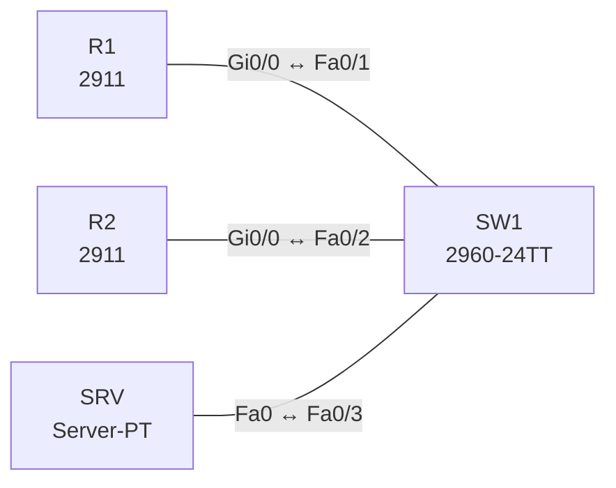

# Lab 21 – TFTP und FTP: Konfigurations- und Image-Sicherung

**Dauer:** 60 min · **Niveau:** leicht

Router sichern ihre Konfiguration und Dateien auf einem Server per TFTP und FTP und spielen sie wieder ein. Du vergleichst die beiden Protokolle (UDP/69 ohne Anmeldung vs. TCP/20/21 mit Benutzer und Passwort).

| CCNA-Ziel | Thema |
|---|---|
| 4.9 | TFTP und FTP |
| 1.5 | TCP und UDP im Vergleich |

**So arbeitest du:** Teil A = Bauen, Teil B = Reparieren, Teil C = Üben. Die Konfigurationsdateien liegen in `build/` (Ausgangszustand zum Einfügen in die CLI), `repair/` (fertig gebaut, mit Fehlern) und `solutions/` (Musterlösung und Fehlerliste, erst nach eigenem Versuch öffnen). Anleitung zum Einfügen: siehe [Arbeiten mit den Dateien](../README.md#arbeiten-mit-den-dateien).

## Topologie




### Geräte

| Gerät | Modell in Packet Tracer | Rolle |
|---|---|---|
| R1 | 2911 | Router mit FTP-Zugangsdaten |
| R2 | 2911 | Zweiter Router (Wiederherstellung) |
| SW1 | 2960-24TT | Switch |
| SRV | Server-PT | TFTP- und FTP-Server |

### Verkabelung

| Von | Port | Nach | Port | Kabel |
|---|---|---|---|---|
| R1 | Gi0/0 | SW1 | Fa0/1 | Copper Straight-Through |
| R2 | Gi0/0 | SW1 | Fa0/2 | Copper Straight-Through |
| SRV | Fa0 | SW1 | Fa0/3 | Copper Straight-Through |

### Adressplan (Ausgangszustand)

| Gerät | Interface | Adresse | Maske | Gateway | DNS |
|---|---|---|---|---|---|
| R1 | Gi0/0 | 10.21.1.1 | 255.255.255.0 | | |
| R2 | Gi0/0 | 10.21.1.2 | 255.255.255.0 | | |
| SRV | Fa0 (GUI) | 10.21.1.100 | 255.255.255.0 | 10.21.1.1 |  |


> **Packet-Tracer-Hinweis:** Server-PT: Services → TFTP und FTP einschalten; FTP-Benutzer `cisco`/`cisco` mit allen Rechten (Services → FTP → User Setup).

## Teil A – Bauen

1. **Basis.** Verkabeln, `build/` einfügen. Pingen R1 → SRV.
2. **TFTP-Sicherung.** `copy running-config tftp:` (Ziel 10.21.1.100, Dateiname `R1-confg`). Auf dem Server unter TFTP erscheint die Datei. Welche Informationen fehlen beim TFTP-Transfer (keine Anmeldung, keine Verschlüsselung)?
3. **Wiederherstellung.** Ändere den Hostnamen, dann `copy tftp: running-config`. Welcher Unterschied zwischen `copy … running-config` (Merge) und `copy … startup-config` (Ersetzen beim Reload)?
4. **FTP.** `ip ftp username cisco` und `ip ftp password cisco`, dann `copy running-config ftp:`. Beobachte Anmeldung und TCP-Verbindung (Port 21 Control, 20 Data) im Simulationsmodus.
5. **IOS-Image.** `copy flash: tftp:` sichert das Image (in PT meist `c2900-…bin`). Wieso ist ein Image-Backup vor einem Upgrade Pflicht, und was prüft `verify /md5`?
6. **Vergleich.** Tabelle TFTP vs. FTP: Port/Transport, Authentisierung, Zuverlässigkeit, Dateigrösse/Verzeichnisse, typische Nutzung (Boot/Config vs. Image/Archiv). Was wäre die sichere Alternative (SCP/SFTP über SSH)?

## Teil B – Reparieren

Baue die Topologie wie oben (oder behalte deine aus Teil A), setze alle Geräte zurück (`erase startup-config`, `reload` bzw. neues Gerät) und füge dann die Dateien aus `repair/` ein. Es stecken **3 Fehler** drin. Behandle jede Meldung als Ticket: erst Symptom nachstellen, dann Layer für Layer eingrenzen, beheben und beweisen. Ändere nur, was kaputt ist.

**Ticket 1:** `copy running-config ftp:` auf R2 scheitert mit Login-Fehler, auf R1 geht es.

**Ticket 2:** R1 erreicht den Server (10.21.1.100) nicht, TFTP/FTP-Transfers melden Timeout.

**Ticket 3:** Der Server ist von beiden Routern nicht erreichbar.

## Verifikation

```
show flash:
show running-config | include ftp
copy running-config tftp:
dir tftp:     (je nach Version)
```
Erwartet: Datei liegt auf dem Server; `copy tftp: running-config` liefert `[OK]`.

## Teil C – Üben

Beantworte zuerst selbst, dann klappe die Antwort auf.

1. Warum ist TFTP unsicher?
<details><summary>Antwort</summary>

Keine Authentisierung, keine Verschlüsselung; jeder, der den Server erreicht, kann Dateien lesen/schreiben (je nach Konfiguration).

</details>

2. Welche Ports nutzt FTP?
<details><summary>Antwort</summary>

TCP/21 für Befehle, TCP/20 im Active Mode für Daten (Passive Mode: hohe Ports).

</details>

3. `copy tftp: running-config` vs. `copy tftp: startup-config`?
<details><summary>Antwort</summary>

Ersteres mischt die Datei in die laufende Konfiguration (Merge, wirkt sofort), zweiteres ersetzt die gespeicherte Konfiguration (wirkt nach Reload).

</details>

4. Wofür TFTP typischerweise?
<details><summary>Antwort</summary>

Einfache Übertragung von Konfigurationen/Images im Labor, PXE/Boot, VoIP-Telefon-Konfiguration.

</details>

5. Wie sicherst du die Übertragung eines IOS-Images?
<details><summary>Antwort</summary>

Per SCP/SFTP oder HTTPS, Hash vergleichen (`verify /md5 flash:image.bin`).

</details>

## Prüfungsbezug

TFTP: UDP/69, kein Login, keine Verzeichnisse, kleine Dateien, Boot/Config. FTP: TCP/21 (Steuerung) und 20 (Daten), Benutzer/Passwort im Klartext, zuverlässig. Beide unverschlüsselt; sicher sind SFTP/SCP über SSH oder FTPS/HTTPS. IOS: `copy <Quelle> <Ziel>`, Image liegt im Flash, `boot system` wählt es.

## Lösungen

- `solutions/<Gerät>.cfg`: Konfiguration zu Teil A (ohne Basis-Adressen)
- `solutions/FAULTS.md`: Fehlerliste zu Teil B (Spoiler!)
