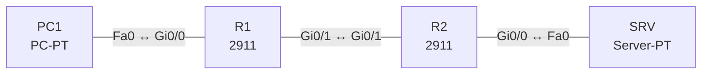

# Lab 22 – QoS: Klassifizierung, Markierung, Queuing, Policing und Shaping

**Dauer:** 90 min · **Niveau:** schwer

Auf einer WAN-Strecke bekommt Sprache Vorrang (LLQ), Geschäftsverkehr eine garantierte Bandbreite, der Rest Best Effort. Du klassifizierst per ACL, markierst DSCP und wendest die Policy am Ausgang an.

| CCNA-Ziel | Thema |
|---|---|
| 4.7 | QoS (Klassifizierung, Markierung, Queuing, Policing, Shaping) |

**So arbeitest du:** Teil A = Bauen, Teil B = Reparieren, Teil C = Üben. Die Konfigurationsdateien liegen in `build/` (Ausgangszustand zum Einfügen in die CLI), `repair/` (fertig gebaut, mit Fehlern) und `solutions/` (Musterlösung und Fehlerliste, erst nach eigenem Versuch öffnen). Anleitung zum Einfügen: siehe [Arbeiten mit den Dateien](../README.md#arbeiten-mit-den-dateien).

## Topologie




### Geräte

| Gerät | Modell in Packet Tracer | Rolle |
|---|---|---|
| R1 | 2911 | WAN-Router mit QoS-Policy |
| R2 | 2911 | Gegenstelle |
| PC1 | PC-PT | Client (Quelle) |
| SRV | Server-PT | Ziel |

### Verkabelung

| Von | Port | Nach | Port | Kabel |
|---|---|---|---|---|
| PC1 | Fa0 | R1 | Gi0/0 | Copper Cross-Over |
| R1 | Gi0/1 | R2 | Gi0/1 | Copper Cross-Over |
| R2 | Gi0/0 | SRV | Fa0 | Copper Cross-Over |

### Adressplan (Ausgangszustand)

| Gerät | Interface | Adresse | Maske | Gateway | DNS |
|---|---|---|---|---|---|
| R1 | Gi0/0 | 10.22.1.1 | 255.255.255.0 | | |
| R1 | Gi0/1 | 10.22.12.1 | 255.255.255.252 | | |
| R2 | Gi0/0 | 10.22.2.1 | 255.255.255.0 | | |
| R2 | Gi0/1 | 10.22.12.2 | 255.255.255.252 | | |
| PC1 | Fa0 (GUI) | 10.22.1.11 | 255.255.255.0 | 10.22.1.1 |  |
| SRV | Fa0 (GUI) | 10.22.2.10 | 255.255.255.0 | 10.22.2.1 |  |


> **Packet-Tracer-Hinweis:** Packet Tracer unterstützt MQC (`class-map`, `policy-map`, `service-policy`) nur teilweise und simuliert kein reales Queuing. Konfiguration und Prüfbefehle (`show policy-map interface`) funktionieren teilweise; für das Verständnis zählen Teil C und die Syntax. Falls ein Befehl abgelehnt wird, notiere dir die Syntax und löse die Teil-C-Fragen.

## Teil A – Bauen

1. **Konzept klären.** Fülle eine Tabelle: Klassifizierung (ACL, NBAR, DSCP/CoS), Markierung (CoS 802.1p, IP Precedence, DSCP), Queuing (FIFO, WFQ, CBWFQ, LLQ), Überlastvermeidung (Tail Drop, WRED), Policing (verwirft/remarkiert) vs. Shaping (puffert).
2. **Basis.** Verkabeln, `build/` einfügen. Link R1–R2 ist der Engpass (WAN, simuliert 2 Mbit/s via `bandwidth 2000`).
3. **Klassifizieren.** ACLs `VOICE` (UDP 16384–32767) und `BUSINESS` (TCP 443, 8080), `class-map match-any VOICE` bzw. `BUSINESS`.
4. **Policy.** `policy-map WAN-OUT`: Klasse VOICE `priority percent 20` (+ `set dscp ef`), Klasse BUSINESS `bandwidth percent 40` (+ `set dscp af31`), `class class-default` `fair-queue`. Warum begrenzt `priority` den Sprachverkehr gleichzeitig (Policing im Überlastfall)?
5. **Anwenden.** `interface Gi0/1` → `service-policy output WAN-OUT`. Warum `output`? (Queuing wirkt beim Senden.) `show policy-map interface gi0/1`.
6. **Policing vs. Shaping.** Schreibe zwei Varianten: `police rate 1000000 bps` (Policing am Eingang) und `shape average 1000000` (Shaping am Ausgang). Welche puffert, welche verwirft?

## Teil B – Reparieren

Baue die Topologie wie oben (oder behalte deine aus Teil A), setze alle Geräte zurück (`erase startup-config`, `reload` bzw. neues Gerät) und füge dann die Dateien aus `repair/` ein. Es stecken **3 Fehler** drin. Behandle jede Meldung als Ticket: erst Symptom nachstellen, dann Layer für Layer eingrenzen, beheben und beweisen. Ändere nur, was kaputt ist.

**Ticket 1:** `show policy-map interface gi0/1` zeigt die Policy nur im Eingang: Die Priorisierung im Ausgang greift nicht; Sprache leidet bei Last.

**Ticket 2:** Die Klasse VOICE zählt keine Treffer (`0 packets`), Sprache landet in class-default.

**Ticket 3:** Beim Einfügen erscheint eine Meldung über zu hohe Bandbreitenzuteilung (Priority + BUSINESS > 75 % der Schnittstelle), die Policy ist unvollständig.

## Verifikation

```
show class-map
show policy-map
show policy-map interface gi0/1
show access-lists
```
Erwartet: Klassen mit Zählern (Packets matched), Policy am Ausgang angewendet.

## Teil C – Üben

Beantworte zuerst selbst, dann klappe die Antwort auf.

1. Wie unterscheiden sich Policing und Shaping?
<details><summary>Antwort</summary>

Policing verwirft/remarkiert Überschuss sofort (keine Verzögerung, Burstverhalten sichtbar), Shaping puffert ihn und sendet später (Verzögerung, glatterer Fluss).

</details>

2. Welche DSCP-Werte gehören typischerweise zu Sprache, Video und Best Effort?
<details><summary>Antwort</summary>

EF (46) für Sprache, AF41 für interaktives Video, 0 (Default) für Best Effort.

</details>

3. Wozu dient die Trust Boundary?
<details><summary>Antwort</summary>

Sie legt fest, ab wo Markierungen vertraut werden; Markierungen von Endgeräten wie PCs werden am Access-Switch überschrieben oder ignoriert, weil sonst jeder Priorität beanspruchen könnte.

</details>

4. Was bewirkt LLQ?
<details><summary>Antwort</summary>

Eine strikte Prioritätswarteschlange für latenzempfindlichen Verkehr (Sprache) neben CBWFQ-Klassen; die Priorität wird begrenzt, damit andere Klassen nicht verhungern.

</details>

5. Warum sind Verzögerung, Jitter und Verlust bei VoIP kritisch?
<details><summary>Antwort</summary>

Echtzeit-Medien tolerieren kaum Verzögerung (< 150 ms einseitig), Jitter (< 30 ms) und Verlust (< 1 %); sie werden daher priorisiert.

</details>

## Prüfungsbezug

Per-Hop-Behavior: Klassifizieren → Markieren → Queuing → Überlast/Policing/Shaping. DSCP: EF = 46 (Sprache), AF41 (Video), AF31/AF21 (Geschäft), CS6 (Steuerung), Default 0. Trust Boundary: Markierungen nur von vertrauenswürdigen Geräten (IP-Phone) übernehmen. LLQ = strikte Priorität + CBWFQ für den Rest. Policing verwirft oder remarkiert überschüssigen Verkehr (Eingang oder Ausgang), Shaping puffert und glättet (nur Ausgang).

## Lösungen

- `solutions/<Gerät>.cfg`: Konfiguration zu Teil A (ohne Basis-Adressen)
- `solutions/FAULTS.md`: Fehlerliste zu Teil B (Spoiler!)
