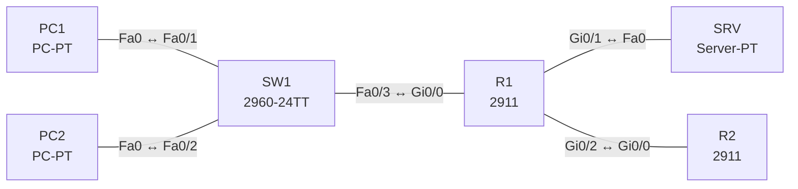

# Lab 23 – Access Control Lists: Standard, Extended, Named

**Dauer:** 90 min · **Niveau:** mittel

Ein Router trennt LAN, Servernetz und Internet. Du schreibst eine erweiterte ACL für die Zugriffsregeln, begrenzt den Telnet/SSH-Zugang per Standard-ACL und findest typische Fehler (Reihenfolge, Richtung, vergessenes DNS).

**Lernziele:** Nach diesem Lab kannst du …

- Eine Extended ACL mit mehreren Regeln in der richtigen Reihenfolge schreiben.
- ACLs richtig platzieren und die Richtung begründen.
- Den Gerätezugang per `access-class` auf eine Adresse begrenzen.

| CCNA-Ziel | Thema |
|---|---|
| 5.6 | Access Control Lists |
| 2.8 | Verwaltungszugriff (Console, Telnet, SSH, HTTP/HTTPS, TACACS+/RADIUS, Cloud) |

**So arbeitest du:** Teil A = Bauen, Teil B = Reparieren, Teil C = Üben. Die Konfigurationsdateien liegen in `build/` (Ausgangszustand zum Einfügen in die CLI), `repair/` (fertig gebaut, mit Fehlern) und `solutions/` (Musterlösung und Fehlerliste, erst nach eigenem Versuch öffnen). Anleitung zum Einfügen: siehe [Arbeiten mit den Dateien](../README.md#arbeiten-mit-den-dateien).

## Topologie



Regeln: Gäste (PC2, .12) dürfen den Server nicht erreichen außer DNS. Mitarbeiter (PC1, .11) nur Web (TCP/80) und Ping zum Server. Alle dürfen ins Internet. Verwaltung des Routers nur von PC1.

### Geräte

| Gerät | Modell in Packet Tracer | Rolle |
|---|---|---|
| R1 | 2911 | Router mit ACLs |
| R2 | 2911 | Internet-Simulation |
| SW1 | 2960-24TT | LAN-Switch |
| PC1 | PC-PT | Mitarbeiter |
| PC2 | PC-PT | Gast |
| SRV | Server-PT | Web (HTTP) und DNS |

### Verkabelung

| Von | Port | Nach | Port | Kabel |
|---|---|---|---|---|
| PC1 | Fa0 | SW1 | Fa0/1 | Copper Straight-Through |
| PC2 | Fa0 | SW1 | Fa0/2 | Copper Straight-Through |
| SW1 | Fa0/3 | R1 | Gi0/0 | Copper Straight-Through |
| R1 | Gi0/1 | SRV | Fa0 | Copper Cross-Over |
| R1 | Gi0/2 | R2 | Gi0/0 | Copper Cross-Over |

### Adressplan (Ausgangszustand)

| Gerät | Interface | Adresse | Maske | Gateway | DNS |
|---|---|---|---|---|---|
| R1 | Gi0/0 | 192.168.23.1 | 255.255.255.0 | | |
| R1 | Gi0/1 | 10.23.2.1 | 255.255.255.0 | | |
| R1 | Gi0/2 | 10.23.9.1 | 255.255.255.252 | | |
| R2 | Gi0/0 | 10.23.9.2 | 255.255.255.252 | | |
| R2 | Loopback0 | 8.8.8.8 | 255.255.255.255 | | |
| PC1 | Fa0 (GUI) | 192.168.23.11 | 255.255.255.0 | 192.168.23.1 | 10.23.2.10 |
| PC2 | Fa0 (GUI) | 192.168.23.12 | 255.255.255.0 | 192.168.23.1 | 10.23.2.10 |
| SRV | Fa0 (GUI) | 10.23.2.10 | 255.255.255.0 | 10.23.2.1 | 10.23.2.10 |


## Teil A – Bauen

Arbeite die Schritte der Reihe nach ab. Jeder Schritt sagt dir, was du tust, woran du den Erfolg erkennst (**Prüfen**) und worüber du nachdenken sollst (**Denkfrage**). Die Antworten auf die Denkfragen stehen am Ende von Teil A.

1. **Basis.** Verkabeln, `build/` einfügen und die PCs einstellen.
   - **Prüfen:** PC1 und PC2 pingen SRV und 8.8.8.8.
2. **Extended ACL `LANA-IN`.** Schreib die ACL für Gi0/0 eingehend, in dieser Reihenfolge: (1) DNS (UDP 53) zum Server für alle, (2) Gast (PC2) komplett vom Servernetz aussperren, (3) Web (TCP 80) vom LAN zum Server erlauben, (4) ICMP-Echo zum Server erlauben, (5) alles andere zum Servernetz sperren, mit `log`, (6) den Rest des LANs ins Internet lassen.
   - **Prüfen:** PC1 öffnet die Webseite und pingt den Server. PC2 löst nur Namen auf. Beide erreichen 8.8.8.8.
   - **Denkfrage:** Warum ist die Reihenfolge so wichtig?
3. **Platzierung.** Überlege, wo welche ACL-Art hingehört.
   - **Denkfrage:** Warum Extended nah an die Quelle, Standard nah an das Ziel?
4. **vty absichern.** Standard-ACL `VTY-ADMIN`, die nur 192.168.23.11 erlaubt, mit `access-class VTY-ADMIN in` auf den vty-Lines.
   - **Prüfen:** Telnet von PC1 klappt, von PC2 nicht.
5. **Zähler und Log.** Sieh dir `show access-lists` an.
   - **Prüfen:** Jede Zeile zeigt ihre Treffer, die Zeile mit `log` erzeugt Meldungen.
   - **Denkfrage:** Was kostet `log`?
6. **Wildcards üben.** Schreib die Wildcards für /24, /28 und einen einzelnen Host.
   - **Denkfrage:** Wie triffst du alle geraden Adressen?

<details><summary>Antworten zu den Denkfragen</summary>

- **Zu 2:** Die ACL hört beim ersten Treffer auf. Stünde die Web-Erlaubnis vor der Gast-Sperre, käme der Gast zum Webserver durch. Und alles, was keine Zeile trifft, fällt ins unsichtbare `deny ip any any` am Ende. Ohne Zeile 6 wäre das Internet gesperrt.
- **Zu 3:** Eine Extended ACL kennt Quelle, Ziel und Port. Sie kann unerwünschten Verkehr deshalb gleich am Anfang verwerfen, ohne andere Ziele zu treffen. Eine Standard-ACL prüft nur die Quelle. Nah an der Quelle würde sie den Absender für alle Ziele sperren.
- **Zu 5:** CPU-Last. Der Router muss jede Meldung erzeugen, auch wenn die Ausgabe gedrosselt wird. `log` nur gezielt und vorübergehend einsetzen.
- **Zu 6:** /24 = `0.0.0.255`, /28 = `0.0.0.15`, Host = `host 10.1.1.1` oder `10.1.1.1 0.0.0.0`. Alle geraden Adressen: `0.0.0.0 255.255.255.254`. Die Wildcard muss nicht zusammenhängend sein, hier wird nur das letzte Bit geprüft, und es muss 0 sein.

</details>

## Teil B – Reparieren

Baue die Topologie wie oben (oder behalte deine aus Teil A), setze alle Geräte zurück (`erase startup-config`, `reload` bzw. neues Gerät) und füge dann die Dateien aus `repair/` ein. Es stecken **5 Fehler** drin. Behandle jede Meldung als Ticket: erst Symptom nachstellen, dann Layer für Layer eingrenzen, beheben und beweisen. Ändere nur, was kaputt ist.

**Ticket 1:** Der Gast (PC2) kann die Webseite des Servers öffnen, obwohl er gesperrt sein soll.

**Ticket 2:** Die ACL greift nicht wie vorgesehen: Der Gast erreicht den Server, der Zähler von `LANA-IN` bleibt 0.

**Ticket 3:** Web per IP (`http://10.23.2.10`) geht für PC1, per Name nicht (`www.lab.local`).

**Ticket 4:** PC1 und PC2 erreichen 8.8.8.8 nicht mehr (Server geht).

**Ticket 5:** Selbst PC1 kann sich nicht mehr per Telnet an R1 anmelden.

## Verifikation

```
show access-lists
show ip interface gi0/0 | include access list
show running-config | section line vty
```

| Prüfung | Das solltest du sehen |
|---|---|
| PC1 | Web und Ping zum Server ja, andere Ports nein, Internet ja |
| PC2 (Gast) | nur DNS zum Server, Internet ja |
| Telnet zu R1 | nur von PC1 |
| `show ip interface gi0/0` | „Inbound access list is LANA-IN“ |

## Teil C – Üben

Beantworte zuerst selbst, dann klappe die Antwort auf.

1. Wo platzierst du Standard- und Extended-ACLs?
<details><summary>Antwort</summary>

**Standard nah am Ziel, Extended nah an der Quelle.** Standard prüft nur die Quelle und würde sonst zu viel sperren. Extended ist genau genug, um den Verkehr früh zu stoppen.

</details>

2. Was bewirkt das implizite Deny?
<details><summary>Antwort</summary>

**Alles, was keine Zeile trifft, wird verworfen.** Eine ACL ohne eine einzige Permit-Zeile sperrt also alles.

</details>

3. Wie lautet die Wildcard für 192.168.23.0/26?
<details><summary>Antwort</summary>

**0.0.0.63.** Wildcard = 255.255.255.255 minus Maske: 255 − 192 = 63.

</details>

4. Was unterscheidet `ip access-group` von `access-class`?
<details><summary>Antwort</summary>

**`ip access-group` filtert Verkehr an einem Interface, `access-class` den Zugang zu den vty-Lines des Routers.**

</details>

5. Wie fügst du eine Zeile in die Mitte einer Named ACL ein?
<details><summary>Antwort</summary>

**Mit einer Sequenznummer zwischen den vorhandenen.** Zum Beispiel unter `ip access-list extended LANA-IN` die Zeile `15 permit …`.

</details>

## Prüfungsbezug

- Auswertung von oben nach unten, erster Treffer gilt, am Ende steht unsichtbar `deny any`.
- Standard (1–99, 1300–1999): nur Quelle, nah ans Ziel. Extended (100–199, 2000–2699): Protokoll, Quelle, Ziel, Ports, nah an die Quelle.
- Named ACLs erlauben Einfügen per Sequenznummer.
- Eine ACL pro Interface, Protokoll und Richtung. `ip access-group` für Verkehr, `access-class` für vty.
- Wildcard: 0 = muss passen, 1 = egal.

## Lösungen

- `solutions/<Gerät>.cfg`: Konfiguration zu Teil A (ohne Basis-Adressen)
- `solutions/FAULTS.md`: Fehlerliste zu Teil B (Spoiler!)
