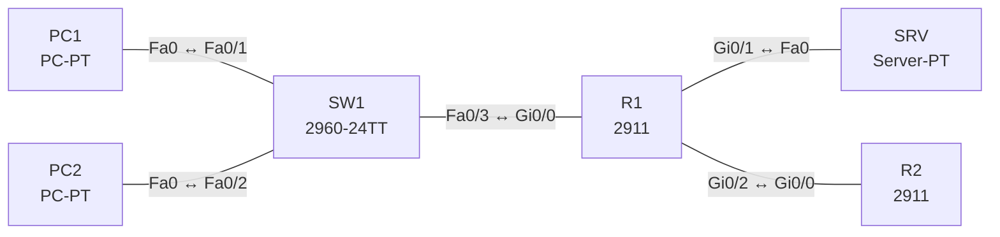

# Lab 23 – Access Control Lists: Standard, Extended, Named

**Dauer:** 90 min · **Niveau:** mittel

Ein Router trennt LAN, Servernetz und Internet. Du schreibst eine erweiterte ACL für die Zugriffsregeln, begrenzt den Telnet/SSH-Zugang per Standard-ACL und findest typische Fehler (Reihenfolge, Richtung, vergessenes DNS).

| CCNA-Ziel | Thema |
|---|---|
| 5.6 | Access Control Lists |
| 2.8 | Verwaltungszugriff (Console, Telnet, SSH, HTTP/HTTPS, TACACS+/RADIUS, Cloud) |

**So arbeitest du:** Teil A = Bauen, Teil B = Reparieren, Teil C = Üben. Die Konfigurationsdateien liegen in `build/` (Ausgangszustand zum Einfügen in die CLI), `repair/` (fertig gebaut, mit Fehlern) und `solutions/` (Musterlösung und Fehlerliste, erst nach eigenem Versuch öffnen). Anleitung zum Einfügen: siehe [Arbeiten mit den Dateien](../README.md#arbeiten-mit-den-dateien).

## Topologie



Regeln: Gäste (PC2, .12) dürfen den Server nicht erreichen ausser DNS. Mitarbeiter (PC1, .11) nur Web (TCP/80) und Ping zum Server. Alle dürfen ins Internet. Verwaltung des Routers nur von PC1.

### Geräte

| Gerät | Modell in Packet Tracer | Rolle |
|---|---|---|
| R1 | 2911 | Router mit ACLs |
| R2 | 2911 | Internet-Simulation |
| SW1 | 2960-24TT | LAN-Switch |
| PC1 | PC-PT | Mitarbeiter |
| PC2 | PC-PT | Gast |
| SRV | Server-PT | Web (HTTP) und DNS |

### Verkabelung

| Von | Port | Nach | Port | Kabel |
|---|---|---|---|---|
| PC1 | Fa0 | SW1 | Fa0/1 | Copper Straight-Through |
| PC2 | Fa0 | SW1 | Fa0/2 | Copper Straight-Through |
| SW1 | Fa0/3 | R1 | Gi0/0 | Copper Straight-Through |
| R1 | Gi0/1 | SRV | Fa0 | Copper Cross-Over |
| R1 | Gi0/2 | R2 | Gi0/0 | Copper Cross-Over |

### Adressplan (Ausgangszustand)

| Gerät | Interface | Adresse | Maske | Gateway | DNS |
|---|---|---|---|---|---|
| R1 | Gi0/0 | 192.168.23.1 | 255.255.255.0 | | |
| R1 | Gi0/1 | 10.23.2.1 | 255.255.255.0 | | |
| R1 | Gi0/2 | 10.23.9.1 | 255.255.255.252 | | |
| R2 | Gi0/0 | 10.23.9.2 | 255.255.255.252 | | |
| R2 | Loopback0 | 8.8.8.8 | 255.255.255.255 | | |
| PC1 | Fa0 (GUI) | 192.168.23.11 | 255.255.255.0 | 192.168.23.1 | 10.23.2.10 |
| PC2 | Fa0 (GUI) | 192.168.23.12 | 255.255.255.0 | 192.168.23.1 | 10.23.2.10 |
| SRV | Fa0 (GUI) | 10.23.2.10 | 255.255.255.0 | 10.23.2.1 | 10.23.2.10 |


## Teil A – Bauen

1. **Basis.** Verkabeln, `build/` einfügen, PCs setzen. Alles pingt: Teste PC1/PC2 → SRV und → 8.8.8.8.
2. **Extended ACL `LANA-IN`** am LAN-Interface Gi0/0 (inbound): 1) DNS (UDP/53) zum Server für alle, 2) Gast-Host komplett zum Servernetz sperren, 3) Web (TCP/80) vom LAN zum Server erlauben, 4) ICMP-Echo zum Server erlauben, 5) restlichen Verkehr zum Servernetz sperren (`log`), 6) Rest des LAN darf ins Internet. Warum zählt die Reihenfolge (First Match, implizites `deny ip any any` am Ende)?
3. **Platzierung.** Extended ACL möglichst nah an der Quelle, Standard ACL möglichst nah am Ziel. Begründe.
4. **vty absichern.** Standard ACL `VTY-ADMIN` (nur 192.168.23.11) mit `access-class VTY-ADMIN in` auf den vty-Lines. Teste Telnet von PC1 (geht) und PC2 (blockiert).
5. **Logging und Zähler.** `show access-lists` zeigt Treffer pro Zeile; `log` meldet Treffer. Was kostet `log` (CPU)?
6. **Aufräumen.** Wildcard-Masken üben: `0.0.0.255`, `0.0.0.15`, Host = `host` oder `0.0.0.0`. Wie schreibst du ‚alle geraden Adressen' (nicht möglich)?

## Teil B – Reparieren

Baue die Topologie wie oben (oder behalte deine aus Teil A), setze alle Geräte zurück (`erase startup-config`, `reload` bzw. neues Gerät) und füge dann die Dateien aus `repair/` ein. Es stecken **5 Fehler** drin. Behandle jede Meldung als Ticket: erst Symptom nachstellen, dann Layer für Layer eingrenzen, beheben und beweisen. Ändere nur, was kaputt ist.

**Ticket 1:** Der Gast (PC2) kann die Webseite des Servers öffnen, obwohl er gesperrt sein soll.

**Ticket 2:** Die ACL greift nicht wie vorgesehen: Der Gast erreicht den Server, der Zähler von `LANA-IN` bleibt 0.

**Ticket 3:** Web per IP (`http://10.23.2.10`) geht für PC1, per Name nicht (`www.lab.local`).

**Ticket 4:** PC1 und PC2 erreichen 8.8.8.8 nicht mehr (Server geht).

**Ticket 5:** Selbst PC1 kann sich nicht mehr per Telnet an R1 anmelden.

## Verifikation

```
show access-lists
show ip interface gi0/0 | include access list
show running-config | section line vty
```
Erwartet: PC1: Web/Ping zum Server ja, andere Ports nein; PC2: nur DNS; beide: Internet ja; Telnet zu R1 nur von PC1.

## Teil C – Üben

Beantworte zuerst selbst, dann klappe die Antwort auf.

1. Wo platzierst du Standard- und Extended ACLs?
<details><summary>Antwort</summary>

Standard nah am Ziel (sie prüfen nur die Quelle), Extended nah an der Quelle (sie sind spezifisch und sparen Transportweg).

</details>

2. Was bewirkt das implizite Deny?
<details><summary>Antwort</summary>

Alles, was keine Regel trifft, wird verworfen; eine ACL ohne Permit sperrt also alles.

</details>

3. Wie lautet die Wildcard für 192.168.23.0/26?
<details><summary>Antwort</summary>

0.0.0.63.

</details>

4. Wie unterscheiden sich `ip access-group` und `access-class`?
<details><summary>Antwort</summary>

`ip access-group` filtert Verkehr, der durch ein Interface läuft; `access-class` filtert Verbindungen zu den vty-Lines des Routers.

</details>

5. Wie fügst du eine Zeile in die Mitte einer Named ACL ein?
<details><summary>Antwort</summary>

Mit Sequenznummer, z. B. `ip access-list extended LANA-IN` → `15 permit …`.

</details>

## Prüfungsbezug

ACLs werden von oben nach unten ausgewertet (First Match), am Ende steht ein implizites `deny any`. Standard (1–99, 1300–1999): nur Quelle, nah am Ziel. Extended (100–199, 2000–2699): Protokoll, Quelle, Ziel, Ports, nah an der Quelle. Named ACLs erlauben Einfügen per Sequenznummer. Pro Interface, Protokoll und Richtung eine ACL. `ip access-group` für Verkehr, `access-class` für vty. Wildcard: 0 = muss passen, 1 = egal.

## Lösungen

- `solutions/<Gerät>.cfg`: Konfiguration zu Teil A (ohne Basis-Adressen)
- `solutions/FAULTS.md`: Fehlerliste zu Teil B (Spoiler!)
