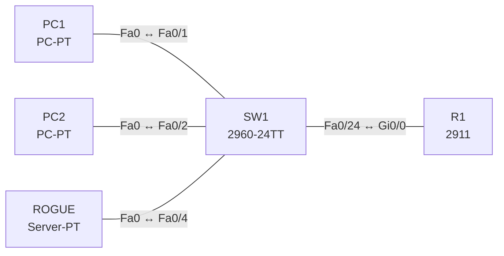

# Lab 24 – Layer-2-Sicherheit: Port Security, DHCP Snooping, DAI

**Dauer:** 90 min · **Niveau:** mittel

Ein Access-Switch schützt sich gegen falsche MAC-Adressen, Rogue-DHCP-Server und ARP-Spoofing. Du konfigurierst Port Security (sticky), DHCP Snooping mit Trust-Port und Dynamic ARP Inspection und deutest die Fehlerbilder.

| CCNA-Ziel | Thema |
|---|---|
| 5.7 | Layer-2-Security (DHCP Snooping, DAI, Port Security) |

**So arbeitest du:** Teil A = Bauen, Teil B = Reparieren, Teil C = Üben. Die Konfigurationsdateien liegen in `build/` (Ausgangszustand zum Einfügen in die CLI), `repair/` (fertig gebaut, mit Fehlern) und `solutions/` (Musterlösung und Fehlerliste, erst nach eigenem Versuch öffnen). Anleitung zum Einfügen: siehe [Arbeiten mit den Dateien](../README.md#arbeiten-mit-den-dateien).

## Topologie




### Geräte

| Gerät | Modell in Packet Tracer | Rolle |
|---|---|---|
| R1 | 2911 | Gateway und legitimer DHCP-Server |
| SW1 | 2960-24TT | Access-Switch mit Schutzfunktionen |
| PC1 | PC-PT | Client |
| PC2 | PC-PT | Client |
| ROGUE | Server-PT | Rogue-DHCP-Server |

### Verkabelung

| Von | Port | Nach | Port | Kabel |
|---|---|---|---|---|
| PC1 | Fa0 | SW1 | Fa0/1 | Copper Straight-Through |
| PC2 | Fa0 | SW1 | Fa0/2 | Copper Straight-Through |
| ROGUE | Fa0 | SW1 | Fa0/4 | Copper Straight-Through |
| SW1 | Fa0/24 | R1 | Gi0/0 | Copper Straight-Through |

### Adressplan (Ausgangszustand)

| Gerät | Interface | Adresse | Maske | Gateway | DNS |
|---|---|---|---|---|---|
| R1 | Gi0/0 | 192.168.24.1 | 255.255.255.0 | | |
| PC1 | Fa0 (GUI) | DHCP |  |  |  |
| PC2 | Fa0 (GUI) | DHCP |  |  |  |
| ROGUE | Fa0 (GUI) | 192.168.66.2 | 255.255.255.0 | 192.168.66.1 |  |


> **Packet-Tracer-Hinweis:** Port Security und DHCP Snooping gibt es in Packet Tracer auf den 2960. Dynamic ARP Inspection (`ip arp inspection`) ist je nach Version nur teilweise vorhanden; falls abgelehnt, überspringe DAI und bearbeite die Theoriefrage in Teil C. Der Rogue-DHCP-Server ist ein zweiter Server-PT mit DHCP-Pool 192.168.66.0/24 (Gateway 192.168.66.1).

## Teil A – Bauen

1. **Basis.** Verkabeln, `build/` einfügen. R1 vergibt per DHCP 192.168.24.0/24. PC1 und PC2 auf DHCP: Erhalten sie Adressen (ohne Snooping)?
2. **Rogue erzeugen.** Auf dem Rogue-Server (Fa0/4) den DHCP-Dienst mit Pool 192.168.66.0/24 einschalten. Lösche beim PC `ipconfig /renew`: Welche Adresse bekommt er (der schnellere Server gewinnt)?
3. **DHCP Snooping.** `ip dhcp snooping`, `ip dhcp snooping vlan 1`, Trust-Port Richtung R1 (Fa0/24): `ip dhcp snooping trust`. Wiederhole den Test: Nur R1-Adressen. `show ip dhcp snooping binding` zeigt die Bindungstabelle (MAC, IP, Port).
4. **Port Security.** An Fa0/1 und Fa0/2: `switchport mode access`, `switchport port-security`, `maximum 1`, `mac-address sticky`, `violation shutdown`. Stecke einen anderen PC an Fa0/1: Port geht `err-disabled` (Wiederherstellung: `shutdown`/`no shutdown`). Unterschiede der Violation-Modi (protect, restrict, shutdown)?
5. **DAI.** `ip arp inspection vlan 1`, Trust an Fa0/24. DAI vergleicht ARP-Pakete mit der Snooping-Bindungstabelle: Was wird verworfen (Spoofing, Gratuitous ARP mit falscher Zuordnung)? Welcher Port muss trusted sein (Uplink, Router)?
6. **Absichern.** Ungenutzte Ports `shutdown`, in ein Parking-VLAN, `switchport nonegotiate`. Warum zusammen mit BPDU Guard/PortFast?

## Teil B – Reparieren

Baue die Topologie wie oben (oder behalte deine aus Teil A), setze alle Geräte zurück (`erase startup-config`, `reload` bzw. neues Gerät) und füge dann die Dateien aus `repair/` ein. Es stecken **4 Fehler** drin. Behandle jede Meldung als Ticket: erst Symptom nachstellen, dann Layer für Layer eingrenzen, beheben und beweisen. Ändere nur, was kaputt ist.

**Ticket 1:** Keiner der PCs erhält eine Adresse; `show ip dhcp snooping` zeigt Fa0/24 als untrusted, Offers von R1 werden verworfen.

**Ticket 2:** Ein PC bekommt eine Adresse aus 192.168.66.0/24 vom Rogue-Server, Snooping wirkt nicht.

**Ticket 3:** PC2 verliert die Verbindung, der Port ist `err-disabled` (Port-Security-Violation), obwohl er korrekt angeschlossen ist.

**Ticket 4:** PCs bekommen Adressen, erreichen aber das Gateway nicht (ARP-Antworten des Routers werden von DAI verworfen).

## Verifikation

```
show ip dhcp snooping
show ip dhcp snooping binding
show port-security
show port-security interface fa0/1
show interfaces status err-disabled
show ip arp inspection
```
Erwartet: PCs bekommen 192.168.24.x, Rogue-Offers werden verworfen, Port Security zeigt 1 sichere MAC je Port.

## Teil C – Üben

Beantworte zuerst selbst, dann klappe die Antwort auf.

1. Wozu dient die DHCP-Snooping-Bindungstabelle?
<details><summary>Antwort</summary>

Sie speichert MAC, IP, VLAN, Port und Lease der Clients; DAI und IP Source Guard prüfen damit ARP/IP-Pakete.

</details>

2. Was sind die drei Violation-Modi?
<details><summary>Antwort</summary>

Protect (verwerfen, still), Restrict (verwerfen + Logging/SNMP), Shutdown (Port err-disabled, Standard).

</details>

3. Auf welchen Ports setzt du `ip dhcp snooping trust`?
<details><summary>Antwort</summary>

Auf Ports in Richtung legitimer DHCP-Server (Uplink/Router), nie auf Access-Ports.

</details>

4. Was verhindert DAI?
<details><summary>Antwort</summary>

ARP-Spoofing/Poisoning und Man-in-the-Middle: ARP-Pakete, deren IP-MAC-Zuordnung nicht zur Bindungstabelle passt, werden verworfen.

</details>

5. Wie bringst du einen err-disabled Port zurück?
<details><summary>Antwort</summary>

Ursache beseitigen, dann `shutdown`/`no shutdown`, oder `errdisable recovery cause psecure-violation interval …`.

</details>

## Prüfungsbezug

Port Security: begrenzt/erlaubt MACs pro Port (static, dynamic, sticky), Violation: protect (verwerfen), restrict (verwerfen + Log), shutdown (err-disabled, Standard). DHCP Snooping: untrusted Ports dürfen keine DHCP-Server-Nachrichten (Offer/Ack) senden; Bindungstabelle MAC–IP–Port–VLAN. DAI nutzt diese Tabelle zur Prüfung von ARP-Paketen. Trusted: Uplinks zum DHCP-Server/Router.

## Lösungen

- `solutions/<Gerät>.cfg`: Konfiguration zu Teil A (ohne Basis-Adressen)
- `solutions/FAULTS.md`: Fehlerliste zu Teil B (Spoiler!)
