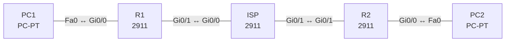

# Lab 25 – IPsec Site-to-Site-VPN

**Dauer:** 90 min · **Niveau:** schwer

Zwei Standorte verbinden ihre privaten LANs über ein simuliertes Internet. Der ISP kennt die privaten Netze nicht; erst der IPsec-Tunnel (IKE Phase 1, Phase 2, Crypto Map) macht sie erreichbar.

| CCNA-Ziel | Thema |
|---|---|
| 5.5 | IPsec: Remote Access und Site-to-Site-VPN |

**So arbeitest du:** Teil A = Bauen, Teil B = Reparieren, Teil C = Üben. Die Konfigurationsdateien liegen in `build/` (Ausgangszustand zum Einfügen in die CLI), `repair/` (fertig gebaut, mit Fehlern) und `solutions/` (Musterlösung und Fehlerliste, erst nach eigenem Versuch öffnen). Anleitung zum Einfügen: siehe [Arbeiten mit den Dateien](../README.md#arbeiten-mit-den-dateien).

## Topologie



Interessanter Verkehr (ACL 110) = LAN1 ↔ LAN2. Peers: R1 198.51.100.1 ↔ R2 198.51.101.2.

### Geräte

| Gerät | Modell in Packet Tracer | Rolle |
|---|---|---|
| R1 | 2911 | Standort A (VPN-Peer 1) |
| R2 | 2911 | Standort B (VPN-Peer 2) |
| ISP | 2911 | Internet (kennt keine privaten Netze) |
| PC1 | PC-PT | LAN Standort A |
| PC2 | PC-PT | LAN Standort B |

### Verkabelung

| Von | Port | Nach | Port | Kabel |
|---|---|---|---|---|
| PC1 | Fa0 | R1 | Gi0/0 | Copper Cross-Over |
| R1 | Gi0/1 | ISP | Gi0/0 | Copper Cross-Over |
| ISP | Gi0/1 | R2 | Gi0/1 | Copper Cross-Over |
| R2 | Gi0/0 | PC2 | Fa0 | Copper Cross-Over |

### Adressplan (Ausgangszustand)

| Gerät | Interface | Adresse | Maske | Gateway | DNS |
|---|---|---|---|---|---|
| R1 | Gi0/0 | 192.168.25.1 | 255.255.255.0 | | |
| R1 | Gi0/1 | 198.51.100.1 | 255.255.255.252 | | |
| R2 | Gi0/0 | 172.25.2.1 | 255.255.255.0 | | |
| R2 | Gi0/1 | 198.51.101.2 | 255.255.255.252 | | |
| ISP | Gi0/0 | 198.51.100.2 | 255.255.255.252 | | |
| ISP | Gi0/1 | 198.51.101.1 | 255.255.255.252 | | |
| PC1 | Fa0 (GUI) | 192.168.25.11 | 255.255.255.0 | 192.168.25.1 |  |
| PC2 | Fa0 (GUI) | 172.25.2.11 | 255.255.255.0 | 172.25.2.1 |  |


> **Packet-Tracer-Hinweis:** Packet Tracer 2911: Sicherheits-Lizenz zuerst aktivieren: `license boot module c2900 technology-package securityk9`, EULA mit `yes` bestätigen, `copy running-config startup-config`, `reload`. Danach stehen die `crypto`-Befehle zur Verfügung. Unterstützte Parameter in PT: AES/3DES, SHA/MD5, DH-Gruppe 1/2/5, PSK.

## Teil A – Bauen

1. **Basis.** Verkabeln, `build/` einfügen, Lizenz aktivieren (siehe Hinweis), PCs setzen. Ohne VPN: PC1 pingt PC2? Warum nicht (ISP hat keine Route zu den privaten Netzen)?
2. **Interessanter Verkehr.** ACL 110 auf beiden Routern (gespiegelt): R1 `permit ip 192.168.25.0 0.0.0.255 172.25.2.0 0.0.0.255`, R2 umgekehrt.
3. **IKE Phase 1.** `crypto isakmp policy 10`: AES, SHA, `authentication pre-share`, `group 2`, `lifetime 86400`. Pre-Shared Key: `crypto isakmp key Lab2026vpnKey address <Peer>`. Phase 1 baut den gesicherten Verwaltungskanal (ISAKMP SA).
4. **IKE Phase 2 / IPsec.** `crypto ipsec transform-set TS esp-aes esp-sha-hmac`, `crypto map CMAP 10 ipsec-isakmp` mit `set peer`, `set transform-set TS`, `match address 110`. Auf das WAN-Interface: `crypto map CMAP`.
5. **Auslösen und prüfen.** PC1 → PC2 pingen (die ersten Pings können verloren gehen). `show crypto isakmp sa` (QM_IDLE), `show crypto ipsec sa` (Zähler encaps/decaps). Wie erkennst du im Simulationsmodus ESP?
6. **Einordnung.** Site-to-Site vs. Remote Access (IPsec/SSL mit Client wie AnyConnect). Tunnel- vs. Transport-Modus, AH vs. ESP, IKEv1 vs. IKEv2, GRE over IPsec für Routing-Protokolle.

## Teil B – Reparieren

Baue die Topologie wie oben (oder behalte deine aus Teil A), setze alle Geräte zurück (`erase startup-config`, `reload` bzw. neues Gerät) und füge dann die Dateien aus `repair/` ein. Es stecken **5 Fehler** drin. Behandle jede Meldung als Ticket: erst Symptom nachstellen, dann Layer für Layer eingrenzen, beheben und beweisen. Ändere nur, was kaputt ist.

**Ticket 1:** Phase 1 kommt nicht zustande: `show crypto isakmp sa` ist leer oder `MM_NO_STATE`/`AG_NO_STATE`, im Debug `pre-shared key mismatch`.

**Ticket 2:** Phase 1 steht, aber PC1 und PC2 erreichen sich nicht; Zähler von `show crypto ipsec sa` bleiben 0 oder Phase 2 scheitert.

**Ticket 3:** Phase 1 ist `QM_IDLE`, aber Phase 2 kommt nicht zustande; Meldung `no matching transform set`/`IPSEC rejected`.

**Ticket 4:** PC1 → PC2 pingt nicht und nichts wird verschlüsselt: `show crypto isakmp sa` bleibt leer, `show crypto map` zeigt kein Interface.

**Ticket 5:** ISAKMP-Verhandlung scheitert (`MM_NO_STATE`), Debug zeigt `no offers accepted`.

## Verifikation

```
show crypto isakmp sa
show crypto ipsec sa
show crypto map
show access-lists 110
ping 172.25.2.11 source 192.168.25.1
```
Erwartet: ISAKMP SA `QM_IDLE`, IPsec-Zähler steigen bei Pings, PC1 ↔ PC2 funktionieren, `traceroute` zeigt keinen Zwischen-Hop des ISP-Innennetzes.

## Teil C – Üben

Beantworte zuerst selbst, dann klappe die Antwort auf.

1. Welche Parameter müssen auf beiden Seiten identisch sein?
<details><summary>Antwort</summary>

Phase 1: Verschlüsselung, Hash, Authentisierungsmethode/PSK, DH-Gruppe. Phase 2: Transform-Set (ESP/AH, Algorithmen), Modus, gespiegelte ACL/Proxy-Identitäten.

</details>

2. Unterschied ESP vs. AH?
<details><summary>Antwort</summary>

ESP verschlüsselt und authentisiert, AH authentisiert nur und passt nicht zu NAT. Praktisch wird ESP verwendet.

</details>

3. Tunnel- vs. Transportmodus?
<details><summary>Antwort</summary>

Tunnelmodus kapselt das gesamte IP-Paket mit neuem IP-Header (Site-to-Site), Transportmodus schützt nur die Nutzlast (Host-zu-Host).

</details>

4. Warum kann ein Routing-Protokoll nicht direkt über reines IPsec laufen?
<details><summary>Antwort</summary>

Klassisches IPsec transportiert nur Unicast und per ACL festgelegten Verkehr; für Multicast/Routing braucht man GRE oder VTI mit IPsec.

</details>

5. Wie unterscheiden sich Site-to-Site und Remote-Access-VPN?
<details><summary>Antwort</summary>

Site-to-Site verbindet zwei Gateways und Netze dauerhaft, Remote Access baut pro Benutzer einen Tunnel (Client, SSL- oder IPsec-VPN).

</details>

## Prüfungsbezug

IPsec: Vertraulichkeit (ESP-Verschlüsselung), Integrität (HMAC), Authentisierung (PSK/Zertifikate), Anti-Replay. IKE Phase 1 (ISAKMP SA: Verschlüsselung, Hash, Authentisierung, DH-Gruppe, Lifetime), Phase 2 (IPsec SA: Transform-Set, Tunnel-/Transport-Modus). Interessanter Verkehr per ACL, Crypto Map am ausgehenden Interface. Site-to-Site verbindet Netze, Remote Access einzelne Benutzer. Parameter müssen auf beiden Peers übereinstimmen.

## Lösungen

- `solutions/<Gerät>.cfg`: Konfiguration zu Teil A (ohne Basis-Adressen)
- `solutions/FAULTS.md`: Fehlerliste zu Teil B (Spoiler!)
