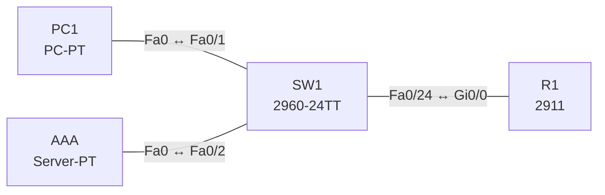

# Lab 26 – AAA: Authentisierung mit RADIUS und lokalem Fallback

**Dauer:** 75 min · **Niveau:** mittel

Ein Router authentisiert Administratoren zentral gegen einen RADIUS-Server und fällt bei Ausfall auf einen lokalen Benutzer zurück. Du ordnest Authentication, Authorization und Accounting zu und vergleichst RADIUS mit TACACS+.

| CCNA-Ziel | Thema |
|---|---|
| 5.8 | AAA: Authentication, Authorization, Accounting |
| 2.8 | Verwaltungszugriff (Console, Telnet, SSH, HTTP/HTTPS, TACACS+/RADIUS, Cloud) |
| 5.3 | Gerätezugriff mit lokalen Passwörtern |

**So arbeitest du:** Teil A = Bauen, Teil B = Reparieren, Teil C = Üben. Die Konfigurationsdateien liegen in `build/` (Ausgangszustand zum Einfügen in die CLI), `repair/` (fertig gebaut, mit Fehlern) und `solutions/` (Musterlösung und Fehlerliste, erst nach eigenem Versuch öffnen). Anleitung zum Einfügen: siehe [Arbeiten mit den Dateien](../README.md#arbeiten-mit-den-dateien).

## Topologie




### Geräte

| Gerät | Modell in Packet Tracer | Rolle |
|---|---|---|
| R1 | 2911 | Router mit AAA |
| SW1 | 2960-24TT | Switch |
| PC1 | PC-PT | Admin-PC |
| AAA | Server-PT | RADIUS/TACACS+-Server |

### Verkabelung

| Von | Port | Nach | Port | Kabel |
|---|---|---|---|---|
| PC1 | Fa0 | SW1 | Fa0/1 | Copper Straight-Through |
| AAA | Fa0 | SW1 | Fa0/2 | Copper Straight-Through |
| SW1 | Fa0/24 | R1 | Gi0/0 | Copper Straight-Through |

### Adressplan (Ausgangszustand)

| Gerät | Interface | Adresse | Maske | Gateway | DNS |
|---|---|---|---|---|---|
| R1 | Gi0/0 | 10.26.1.1 | 255.255.255.0 | | |
| PC1 | Fa0 (GUI) | 10.26.1.11 | 255.255.255.0 | 10.26.1.1 |  |
| AAA | Fa0 (GUI) | 10.26.1.100 | 255.255.255.0 | 10.26.1.1 |  |


> **Packet-Tracer-Hinweis:** Server-PT: Services → AAA einschalten. *Network Configuration*: Client `R1`, Adresse 10.26.1.1, Secret `RadKey2026`, Servertyp Radius. *User Setup*: Benutzer `admin`, Passwort `Admin#2026`. TACACS+ kannst du analog als Servertyp einrichten.

## Teil A – Bauen

1. **Basis.** Verkabeln, `build/` einfügen. PC1 verbindet sich per Telnet (`telnet 10.26.1.1`): Es gilt noch kein AAA.
2. **AAA aktivieren.** `aaa new-model`, `radius-server host 10.26.1.100 key RadKey2026`. Warum `aaa new-model` zuerst (und vor dem Setzen der Method-Lists den Zugang absichern, sonst Aussperrung)?
3. **Method Lists.** `aaa authentication login VTY-AUTH group radius local`, auf den vty-Lines: `login authentication VTY-AUTH`. Der Fallback `local` greift nur, wenn der RADIUS-Server nicht antwortet, nicht bei abgelehntem Passwort. Teste beides.
4. **Notfallzugang.** Lokaler Benutzer `backup`. Konsole bleibt eigenständig (`login authentication CON-AUTH` mit `local`), damit du nicht ausgesperrt wirst.
5. **Accounting.** `aaa accounting exec default start-stop group radius`: Im Server unter AAA → Accounting steht die Sitzung. Was protokolliert Accounting (Wer, wann, was)?
6. **Vergleich.** Tabelle RADIUS (UDP 1812/1813 bzw. 1645/1646, Passwort verschlüsselt, Authentisierung+Authorization kombiniert) vs. TACACS+ (TCP 49, gesamtes Paket verschlüsselt, Authorization getrennt, Befehls-Autorisierung). Wann nimmst du welches (Netzzugang/802.1X → RADIUS, Geräteadministration → TACACS+)?

## Teil B – Reparieren

Baue die Topologie wie oben (oder behalte deine aus Teil A), setze alle Geräte zurück (`erase startup-config`, `reload` bzw. neues Gerät) und füge dann die Dateien aus `repair/` ein. Es stecken **4 Fehler** drin. Behandle jede Meldung als Ticket: erst Symptom nachstellen, dann Layer für Layer eingrenzen, beheben und beweisen. Ändere nur, was kaputt ist.

**Ticket 1:** Anmeldung als `admin` scheitert; RADIUS meldet keine gültige Antwort, der Router fällt auf `local` zurück und lehnt `admin` ab.

**Ticket 2:** Bei ausgeschaltetem RADIUS-Server kommt niemand mehr per Telnet auf den Router, auch `backup` nicht.

**Ticket 3:** Beim Telnet-Login erscheint eine Fehlermeldung zur Method-List bzw. es wird kein Passwort akzeptiert.

**Ticket 4:** RADIUS-Anfragen erreichen den Server nicht (Timeout), Login nur per Fallback; Ping zum Server (10.26.1.100) schlägt fehl.

## Verifikation

```
show aaa servers
show running-config | section aaa
show users
debug aaa authentication     (kurz)
```
Erwartet: Telnet-Login als `admin` mit RADIUS-Passwort gelingt; bei abgeschaltetem Server meldet der Router RADIUS-Fehler und akzeptiert `backup` lokal.

## Teil C – Üben

Beantworte zuerst selbst, dann klappe die Antwort auf.

1. Wann greift der lokale Fallback?
<details><summary>Antwort</summary>

Nur wenn alle zuvor gelisteten Server nicht erreichbar sind (Timeout/Fehler). Lehnt der Server das Passwort ab, wird der Zugang verweigert.

</details>

2. Wofür steht Accounting?
<details><summary>Antwort</summary>

Es protokolliert Sitzungen (Benutzer, Zeit, Befehle, Datenmenge) für Nachvollziehbarkeit und Abrechnung.

</details>

3. RADIUS vs. TACACS+: drei Unterschiede?
<details><summary>Antwort</summary>

Transport (UDP vs. TCP), Verschlüsselung (nur Passwort vs. ganzer Inhalt), Trennung von Authentication/Authorization/Accounting bei TACACS+ (Befehls-Autorisierung möglich).

</details>

4. Wozu `aaa new-model`?
<details><summary>Antwort</summary>

Es aktiviert das AAA-Framework und ersetzt die einfachen `login`-Mechanismen der Lines durch Method-Lists.

</details>

5. Wie vermeidest du, dich selbst auszusperren?
<details><summary>Antwort</summary>

Lokalen Notfall-Benutzer anlegen, Konsole mit eigener Method-List (`local`), Änderungen zuerst in einer zweiten Session testen.

</details>

## Prüfungsbezug

AAA: Authentication (wer bist du), Authorization (was darfst du), Accounting (was hast du getan). RADIUS: offener Standard, UDP 1812/1813, verschlüsselt nur das Passwort, typisch für Netzzugang/802.1X. TACACS+: Cisco, TCP 49, verschlüsselt den gesamten Inhalt, trennt AAA, ideal für Geräteadministration mit Befehlsautorisierung. Method-List: Reihenfolge der Quellen, `local` als Fallback; `aaa new-model` aktiviert das AAA-Modell.

## Lösungen

- `solutions/<Gerät>.cfg`: Konfiguration zu Teil A (ohne Basis-Adressen)
- `solutions/FAULTS.md`: Fehlerliste zu Teil B (Spoiler!)
