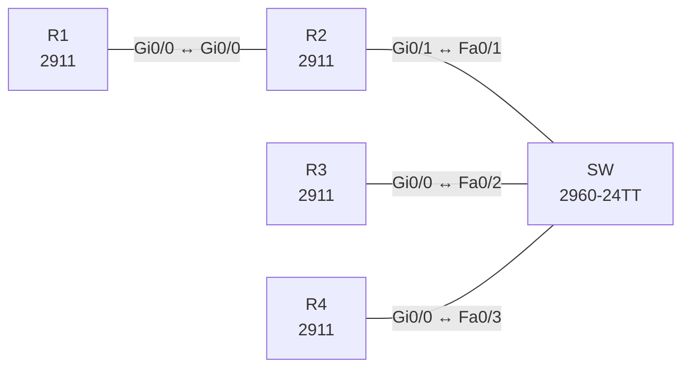

# Lab 01 – OSPFv2 Multi-Area

**Dauer:** 90 min · **Niveau:** mittel

OSPF-Areas, ABR/ASBR, DR/BDR, Summarization, Stub/NSSA, Authentifizierung und typische OSPF-Fehler.

| ENCOR-Ziel (`Ziel::…`) | Thema |
|---|---|
| 3.2.a | EIGRP und OSPF vergleichen |
| 3.2.b | OSPFv2 und OSPFv3 |

**So arbeitest du:** Teil A = Bauen, Teil B = Reparieren, Teil C = Üben. Die Konfigurationsdateien liegen in `build/` (Ausgangszustand zum Einfügen in die CLI), `repair/` (fertig gebaut, mit Fehlern) und `solutions/` (Musterlösung und Fehlerliste, erst nach eigenem Versuch öffnen). Anleitung zum Einfügen: siehe [Arbeiten mit den Dateien](../README.md#arbeiten-mit-den-dateien).

## Topologie



**Entwurfsskizze (aus dem CML-Lab; Portnamen der Switches siehe Verkabelungstabelle):**

```
 Area 0              Area 1 (10.1.234.0/24)
 R1 ---- R2 (ABR) ---- SW ---- R3 (Lo10-13 = 10.1.16-19.0/24)
 10.0.12.0/30                \--- R4 (extern 198.51.100.0/24 via Null0)
```

### Geräte

| Gerät | Modell in Packet Tracer | Rolle |
|---|---|---|
| R1 | 2911 | Router |
| R2 | 2911 | Router |
| SW | 2960-24TT | Switch (im CML-Lab unmanaged; ohne Konfiguration) |
| R3 | 2911 | Router |
| R4 | 2911 | Router |

### Verkabelung

| Von | Port | Nach | Port | Kabel |
|---|---|---|---|---|
| R1 | Gi0/0 | R2 | Gi0/0 | Copper Cross-Over |
| R2 | Gi0/1 | SW | Fa0/1 | Copper Straight-Through |
| R3 | Gi0/0 | SW | Fa0/2 | Copper Straight-Through |
| R4 | Gi0/0 | SW | Fa0/3 | Copper Straight-Through |

### Adressplan (Ausgangszustand)

| Gerät | Interface | Adresse | Maske | Gateway | DNS |
|---|---|---|---|---|---|
| R1 | Loopback0 | 1.1.1.1 | 255.255.255.255 | | |
| R1 | Gi0/0 | 10.0.12.1 | 255.255.255.252 | | |
| R2 | Loopback0 | 2.2.2.2 | 255.255.255.255 | | |
| R2 | Gi0/0 | 10.0.12.2 | 255.255.255.252 | | |
| R2 | Gi0/1 | 10.1.234.2 | 255.255.255.0 | | |
| R3 | Loopback0 | 3.3.3.3 | 255.255.255.255 | | |
| R3 | Gi0/0 | 10.1.234.3 | 255.255.255.0 | | |
| R3 | Loopback10 | 10.1.16.1 | 255.255.255.0 | | |
| R3 | Loopback11 | 10.1.17.1 | 255.255.255.0 | | |
| R3 | Loopback12 | 10.1.18.1 | 255.255.255.0 | | |
| R3 | Loopback13 | 10.1.19.1 | 255.255.255.0 | | |
| R4 | Loopback0 | 4.4.4.4 | 255.255.255.255 | | |
| R4 | Gi0/0 | 10.1.234.4 | 255.255.255.0 | | |

| Gerät | Interface | Adresse |
|---|---|---|
| R1 | Lo0 / Gi0/0 | 1.1.1.1/32 / 10.0.12.1/30 |
| R2 | Lo0 / Gi0/0 / Gi0/1 | 2.2.2.2/32 / 10.0.12.2/30 / 10.1.234.2/24 |
| R3 | Lo0 / Gi0/0 / Lo10–13 | 3.3.3.3/32 / 10.1.234.3/24 / 10.1.16–19.1/24 |
| R4 | Lo0 / Gi0/0 | 4.4.4.4/32 / 10.1.234.4/24, statisch 198.51.100.0/24 → Null0 |

### Portzuordnung der Switches (CML → Packet Tracer)

Die Aufgabentexte nennen Switch-Ports in der CML-Schreibweise (`Gi…`). Verkabelung, Konfigurationen und Fehlerlisten verwenden die Packet-Tracer-Ports. Umrechnung: `GiX/Y` → `Fa0/(X·4+Y+1)`.

| Switch | CML-Port | PT-Port |
|---|---|---|
| SW | Gi0/0 | Fa0/1 |
| SW | Gi0/1 | Fa0/2 |
| SW | Gi0/2 | Fa0/3 |

> **Packet-Tracer-Hinweis:** **Eignung: geeignet.** Alle verwendeten Funktionen gibt es in Packet Tracer; Ausgabeformate einzelner `show`-Befehle weichen leicht ab. Die CML-Switches (Gi-Ports) sind hier 3560-24PS bzw. 2960 mit FastEthernet-Ports: Die Portzuordnung steht unter dem Adressplan; die Aufgabentexte nennen noch die CML-Ports.

## Teil A – Bauen

1. **OSPF aufbauen.** Process-ID 1, Router-ID = Loopback0. Link R1–R2 und Loopbacks von R1/R2 in Area 0, LAN 10.1.234.0/24, Loopback0 von R3/R4 und R3-Loopbacks 10–13 in Area 1. Aktiviere OSPF **pro Interface** (`ip ospf 1 area X`) statt per `network`.
2. **DR/BDR.** Im LAN soll R3 DR und R4 BDR sein, R2 darf nie DR/BDR werden. Löse es per Priorität, ohne Router-IDs zu ändern. Warum ist die Wahl nicht präemptiv und was musst du nach der Änderung tun?
3. **Passive Interfaces.** R3: `passive-interface default`, nur Gi0/0 aktiv. Die Loopback-Netze bleiben im LSDB.
4. **Summarization.** R2 sendet 10.1.16.0–19.0/24 als **eine** Route nach Area 0 (`area 1 range`). Welche Maske? Was zeigt R1?
5. **Externe Route.** R4 verteilt 198.51.100.0/24 per `redistribute static` (Metrik-Typ 1) ein. Beobachte `O E1` auf R1 und erkläre Typ-4-LSA, ASBR und ABR. Wie unterscheidet sich die Metrik von E2?
6. **Stub-Varianten.** Mache Area 1 zur **Totally Stubby Area** (R4 muss dafür seine Redistribution aufgeben). Was siehst du auf R3 statt der Externen? Wechsle danach auf **NSSA**, sodass R4 extern einspeisen darf. Welcher LSA-Typ (7) wird von wem zu Typ 5 umgewandelt?
7. **Authentifizierung.** SHA-256 per Key-Chain auf R1–R2. Setze auf R1 testweise einen falschen Schlüssel und lies Log und `show ip ospf neighbor`.
8. **Timer.** Hello 3/Dead 12 nur auf R1: Was passiert, was zeigt `debug ip ospf hello`? (`undebug all` nicht vergessen.)

## Teil B – Reparieren

Baue die Topologie wie oben (oder behalte deine aus Teil A), setze alle Geräte zurück (`erase startup-config`, `reload` bzw. neues Gerät) und füge dann die Dateien aus `repair/` ein. Es stecken **4 Fehler** drin. Behandle jede Meldung als Ticket: erst Symptom nachstellen, dann Layer für Layer eingrenzen, beheben und beweisen. Ändere nur, was kaputt ist.

**Ticket 1:** R1 und R2 werden nicht Nachbarn, `show ip ospf neighbor` ist auf R1 leer, Area 0 ist isoliert.

**Ticket 2:** R3 erscheint nirgends als Nachbar, R2 und R4 sehen nur sich gegenseitig.

**Ticket 3:** R1 sieht vier einzelne /24 (10.1.16–19) statt der Zusammenfassung.

**Ticket 4:** R4 bleibt in `INIT`/taucht nicht als Nachbar auf, während R3 und R2 sich sehen.

## Verifikation

```
show ip ospf neighbor
show ip ospf interface brief
show ip ospf database [summary|external|nssa-external]
show ip route ospf
show ip protocols
```
Erwartet nach Aufgabe 1–5: R1 hat `O IA 10.1.16.0/22`, `O IA 10.1.234.0/24` und `O E1 198.51.100.0/24`. LAN: R3 DR, R4 BDR, R2 DROTHER.

## Teil C – Üben

Beantworte zuerst selbst, dann klappe die Antwort auf.

1. Welche LSA-Typen sieht ein Router in einer Totally Stubby Area?
<details><summary>Antwort</summary>

Typ 1 und 2 (intern) plus eine Default-Route per Typ 3 vom ABR. Typ 3 (außer Default), 4 und 5 werden blockiert.

</details>

2. Zwei Router hängen im selben Subnetz, bleiben aber in `2WAY`. Ist das ein Fehler?
<details><summary>Antwort</summary>

Nein, wenn beide `DROTHER` sind: Nur DR/BDR bilden zu allen `FULL`-Adjazenzen, DROTHERs bleiben untereinander in 2WAY.

</details>

3. Warum sieht man auf dem ABR nach `area range` trotzdem die Einzelnetze?
<details><summary>Antwort</summary>

Im Area-1-LSDB und der lokalen RIB bleiben sie bestehen. Nur Area 0 bekommt die Summary, und der ABR installiert eine Null0-Discard-Route für sie.

</details>

## Prüfungsbezug

Hello/Dead und Area-Typ (E-/N-Flag) müssen übereinstimmen, DR-Wahl ist nicht präemptiv, Summarization nur am ABR (`area range`) oder ASBR (`summary-address`), E1 addiert interne Kosten, Stub blockiert Typ 5, NSSA transportiert Typ 7.

## Lösungen

- `solutions/<Gerät>.cfg`: Konfiguration zu Teil A (ohne Basis-Adressen)
- `solutions/FAULTS.md`: Fehlerliste zu Teil B (Spoiler!)
