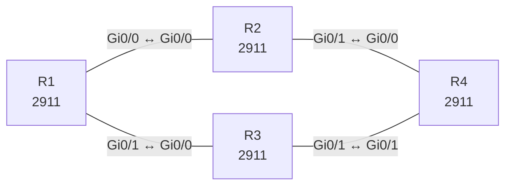

# Lab 03 – eBGP Dual-Homing und Policy

**Dauer:** 90 min · **Niveau:** mittel bis schwer

Kunde mit zwei Providern: eBGP-Sessions, Best-Path-Auswahl, Local-Preference, AS-Path-Prepending, MED, No-Transit-Filter und Soft-Reset. Private AS-Nummern dienen nur der Übung.

**Lernziele:** Nach diesem Lab kannst du …

- Eine eBGP-Anbindung an zwei Provider aufbauen und Präfixe gezielt ankündigen.
- Mit Route-Maps und Local Preference den Ausgang steuern.
- Verhindern, dass das eigene AS zum Transit zwischen den Providern wird.

| ENCOR-Ziel (`Ziel::…`) | Thema |
|---|---|
| 3.2.c | Direktes eBGP |

**So arbeitest du:** Teil A = Bauen, Teil B = Reparieren, Teil C = Üben. Die Konfigurationsdateien liegen in `build/` (Ausgangszustand zum Einfügen in die CLI), `repair/` (fertig gebaut, mit Fehlern) und `solutions/` (Musterlösung und Fehlerliste, erst nach eigenem Versuch öffnen). Anleitung zum Einfügen: siehe [Arbeiten mit den Dateien](../README.md#arbeiten-mit-den-dateien).

## Topologie



**Entwurfsskizze (aus dem CML-Lab; Portnamen der Switches siehe Verkabelungstabelle):**

```
          AS 65010                 AS 65100
        ┌── R2 ──────────┐
 AS 65001│  Gi0/0   Gi0/1│
   R1 ───┤               ├── R4  (Internet, 198.51.100.0/24)
        │  Gi0/0   Gi0/1│
        └── R3 ──────────┘
          AS 65020
```

### Geräte

| Gerät | Modell in Packet Tracer | Rolle |
|---|---|---|
| R1 | 2911 | Router |
| R2 | 2911 | Router |
| R3 | 2911 | Router |
| R4 | 2911 | Router |

### Verkabelung

| Von | Port | Nach | Port | Kabel |
|---|---|---|---|---|
| R1 | Gi0/0 | R2 | Gi0/0 | Copper Cross-Over |
| R1 | Gi0/1 | R3 | Gi0/0 | Copper Cross-Over |
| R2 | Gi0/1 | R4 | Gi0/0 | Copper Cross-Over |
| R3 | Gi0/1 | R4 | Gi0/1 | Copper Cross-Over |

### Adressplan (Ausgangszustand)

| Gerät | Interface | Adresse | Maske | Gateway | DNS |
|---|---|---|---|---|---|
| R1 | Loopback0 | 1.1.1.1 | 255.255.255.255 | | |
| R1 | Gi0/0 | 10.12.0.1 | 255.255.255.252 | | |
| R1 | Gi0/1 | 10.13.0.1 | 255.255.255.252 | | |
| R2 | Loopback0 | 2.2.2.2 | 255.255.255.255 | | |
| R2 | Gi0/0 | 10.12.0.2 | 255.255.255.252 | | |
| R2 | Gi0/1 | 10.24.0.1 | 255.255.255.252 | | |
| R3 | Loopback0 | 3.3.3.3 | 255.255.255.255 | | |
| R3 | Gi0/0 | 10.13.0.2 | 255.255.255.252 | | |
| R3 | Gi0/1 | 10.34.0.1 | 255.255.255.252 | | |
| R4 | Loopback0 | 4.4.4.4 | 255.255.255.255 | | |
| R4 | Gi0/0 | 10.24.0.2 | 255.255.255.252 | | |
| R4 | Gi0/1 | 10.34.0.2 | 255.255.255.252 | | |
| R4 | Loopback1 | 198.51.100.1 | 255.255.255.0 | | |

| Link | Netz | Seiten |
|---|---|---|
| R1–R2 | 10.12.0.0/30 | R1 .1 / R2 .2 |
| R1–R3 | 10.13.0.0/30 | R1 .1 / R3 .2 |
| R2–R4 | 10.24.0.0/30 | R2 .1 / R4 .2 |
| R3–R4 | 10.34.0.0/30 | R3 .1 / R4 .2 |

R1 = Kunde (AS 65001) mit **203.0.113.0/24** (statisch Null0). R2 = ISP-A (AS 65010), R3 = ISP-B (AS 65020), R4 = Internet (AS 65100) mit **198.51.100.0/24** (Lo1). Router-IDs: R1 1.1.1.1, R2 **20.20.20.20**, R3 3.3.3.3, R4 4.4.4.4. Die Absicht: Ohne Policy gewinnt bei Gleichstand die niedrigere Router-ID, also ISP-B – das Gegenteil des Ziels.
> **Packet-Tracer-Hinweis:** **Eignung: geeignet.** Alle verwendeten Funktionen gibt es in Packet Tracer; Ausgabeformate einzelner `show`-Befehle weichen leicht ab.

## Teil A – Bauen

1. **eBGP-Sessions.** R1–R2, R1–R3, R2–R4, R3–R4 über die direkten Interface-Adressen, Router-IDs wie oben (`bgp router-id`).
2. **Präfixe.** R1 kündigt 203.0.113.0/24 an, R4 198.51.100.0/24. Beide Seiten sollen je zwei Pfade sehen. Welcher Pfad gewinnt auf R1, und welches Kriterium der Best-Path-Auswahl entscheidet (Reihenfolge nennen)?
3. **Ausgehend: Local-Preference.** R1 soll über ISP-A (R2) senden. Setze per Route-Map **eingehend** auf R2-Routen `local-preference 200`. Warum wirkt Local-Pref nur innerhalb der AS, und wie wird sie bei mehreren Border-Routern verteilt (iBGP)?
4. **Eingehend: AS-Path-Prepending.** R1 stellt bei der Ankündigung an R3 den eigenen AS dreimal voran. Prüfe auf R4 die Pfadwahl zu 203.0.113.0/24. Warum steuert Prepending nur *eingehenden* Verkehr?
5. **MED.** Entferne das Prepending und setze stattdessen `metric 50` zu R2 und `metric 100` zu R3. Wirkt es auf R4? Warum nicht (verschiedene Nachbar-ASe), und was ändert `bgp always-compare-med`?
6. **No-Transit.** R1 darf nicht zum Transit werden: Filtere **ausgehend** per `ip as-path access-list 1 permit ^$` nur lokal erzeugte Routen. Prüfe auf R2/R3, was ankommt.
7. **Soft Reset.** Ändere eine Route-Map und wende sie ohne Session-Reset an (`clear ip bgp * soft in|out`, Route Refresh). Warum ist `clear ip bgp *` im Betrieb ein Fehler?
8. **Optional.** `neighbor … maximum-prefix 100 80` und ein Bogon-Filter per Prefix-List.

## Teil B – Reparieren

Baue die Topologie wie oben (oder behalte deine aus Teil A), setze alle Geräte zurück (`erase startup-config`, `reload` bzw. neues Gerät) und füge dann die Dateien aus `repair/` ein. Es stecken **5 Fehler** drin. Behandle jede Meldung als Ticket: erst Symptom nachstellen, dann Layer für Layer eingrenzen, beheben und beweisen. Ändere nur, was kaputt ist.

**Ticket 1:** Die Session R1–R2 kommt nicht hoch (Idle/Active), das Log meldet eine falsche Nachbar-AS.

**Ticket 2:** R1 wählt zu 198.51.100.0/24 den Pfad über ISP-B, obwohl ISP-A bevorzugt sein soll (LocPrf überall 100).

**Ticket 3:** Auf R2 erscheint 198.51.100.0/24 zusätzlich mit AS-Path `65001 65020 65100`, R1 wird zum Transit.

**Ticket 4:** Weder R2 noch R3 lernen 198.51.100.0/24, R1 hat keine Internet-Route.

**Ticket 5:** Der Kundenbereich 203.0.113.0/24 ist aus dem Internet nicht erreichbar, R2/R3 sehen kein Präfix von R1.

## Verifikation

```
show ip bgp summary
show ip bgp
show ip bgp 198.51.100.0/24
show ip bgp neighbors 10.12.0.2 advertised-routes
show route-map
show ip bgp regexp ^65010
```
Erwartet nach Aufgabe 3: R1 wählt zu 198.51.100.0/24 den Next-Hop 10.12.0.2 (LocPrf 200). Nach Aufgabe 4: R4 wählt zu 203.0.113.0/24 den Pfad über R2.

## Teil C – Üben

Beantworte zuerst selbst, dann klappe die Antwort auf.

1. Warum bleibt eine eBGP-Session in `Active`?
<details><summary>Antwort</summary>

**Weil TCP nicht zustande kommt oder die OPEN-Nachricht abgelehnt wird.** Active heißt: Der Router versucht aktiv, die Sitzung aufzubauen, bekommt aber keine. Typische Ursachen: falsche Nachbar-IP oder AS, keine Route oder eine ACL für TCP 179, fehlendes `ebgp-multihop` beim Peering über Loopbacks, falsches Passwort.

</details>

2. Wann nutzt man `next-hop-self` in iBGP?
<details><summary>Antwort</summary>

**Wenn der eBGP-Next-Hop im IGP nicht bekannt ist.** iBGP gibt den Next-Hop unverändert weiter. Kennt der iBGP-Nachbar ihn nicht, ist die Route für ihn unbrauchbar und wird nicht installiert. Mit `next-hop-self` trägt der Rand-Router sich selbst als Next-Hop ein.

</details>

3. Was passiert mit AS-Pfaden, wenn R1 ISP-B-Routen an ISP-A schickt?
<details><summary>Antwort</summary>

**ISP-A würde sie annehmen, und R1 würde Transit für fremden Verkehr.** Der AS-Pfad ist gültig, also gibt es keinen Grund zum Verwerfen. Das verhindert nur ein Ausgangsfilter, der nur eigene Routen erlaubt, z. B. AS-Path `^$` oder eine Prefix-List.

</details>

## Prüfungsbezug

Best-Path-Reihenfolge: Weight → Local-Pref → lokal erzeugt → AS-Path-Länge → Origin → MED → eBGP vor iBGP → IGP-Metrik → ältester Pfad → niedrigste Router-ID. Local-Pref/Weight steuern ausgehend, Prepending/MED eingehend. `network` braucht eine exakt passende Route in der RIB.

## Lösungen

- `solutions/<Gerät>.cfg`: Konfiguration zu Teil A (ohne Basis-Adressen)
- `solutions/FAULTS.md`: Fehlerliste zu Teil B (Spoiler!)
