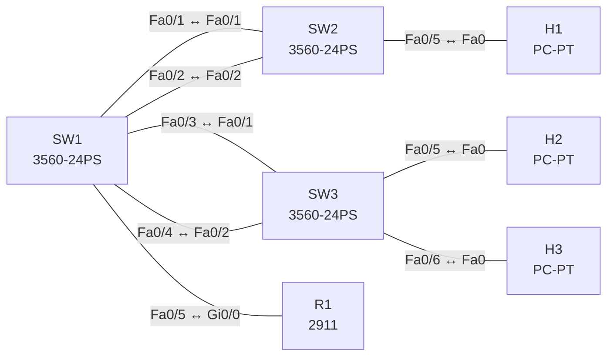

# Lab 05 – VLANs, Trunks und EtherChannel

**Dauer:** 90 min · **Niveau:** leicht bis mittel

Drei Switches, Router-on-a-Stick und drei Hosts: 802.1Q-Trunks (Native VLAN, Allowed VLANs, DTP, VTP) und EtherChannel mit LACP, PAgP und statischem Modus.

| ENCOR-Ziel (`Ziel::…`) | Thema |
|---|---|
| 3.1.a | 802.1Q und Trunks |
| 3.1.b | EtherChannel |

**So arbeitest du:** Teil A = Bauen, Teil B = Reparieren, Teil C = Üben. Die Konfigurationsdateien liegen in `build/` (Ausgangszustand zum Einfügen in die CLI), `repair/` (fertig gebaut, mit Fehlern) und `solutions/` (Musterlösung und Fehlerliste, erst nach eigenem Versuch öffnen). Anleitung zum Einfügen: siehe [Arbeiten mit den Dateien](../README.md#arbeiten-mit-den-dateien).

## Topologie



**Entwurfsskizze (aus dem CML-Lab; Portnamen der Switches siehe Verkabelungstabelle):**

```
                      ┌── Po1 (LACP, 2 Links) ── SW2 ── H1 (VLAN10)
 R1 ══trunk══ SW1 ════┤
                      └── Po2 (PAgP, 2 Links) ── SW3 ──┬── H2 (VLAN20)
                                                       └── H3 (VLAN10)
```

### Geräte

| Gerät | Modell in Packet Tracer | Rolle |
|---|---|---|
| SW1 | 3560-24PS | Switch |
| SW2 | 3560-24PS | Switch |
| SW3 | 3560-24PS | Switch |
| R1 | 2911 | Router |
| H1 | PC-PT | Host |
| H2 | PC-PT | Host |
| H3 | PC-PT | Host |

### Verkabelung

| Von | Port | Nach | Port | Kabel |
|---|---|---|---|---|
| SW1 | Fa0/1 | SW2 | Fa0/1 | Copper Cross-Over |
| SW1 | Fa0/2 | SW2 | Fa0/2 | Copper Cross-Over |
| SW1 | Fa0/3 | SW3 | Fa0/1 | Copper Cross-Over |
| SW1 | Fa0/4 | SW3 | Fa0/2 | Copper Cross-Over |
| SW1 | Fa0/5 | R1 | Gi0/0 | Copper Straight-Through |
| SW2 | Fa0/5 | H1 | Fa0 | Copper Straight-Through |
| SW3 | Fa0/5 | H2 | Fa0 | Copper Straight-Through |
| SW3 | Fa0/6 | H3 | Fa0 | Copper Straight-Through |

### Adressplan (Ausgangszustand)

| Gerät | Interface | Adresse | Maske | Gateway | DNS |
|---|---|---|---|---|---|
| R1 | Gi0/0.10 | 10.10.10.1 | 255.255.255.0 | | |
| R1 | Gi0/0.20 | 10.10.20.1 | 255.255.255.0 | | |
| H1 | Fa0 (GUI) | 10.10.10.11 | 255.255.255.0 | 10.10.10.1 |  |
| H2 | Fa0 (GUI) | 10.10.20.12 | 255.255.255.0 | 10.10.20.1 |  |
| H3 | Fa0 (GUI) | 10.10.10.13 | 255.255.255.0 | 10.10.10.1 |  |

| VLAN | Name | Subnetz | Gateway (R1 Subinterface) |
|---|---|---|---|
| 10 | USERS | 10.10.10.0/24 | .1 (`Gi0/0.10`) |
| 20 | SERVERS | 10.10.20.0/24 | .1 (`Gi0/0.20`) |
| 99 | NATIVE | – | ungenutzt |

H1 10.10.10.11 (SW2 Gi1/0), H2 10.10.20.12 (SW3 Gi1/0), H3 10.10.10.13 (SW3 Gi1/1). Verkabelung: SW1 Gi0/0–0/1 ↔ SW2 Gi0/0–0/1, SW1 Gi0/2–0/3 ↔ SW3 Gi0/0–0/1, SW1 Gi1/0 ↔ R1 Gi0/0.

### Portzuordnung der Switches (CML → Packet Tracer)

Die Aufgabentexte nennen Switch-Ports in der CML-Schreibweise (`Gi…`). Verkabelung, Konfigurationen und Fehlerlisten verwenden die Packet-Tracer-Ports. Umrechnung: `GiX/Y` → `Fa0/(X·4+Y+1)`.

| Switch | CML-Port | PT-Port |
|---|---|---|
| SW1 | Gi0/0 | Fa0/1 |
| SW1 | Gi0/1 | Fa0/2 |
| SW1 | Gi0/2 | Fa0/3 |
| SW1 | Gi0/3 | Fa0/4 |
| SW1 | Gi1/0 | Fa0/5 |
| SW2 | Gi0/0 | Fa0/1 |
| SW2 | Gi0/1 | Fa0/2 |
| SW2 | Gi1/0 | Fa0/5 |
| SW3 | Gi0/0 | Fa0/1 |
| SW3 | Gi0/1 | Fa0/2 |
| SW3 | Gi1/0 | Fa0/5 |
| SW3 | Gi1/1 | Fa0/6 |

> **Packet-Tracer-Hinweis:** **Eignung: geeignet.** Alle verwendeten Funktionen gibt es in Packet Tracer; Ausgabeformate einzelner `show`-Befehle weichen leicht ab. Die CML-Switches (Gi-Ports) sind hier 3560-24PS bzw. 2960 mit FastEthernet-Ports: Die Portzuordnung steht unter dem Adressplan; die Aufgabentexte nennen noch die CML-Ports.

## Teil A – Bauen

1. **VLANs.** Lege VLAN 10 (USERS), 20 (SERVERS) und 99 (NATIVE) auf allen Switches an. Setze **VTP auf `transparent`** (`vtp mode transparent`). Warum ist VTP Server/Client auf einer neuen Switch mit höherer Revision gefährlich?
2. **Trunk zum Router.** SW1 Gi1/0 als statischer Trunk (`switchport mode trunk`, `nonegotiate`), Native VLAN 99, erlaubte VLANs 10 und 20. R1 bekommt Subinterfaces `Gi0/0.10` und `.20` (`encapsulation dot1Q`, `ip address`). Prüfe, dass H1 sein Gateway erreicht.
3. **EtherChannel LACP.** SW1–SW2 als **Po1 mit LACP** (SW1 `active`, SW2 `passive`), als Trunk (10, 20, Native 99). Prüfe `show etherchannel summary` auf Flags `SU`/`P`. Welche Modus-Kombinationen bilden einen Channel und welche nicht (active/passive, passive/passive, on/active)?
4. **EtherChannel PAgP.** SW1–SW3 als **Po2 mit PAgP** (SW1 `desirable`, SW3 `auto`). Vergleiche PAgP und LACP (Cisco-proprietär vs. IEEE 802.3ad, Mode-Namen, max. Ports pro Channel).
5. **Hosts.** Ports H1 (VLAN 10), H2 (VLAN 20), H3 (VLAN 10) als Access, `spanning-tree portfast`. Teste: H1 → H3 (gleiches VLAN, nur Layer 2), H1 → H2 (inter-VLAN via R1).
6. **Lastverteilung.** Setze `port-channel load-balance src-dst-ip` und prüfe mit `show etherchannel load-balance`. Warum nutzt ein einzelner Flow nur einen Link? Erkläre Hash-Berechnung (Quell-/Ziel-IP/MAC/Port).
7. **Native-VLAN-Trick.** Stelle bewusst auf SW3 Po2 Native VLAN 1 ein und lies das Log (`%CDP-4-NATIVE_VLAN_MISMATCH`). Welche Angriffsfläche (VLAN Hopping per Double Tagging) schließt ein ungenutztes Native VLAN?
8. **Pruning.** Beschränke die Trunks auf nur die tatsächlich benötigten VLANs und prüfe `show interfaces trunk` (Spalten *allowed*, *active*, *forwarding*).

## Teil B – Reparieren

Baue die Topologie wie oben (oder behalte deine aus Teil A), setze alle Geräte zurück (`erase startup-config`, `reload` bzw. neues Gerät) und füge dann die Dateien aus `repair/` ein. Es stecken **4 Fehler** drin. Behandle jede Meldung als Ticket: erst Symptom nachstellen, dann Layer für Layer eingrenzen, beheben und beweisen. Ändere nur, was kaputt ist.

**Ticket 1:** Po1 kommt nicht hoch: Auf SW1 sind die Ports `s` (suspended), H1 hat keine Verbindung.

**Ticket 2:** H2 (VLAN 20) hat weder Gateway noch Verbindung, H3 (VLAN 10) funktioniert.

**Ticket 3:** Alle Hosts in VLAN 20 erreichen ihr Gateway 10.10.20.1 nicht, VLAN 10 ist in Ordnung.

**Ticket 4:** H3 (10.10.10.13) erreicht weder H1 noch das Gateway.

## Verifikation

```
show vlan brief
show interfaces trunk
show etherchannel summary
show etherchannel load-balance
show lacp neighbor
show pagp neighbor
show vtp status
```
Erwartet: `Po1(SU)` mit `Gi0/0(P) Gi0/1(P)`, `Po2(SU)` mit PAgP, alle drei Hosts pingen ihr Gateway, H1 pingt H2 über R1.

## Teil C – Üben

Beantworte zuerst selbst, dann klappe die Antwort auf.

1. Zwei Switches stehen auf `dynamic auto`. Entsteht ein Trunk?
<details><summary>Antwort</summary>

Nein: Beide warten passiv, Ergebnis ist Access. Mindestens eine Seite muss `desirable` oder `trunk` sein.

</details>

2. Ein Port ist in einem Channel gelistet, aber als `s` (suspended) markiert. Typische Ursache?
<details><summary>Antwort</summary>

Mismatch von Parametern oder Modi zur Gegenseite (z. B. `on` gegen `active`, andere VLAN-Liste, Speed/Duplex), sodass der Port nicht gebündelt wird.

</details>

3. Wozu `switchport nonegotiate`?
<details><summary>Antwort</summary>

Schaltet DTP-Frames ab: Verhindert, dass ein Angreifer einen Trunk aushandelt. Setzt voraus, dass der Port statisch auf `access` oder `trunk` steht.

</details>

## Prüfungsbezug

LACP: active+active/passive bildet, passive+passive nicht. PAgP: desirable+desirable/auto. `on` verhandelt nicht und passt nur zu `on`. Parameter (Speed, Duplex, Trunk, Native/Allowed VLANs) müssen auf allen Mitgliedsports gleich sein. DTP: `dynamic auto`+`auto` ergibt Access, `desirable` zieht einen Trunk hoch; `switchport nonegotiate` schaltet DTP ab.

## Lösungen

- `solutions/<Gerät>.cfg`: Konfiguration zu Teil A (ohne Basis-Adressen)
- `solutions/FAULTS.md`: Fehlerliste zu Teil B (Spoiler!)
