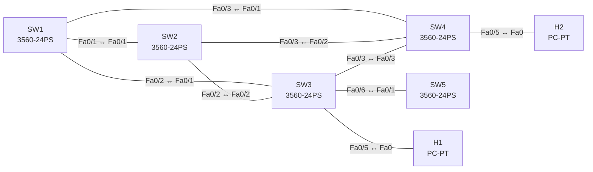

# Lab 06 – Spanning Tree, MST und Schutzfunktionen

**Dauer:** 90 min · **Niveau:** mittel bis schwer

Vier Switches im Dreiecksverbund plus „Rogue“-Switch: Rapid-PVST, Root-Platzierung und Lastverteilung, Umstieg auf MST, PortFast, BPDU Guard, Root Guard, Loop Guard und typische STP-Fehler.

**Lernziele:** Nach diesem Lab kannst du …

- Die STP-Root-Wahl vorhersagen und gezielt steuern.
- MST mit Region, Instanzen und Prioritäten konfigurieren.
- PortFast, BPDU Guard und Root Guard sinnvoll einsetzen.

| ENCOR-Ziel (`Ziel::…`) | Thema |
|---|---|
| 3.1.c | RSTP, MST und Schutzfunktionen |

**So arbeitest du:** Teil A = Bauen, Teil B = Reparieren, Teil C = Üben. Die Konfigurationsdateien liegen in `build/` (Ausgangszustand zum Einfügen in die CLI), `repair/` (fertig gebaut, mit Fehlern) und `solutions/` (Musterlösung und Fehlerliste, erst nach eigenem Versuch öffnen). Anleitung zum Einfügen: siehe [Arbeiten mit den Dateien](../README.md#arbeiten-mit-den-dateien).

## Topologie



**Entwurfsskizze (aus dem CML-Lab; Portnamen der Switches siehe Verkabelungstabelle):**

```
        SW1 ───── SW2          Distribution (Root-Kandidaten)
        │ ╲     ╱ │
        │   ╲ ╱   │
        │   ╱ ╲   │
        SW3 ───── SW4          Access
        │         │
   H1 ──┤         └── H2      (beide VLAN 10)
   SW5 (Rogue, BPDU-Quelle) am Port Gi1/1 von SW3
```

### Geräte

| Gerät | Modell in Packet Tracer | Rolle |
|---|---|---|
| SW1 | 3560-24PS | Switch |
| SW2 | 3560-24PS | Switch |
| SW3 | 3560-24PS | Switch |
| SW4 | 3560-24PS | Switch |
| SW5 | 3560-24PS | Switch |
| H1 | PC-PT | Host |
| H2 | PC-PT | Host |

### Verkabelung

| Von | Port | Nach | Port | Kabel |
|---|---|---|---|---|
| SW1 | Fa0/1 | SW2 | Fa0/1 | Copper Cross-Over |
| SW1 | Fa0/2 | SW3 | Fa0/1 | Copper Cross-Over |
| SW1 | Fa0/3 | SW4 | Fa0/1 | Copper Cross-Over |
| SW2 | Fa0/2 | SW3 | Fa0/2 | Copper Cross-Over |
| SW2 | Fa0/3 | SW4 | Fa0/2 | Copper Cross-Over |
| SW3 | Fa0/3 | SW4 | Fa0/3 | Copper Cross-Over |
| SW3 | Fa0/5 | H1 | Fa0 | Copper Straight-Through |
| SW4 | Fa0/5 | H2 | Fa0 | Copper Straight-Through |
| SW3 | Fa0/6 | SW5 | Fa0/1 | Copper Cross-Over |

### Adressplan (Ausgangszustand)

| Gerät | Interface | Adresse | Maske | Gateway | DNS |
|---|---|---|---|---|---|
| H1 | Fa0 (GUI) | 10.10.10.11 | 255.255.255.0 | 10.10.10.1 |  |
| H2 | Fa0 (GUI) | 10.10.10.12 | 255.255.255.0 | 10.10.10.1 |  |

| Link | Ports |
|---|---|
| SW1–SW2 | Fa0/1 ↔ Fa0/1 |
| SW1–SW3 | Fa0/2 ↔ Fa0/1 |
| SW1–SW4 | Fa0/3 ↔ Fa0/1 |
| SW2–SW3 | Fa0/2 ↔ Fa0/2 |
| SW2–SW4 | Fa0/3 ↔ Fa0/2 |
| SW3–SW4 | Fa0/3 ↔ Fa0/3 |
| H1 / H2 | SW3 Fa0/5 / SW4 Fa0/5 (VLAN 10) |
| SW5 | SW3 Fa0/6 ↔ SW5 Fa0/1 (SW5 ist ab Werk `shutdown`) |

VLANs 10 und 20 sind angelegt, die Inter-Switch-Links sind noch **nicht** als Trunks konfiguriert (Aufgabe 1). Hosts: H1 10.10.10.11, H2 10.10.10.12 (/24).

### Portzuordnung der Switches (CML → Packet Tracer)

Aufgaben, Verkabelung, Konfigurationen und Fehlerlisten verwenden die Packet-Tracer-Ports. Die Tabelle zeigt, welcher Port der CML-Vorlage dazu gehört. Nur die Skizze nennt noch die CML-Ports. Umrechnung: `GiX/Y` → `Fa0/(X·4+Y+1)`.

| Switch | CML-Port | PT-Port |
|---|---|---|
| SW1 | Gi0/0 | Fa0/1 |
| SW1 | Gi0/1 | Fa0/2 |
| SW1 | Gi0/2 | Fa0/3 |
| SW2 | Gi0/0 | Fa0/1 |
| SW2 | Gi0/1 | Fa0/2 |
| SW2 | Gi0/2 | Fa0/3 |
| SW3 | Gi0/0 | Fa0/1 |
| SW3 | Gi0/1 | Fa0/2 |
| SW3 | Gi0/2 | Fa0/3 |
| SW3 | Gi1/0 | Fa0/5 |
| SW3 | Gi1/1 | Fa0/6 |
| SW4 | Gi0/0 | Fa0/1 |
| SW4 | Gi0/1 | Fa0/2 |
| SW4 | Gi0/2 | Fa0/3 |
| SW4 | Gi1/0 | Fa0/5 |
| SW5 | Gi0/0 | Fa0/1 |

> **Packet-Tracer-Hinweis:** **Eignung: teilweise.** Stand Packet Tracer 8.x: MST: eingeschränkt. MST nur in Grundzügen; Region/Instanzen anlegen geht, Feinheiten (z. B. `show spanning-tree mst`-Ausgabe) weichen ab. Akzeptiert PT einen Befehl nicht, ist das ein PT-Limit und kein Fehler von dir; solche Schritte machst du in CML oder EVE-NG. Die CML-Switches (Gi-Ports) sind hier 3560-24PS bzw. 2960 mit FastEthernet-Ports: Die Portzuordnung steht unter dem Adressplan.

## Teil A – Bauen

1. **Trunks.** Alle sechs Inter-Switch-Links statische Trunks (`mode trunk`, `nonegotiate`, erlaubte VLANs 10,20, Native 99, VLAN 99 anlegen). Prüfe, dass H1 ↔ H2 pingen.
2. **Rapid-PVST lesen.** Auf SW3: `show spanning-tree vlan 10`. Wer ist Root (niedrigste Bridge-ID = Priorität + MAC)? Welche Ports sind Root, Designated, Alternate? Warum sind Alternate-Ports in RSTP sofort einsatzbereit?
3. **Root platzieren.** SW1 Root für VLAN 10, SW2 Root für VLAN 20 (jeweils Secondary für das andere) mit `spanning-tree vlan X root primary|secondary`. Welche Priorität wird gesetzt? Wie beeinflusst `spanning-tree cost` die Pfadwahl (Standardkosten Short-Metrik: 1 Gbit/s = 4, 100 Mbit/s = 19; Long-Metrik: 1 Gbit/s = 20000)?
4. **Umstieg auf MST.** `spanning-tree mode mst`, Region `ENCOR`, Revision 1, Instanz 1 = VLAN 10, Instanz 2 = VLAN 20 auf **allen** Switches. Prioritäten: Instanz 0 und 1 SW1 (4096), Instanz 2 SW2 (4096), jeweils der andere als Backup (8192). Warum sind Name, Revision **und** VLAN-Mapping Teil des Region-Digests, und was passiert bei Abweichung (Boundary-Port, alle VLANs hängen am IST)?
5. **Edge-Schutz.** Auf H1/H2-Ports und Fa0/6 (SW5): `portfast`, `bpduguard`. Aktiviere SW5 (`no shutdown`) mit niedriger Priorität und beobachte das Err-Disable. Dann zusätzlich `errdisable recovery cause bpduguard` mit Intervall 60 s. Wie unterscheidet sich **BPDU Filter** (still, gefährlich) von **BPDU Guard**?
6. **Root Guard.** Setze Root Guard auf den Distribution→Access-Ports (SW1 Fa0/2, Fa0/3, SW2 Fa0/2, Fa0/3). Erkläre den Zustand `root-inconsistent` und warum Root Guard keine Nachbarn blockiert, sondern nur Superior BPDUs.
7. **Loop Guard und UDLD.** Aktiviere Loop Guard auf den Access-Uplinks (`spanning-tree guard loop` oder global `spanning-tree loopguard default`) und `udld enable`/`udld aggressive`. Welcher Fehler (unidirektionale Verbindung, BPDU-Verlust) entsteht ohne sie?
8. **Konvergenz testen.** `ping 10.10.10.12 repeat 1000` von H1, dann Root-Link abschalten: Wie lange dauert der Ausfall bei Rapid-PVST/MST (Proposal/Agreement, `show spanning-tree summary`)?

## Teil B – Reparieren

Baue die Topologie wie oben (oder behalte deine aus Teil A), setze alle Geräte zurück (`erase startup-config`, `reload` bzw. neues Gerät) und füge dann die Dateien aus `repair/` ein. Es stecken **3 Fehler** drin. Behandle jede Meldung als Ticket: erst Symptom nachstellen, dann Layer für Layer eingrenzen, beheben und beweisen. Ändere nur, was kaputt ist.

**Ticket 1:** Alle Hosts erreichen sich, aber `show spanning-tree mst` auf SW4 meldet Boundary-Ports zur eigenen MST-Region; die Lastverteilung nach Instanz funktioniert nicht.

**Ticket 2:** Instanz 2 hat dieselbe Root wie Instanz 1 (SW1), die VLAN-Lastverteilung fehlt.

**Ticket 3:** Nachdem jemand an Fa0/6 einen kleinen Switch angeschlossen hat, wechselt die Root und das Netz flattert. SW3 zeigt eine neue Root über Fa0/6.

## Verifikation

```
show spanning-tree
show spanning-tree mst configuration
show spanning-tree mst 1
show spanning-tree inconsistentports
show spanning-tree summary
show errdisable recovery
show udld neighbors
```
Erwartet: SW1 Root für IST und Instanz 1, SW2 Root für Instanz 2, SW4/SW3 haben Alternate-Ports, keine `Boundary`-Ports, SW5 verursacht kein Root-Wechsel (BPDU Guard).

## Teil C – Üben

Beantworte zuerst selbst, dann klappe die Antwort auf.

1. Welcher Switch wird Root, wenn alle Prioritäten gleich sind?
<details><summary>Antwort</summary>

**Der Switch mit der niedrigsten MAC-Adresse.** Die Bridge-ID besteht aus Priorität und MAC. Bei gleicher Priorität entscheidet die MAC. Bei PVST+ ist die VLAN-ID in der Priorität enthalten (Extended System ID).

</details>

2. Ein Switch hat Port-Zustand `BKN*`. Was bedeutet das?
<details><summary>Antwort</summary>

**Der Port ist durch eine Schutzfunktion blockiert (Broken).** Ursachen sind Root Guard (`ROOT_Inc`), Loop Guard (`LOOP_Inc`) oder eine Type- bzw. PVID-Inkonsistenz. Welche es ist, zeigt `show spanning-tree inconsistentports`.

</details>

3. Warum PortFast **und** BPDU Guard?
<details><summary>Antwort</summary>

**PortFast spart die Wartezeit, BPDU Guard sichert sie ab.** PortFast schaltet einen Edge-Port sofort auf Forwarding. Hängt dort doch ein Switch, könnte eine Schleife entstehen. BPDU Guard schaltet den Port ab, sobald eine BPDU ankommt.

</details>

## Prüfungsbezug

Rapid-PVST: eine Instanz pro VLAN, MST: pro Instanz gruppierte VLANs (nur eine PVST+-Instanz an der Boundary). Port-Rollen Root/Designated/Alternate/Backup, Zustände Discarding/Learning/Forwarding. Root Guard am Port Richtung Access, BPDU Guard am Edge, Loop Guard auf Non-Designated Ports. Default Pfadkosten: 1G=4 (short) bzw. 20000 (long), Priorität in 4096er-Schritten (+VLAN-ID bei PVST).

## Lösungen

- `solutions/<Gerät>.cfg`: Konfiguration zu Teil A (ohne Basis-Adressen)
- `solutions/FAULTS.md`: Fehlerliste zu Teil B (Spoiler!)
