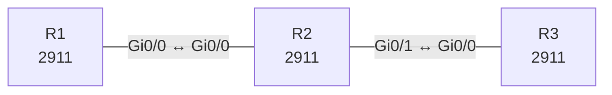

# Lab 08 – NTP, Syslog und SNMPv3

**Dauer:** 75 min · **Niveau:** leicht bis mittel

Management-Plane-Grundlagen: authentifizierte NTP-Hierarchie (Stratum, Server/Peer), Syslog mit Severity und Quell-Interface, SNMPv3 mit authPriv. PTP wird konzeptionell behandelt (Hardwareunterstützung nötig).

| ENCOR-Ziel (`Ziel::…`) | Thema |
|---|---|
| 3.3.a | NTP und PTP |
| 4.1 | Diagnose, SNMP und Syslog |

**So arbeitest du:** Teil A = Bauen, Teil B = Reparieren, Teil C = Üben. Die Konfigurationsdateien liegen in `build/` (Ausgangszustand zum Einfügen in die CLI), `repair/` (fertig gebaut, mit Fehlern) und `solutions/` (Musterlösung und Fehlerliste, erst nach eigenem Versuch öffnen). Anleitung zum Einfügen: siehe [Arbeiten mit den Dateien](../README.md#arbeiten-mit-den-dateien).

## Topologie



**Entwurfsskizze (aus dem CML-Lab; Portnamen der Switches siehe Verkabelungstabelle):**

```
 R1 (NTP Master, Stratum 3) ──── R2 (Client, Stratum 4) ──── R3 (Client, Stratum 5)
   10.0.12.0/30                       10.0.23.0/30
```

### Geräte

| Gerät | Modell in Packet Tracer | Rolle |
|---|---|---|
| R1 | 2911 | Router |
| R2 | 2911 | Router |
| R3 | 2911 | Router |

### Verkabelung

| Von | Port | Nach | Port | Kabel |
|---|---|---|---|---|
| R1 | Gi0/0 | R2 | Gi0/0 | Copper Cross-Over |
| R2 | Gi0/1 | R3 | Gi0/0 | Copper Cross-Over |

### Adressplan (Ausgangszustand)

| Gerät | Interface | Adresse | Maske | Gateway | DNS |
|---|---|---|---|---|---|
| R1 | Loopback0 | 1.1.1.1 | 255.255.255.255 | | |
| R1 | Gi0/0 | 10.0.12.1 | 255.255.255.252 | | |
| R2 | Loopback0 | 2.2.2.2 | 255.255.255.255 | | |
| R2 | Gi0/0 | 10.0.12.2 | 255.255.255.252 | | |
| R2 | Gi0/1 | 10.0.23.1 | 255.255.255.252 | | |
| R3 | Loopback0 | 3.3.3.3 | 255.255.255.255 | | |
| R3 | Gi0/0 | 10.0.23.2 | 255.255.255.252 | | |

| Gerät | Lo0 | Links |
|---|---|---|
| R1 | 1.1.1.1/32 | Gi0/0 10.0.12.1/30 |
| R2 | 2.2.2.2/32 | Gi0/0 10.0.12.2/30, Gi0/1 10.0.23.1/30 |
| R3 | 3.3.3.3/32 | Gi0/0 10.0.23.2/30 |

Routing: statisch vorgegeben (jeder Router kennt alle Loopbacks). NTP-Synchronisation dauert einige Minuten, geduldig prüfen mit `show ntp associations`.
> **Packet-Tracer-Hinweis:** **Eignung: teilweise.** Nach meinem Kenntnisstand zu Packet Tracer 8.x gilt: NTP-Authentifizierung: eingeschränkt. Eingeschränkt; im Zweifel Authentifizierung weglassen. SNMPv3: nicht vorhanden. SNMPv3 (Gruppen, Benutzer, authPriv) fehlt. Akzeptiert PT einen Befehl nicht, ist das ein PT-Limit und kein Fehler von dir; solche Schritte machst du in CML oder EVE-NG.

## Teil A – Bauen

1. **Uhr und Zeitzone.** Setze auf R1 `clock set`, `clock timezone CET 1`, `clock summer-time CEST recurring last Sun Mar 2:00 last Sun Oct 3:00`. Warum ist korrekte Zeit für Syslog, Zertifikate (IPsec/PKI) und Forensik wichtig?
2. **NTP-Master.** R1 wird mit `ntp master 3` zur Zeitquelle (Stratum 3). Wann ist `ntp master` sinnvoll, wann gefährlich (Mehrfachquellen, Zeitsprünge)? Wie unterscheidet sich ein **Server** von einem **Peer** (symmetrisch)?
3. **Hierarchie.** R2 `ntp server 10.0.12.1`, R3 `ntp server 10.0.23.1`. Beobachte Stratum, Reach, Delay, Offset und Jitter in `show ntp associations detail`. Erwarteter Stratum von R2 und R3?
4. **Authentifizierung.** Überall `ntp authenticate`, `ntp authentication-key 1 md5 NtpKey123`, `ntp trusted-key 1`; Clients mit `ntp server … key 1`. Teste einen falschen Key. Warum schützt das vor Zeitspoofing, und welche Alternative (NTPv4 mit SHA/CMAC, NTS) gibt es?
5. **Quell-Interface.** Setze `ntp source Loopback0` auf R2, R3. Warum stabilere Absender-Adresse?
6. **Syslog.** Aktiviere `logging buffered 16384 informational`, `logging source-interface Loopback0`, `logging host` (Ziel ist 10.0.23.99, nur zur Vorbereitung). Wie ist `%FACILITY-SEVERITY-MNEMONIC` aufgebaut? Welche Level gibt es (0 emergencies … 7 debugging) und welches ist `%LINK-3-UPDOWN`?
7. **SNMPv3.** Gruppe `MON` mit `priv`, Benutzer `monitor` mit `auth sha` und `priv aes 128`, View nur für `iso`. Prüfe `show snmp user` und `show snmp group`. Vergleiche v1/v2c (Community, Klartext) mit v3 (USM + VACM).
8. **Timestamps.** Setze `service timestamps log datetime msec localtime show-timezone year`. Warum ist `service timestamps debug` getrennt?
9. **PTP (Konzept).** Beschreibe Aufgaben von Grandmaster, Boundary Clock, Transparent Clock, Sync/Follow_Up/Delay_Req. Warum erreicht PTP Nanosekunden, NTP nur Millisekunden (Hardware-Timestamping)?

## Teil B – Reparieren

Baue die Topologie wie oben (oder behalte deine aus Teil A), setze alle Geräte zurück (`erase startup-config`, `reload` bzw. neues Gerät) und füge dann die Dateien aus `repair/` ein. Es stecken **4 Fehler** drin. Behandle jede Meldung als Ticket: erst Symptom nachstellen, dann Layer für Layer eingrenzen, beheben und beweisen. Ändere nur, was kaputt ist.

**Ticket 1:** Weder R2 noch R3 synchronisieren; `show ntp associations` zeigt auf R2 `~` und Stratum 16 (R1 selbst hat keine Quelle).

**Ticket 2:** R2 hat eine Assoziation mit R1, aber sie wird nie als Sys.Peer gewählt; `authenticated` steht auf `no`.

**Ticket 3:** R3 bleibt unsynchronisiert, `show ntp associations` zeigt Reach 0 zu 10.0.23.10.

**Ticket 4:** In `show logging` auf R2 fehlen Link-Up-Meldungen (`%LINEPROTO-5-UPDOWN`), obwohl der Link geflappt hat.

## Verifikation

```
show clock detail
show ntp status
show ntp associations detail
show logging
show snmp user
show snmp group
show running-config | include ntp|logging|snmp
```
Erwartet: `Clock is synchronized, stratum 4` auf R2, `stratum 5` auf R3, Assoziation mit `*` (Sys.Peer) und `~`.

## Teil C – Üben

Beantworte zuerst selbst, dann klappe die Antwort auf.

1. R2 zeigt `Clock is unsynchronized`, obwohl `ntp server` gesetzt ist. Die ersten Prüfungen?
<details><summary>Antwort</summary>

`show ntp associations` (Reach 0 = keine Antwort?), Erreichbarkeit/ACL für UDP 123, Authentifizierung (`trusted-key`, Key-ID, Passwort), Stratum des Servers (16 = unsynchronisiert).

</details>

2. Was bedeutet Stratum 16?
<details><summary>Antwort</summary>

Ungültig/unsynchronisiert: Die Zeitquelle ist nicht vertrauenswürdig und wird nicht als Referenz akzeptiert.

</details>

3. Wieso `authPriv` und nicht `authNoPriv`?
<details><summary>Antwort</summary>

`authNoPriv` schützt nur Integrität und Herkunft, `authPriv` zusätzlich die Vertraulichkeit der Nutzdaten (Verschlüsselung).

</details>

## Prüfungsbezug

Stratum steigt pro Hop um 1. NTP nutzt UDP 123, Authentifizierung per MD5/SHA über Key-ID. `ntp master` kann die eigene Uhr als Quelle ausgeben. Syslog: UDP 514, Severity 0–7. SNMPv3 hat Sicherheitsstufen noAuthNoPriv, authNoPriv, authPriv. PTP (IEEE 1588): Grandmaster, Best Master Clock Algorithm, Hardware-Timestamps.

## Lösungen

- `solutions/<Gerät>.cfg`: Konfiguration zu Teil A (ohne Basis-Adressen)
- `solutions/FAULTS.md`: Fehlerliste zu Teil B (Spoiler!)
