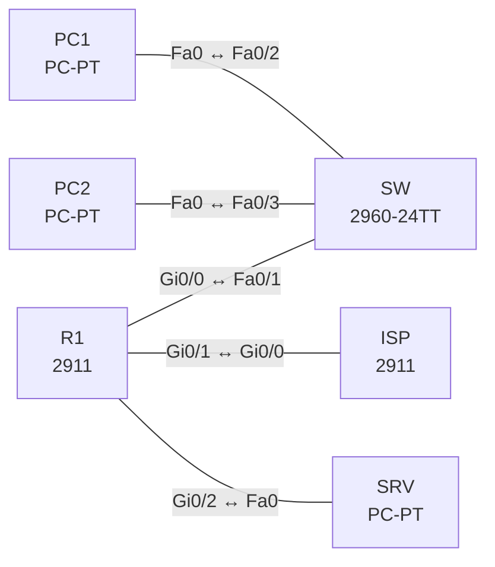

# Lab 09 – NAT und PAT

**Dauer:** 75 min · **Niveau:** mittel

Edge-Router mit LAN, DMZ und ISP: PAT (Overload), dynamisches NAT mit Pool, statisches NAT und Port-Forwarding. Du lernst die vier NAT-Adressbegriffe, die Reihenfolge der Operationen und die typischen Fehler.

**Lernziele:** Nach diesem Lab kannst du …

- Statisches NAT, dynamisches NAT und PAT unterscheiden und konfigurieren.
- Inside, Outside und die NAT-ACL korrekt zuordnen.
- Mit `show ip nat translations` und `statistics` Übersetzungsprobleme eingrenzen.

| ENCOR-Ziel (`Ziel::…`) | Thema |
|---|---|
| 3.3.b | NAT und PAT |

**So arbeitest du:** Teil A = Bauen, Teil B = Reparieren, Teil C = Üben. Die Konfigurationsdateien liegen in `build/` (Ausgangszustand zum Einfügen in die CLI), `repair/` (fertig gebaut, mit Fehlern) und `solutions/` (Musterlösung und Fehlerliste, erst nach eigenem Versuch öffnen). Anleitung zum Einfügen: siehe [Arbeiten mit den Dateien](../README.md#arbeiten-mit-den-dateien).

## Topologie



**Entwurfsskizze (aus dem CML-Lab; Portnamen der Switches siehe Verkabelungstabelle):**

```
 PC1 ─┐                          ┌─ SRV (DMZ 172.16.0.10, HTTP)
      ├─ SW ── R1 ──────────── ISP ── Lo0 8.8.8.8
 PC2 ─┘  LAN   Gi0/0 Gi0/1 .2   (203.0.113.0/30)
 192.168.10.0/24  R1 Gi0/2 = DMZ 172.16.0.0/24
```

### Geräte

| Gerät | Modell in Packet Tracer | Rolle |
|---|---|---|
| SW | 2960-24TT | Switch (im CML-Lab unmanaged; ohne Konfiguration) |
| PC1 | PC-PT | Host |
| PC2 | PC-PT | Host |
| R1 | 2911 | Router |
| ISP | 2911 | Router |
| SRV | PC-PT | Host |

### Verkabelung

| Von | Port | Nach | Port | Kabel |
|---|---|---|---|---|
| R1 | Gi0/0 | SW | Fa0/1 | Copper Straight-Through |
| PC1 | Fa0 | SW | Fa0/2 | Copper Straight-Through |
| PC2 | Fa0 | SW | Fa0/3 | Copper Straight-Through |
| R1 | Gi0/1 | ISP | Gi0/0 | Copper Cross-Over |
| R1 | Gi0/2 | SRV | Fa0 | Copper Cross-Over |

### Adressplan (Ausgangszustand)

| Gerät | Interface | Adresse | Maske | Gateway | DNS |
|---|---|---|---|---|---|
| PC1 | Fa0 (GUI) | 192.168.10.11 | 255.255.255.0 | 192.168.10.1 |  |
| PC2 | Fa0 (GUI) | 192.168.10.12 | 255.255.255.0 | 192.168.10.1 |  |
| R1 | Gi0/0 | 192.168.10.1 | 255.255.255.0 | | |
| R1 | Gi0/1 | 203.0.113.1 | 255.255.255.252 | | |
| R1 | Gi0/2 | 172.16.0.1 | 255.255.255.0 | | |
| ISP | Loopback0 | 8.8.8.8 | 255.255.255.255 | | |
| ISP | Gi0/0 | 203.0.113.2 | 255.255.255.252 | | |
| SRV | Fa0 (GUI) | 172.16.0.10 | 255.255.255.0 | 172.16.0.1 |  |

| Gerät | Interface | Adresse | NAT-Rolle |
|---|---|---|---|
| R1 | Gi0/0 | 192.168.10.1/24 | inside |
| R1 | Gi0/1 | 203.0.113.1/30 | outside |
| R1 | Gi0/2 | 172.16.0.1/24 | inside (DMZ) |
| ISP | Gi0/0 / Lo0 | 203.0.113.2/30 / 8.8.8.8/32 | – |
| PC1/PC2 | Gi0/0 | 192.168.10.11 / .12 | – |
| SRV | Gi0/0 | 172.16.0.10/24 (HTTP-Server an) | – |

Der ISP kennt das Supernetz 203.0.113.0/24 (via R1), daher sind alle Adressen des /24 für NAT nutzbar. R1 hat Default zum ISP.

### Portzuordnung der Switches (CML → Packet Tracer)

Aufgaben, Verkabelung, Konfigurationen und Fehlerlisten verwenden die Packet-Tracer-Ports. Die Tabelle zeigt, welcher Port der CML-Vorlage dazu gehört. Nur die Skizze nennt noch die CML-Ports. Umrechnung: `GiX/Y` → `Fa0/(X·4+Y+1)`.

| Switch | CML-Port | PT-Port |
|---|---|---|
| SW | Gi0/0 | Fa0/1 |
| SW | Gi0/1 | Fa0/2 |
| SW | Gi0/2 | Fa0/3 |

> **Packet-Tracer-Hinweis:** **Eignung: geeignet.** Alle verwendeten Funktionen gibt es in Packet Tracer; Ausgabeformate einzelner `show`-Befehle weichen leicht ab. Die CML-Switches (Gi-Ports) sind hier 3560-24PS bzw. 2960 mit FastEthernet-Ports: Die Portzuordnung steht unter dem Adressplan.

## Teil A – Bauen

1. **Problem erkennen.** PC1 pingt 8.8.8.8: erfolglos. Warum (private Quelle, ISP hat keine Rückroute)? Prüfe mit `debug ip icmp` auf dem ISP.
2. **PAT.** `ip nat inside`/`outside` auf den Interfaces, Standard-ACL 1 für 192.168.10.0/24, `ip nat inside source list 1 interface Gi0/1 overload`. Prüfe `show ip nat translations` und `show ip nat statistics`. Welche Rolle spielen die Quellports?
3. **Vier Adressbegriffe.** Ordne in einer Übersetzung die Adressen *inside local*, *inside global*, *outside local*, *outside global* zu. Welche davon ändert NAT im üblichen Szenario?
4. **Dynamisches NAT.** Definiere Pool `POOL` (203.0.113.16–203.0.113.19, /24) und binde PC2 per ACL 2 ohne Overload daran. Starte vier verschiedene PCs gleichzeitig (oder simuliere) und beobachte Pool-Erschöpfung (`show ip nat statistics`: Misses).
5. **Statisches NAT.** SRV soll aus dem Internet erreichbar sein: `ip nat inside source static 172.16.0.10 203.0.113.10`. Teste `telnet 203.0.113.10 80` vom ISP. Welche Proxy-ARP-/Routing-Frage stellt sich, wenn die globale Adresse im Transfernetz selbst liegt?
6. **Static PAT / Port-Forwarding.** Leite TCP/8080 an der Interface-Adresse 203.0.113.1 auf SRV:80 weiter (`ip nat inside source static tcp 172.16.0.10 80 interface Gi0/1 8080`).
7. **Reihenfolge.** Erkläre Inside→Outside: Routing → NAT; Outside→Inside: NAT → Routing; ACL-Verhalten (Inbound-ACL sieht vor NAT die globale Adresse). Wo setzt man deshalb ACLs?
8. **Debug.** `debug ip nat detailed` kurz nutzen und `clear ip nat translation *`. Wann ist `clear` im Betrieb heikel (aktive Sessions)?

## Teil B – Reparieren

Baue die Topologie wie oben (oder behalte deine aus Teil A), setze alle Geräte zurück (`erase startup-config`, `reload` bzw. neues Gerät) und füge dann die Dateien aus `repair/` ein. Es stecken **4 Fehler** drin. Behandle jede Meldung als Ticket: erst Symptom nachstellen, dann Layer für Layer eingrenzen, beheben und beweisen. Ändere nur, was kaputt ist.

**Ticket 1:** Weder PC1 noch PC2 erreichen den ISP, `show ip nat translations` ist leer (Quelladresse bleibt privat).

**Ticket 2:** Dasselbe Bild trotz korrektem Interface-Setup: keine Übersetzung, der ISP sieht nichts.

**Ticket 3:** PC1 kommt raus, PC2 danach nicht mehr; `show ip nat statistics` zeigt Misses.

**Ticket 4:** Der ISP erreicht 203.0.113.10 (Server) nicht, `show ip nat translations` zeigt die Zuordnung zu .11.

## Verifikation

```
show ip nat translations [verbose]
show ip nat statistics
show access-lists
debug ip nat
```
Erwartet: PC1/PC2 erscheinen als `203.0.113.1:port` (PAT), SRV statisch auf 203.0.113.10, Port 8080 leitet an 172.16.0.10:80.

## Teil C – Üben

Beantworte zuerst selbst, dann klappe die Antwort auf.

1. PC1 kann den ISP erreichen, PC2 nicht. Welche drei Dinge prüfst du?
<details><summary>Antwort</summary>

**Die NAT-ACL, die Inside/Outside-Zuordnung und ob `overload` gesetzt ist.** Passt die ACL auf das Subnetz von PC2? Sind die Interfaces richtig markiert? Steigen in `show ip nat statistics` die Misses, ist der Pool erschöpft oder `overload` fehlt.

</details>

2. Warum sieht man in `show ip nat translations` bei PAT mehrere Zeilen pro Host?
<details><summary>Antwort</summary>

**Weil PAT jede Verbindung einzeln übersetzt.** Jede Kombination aus Protokoll, Quell- und Zielport bekommt eine eigene Zeile. Ein Host mit mehreren offenen Verbindungen erscheint daher mehrfach.

</details>

3. Wozu braucht man `ip nat inside source static tcp … interface`?
<details><summary>Antwort</summary>

**Für Port-Forwarding.** Ein Dienst im inneren Netz wird über einen Port der äußeren Interface-Adresse erreichbar. Dafür braucht man keine eigene öffentliche Adresse.

</details>

## Prüfungsbezug

Inside Local = interne Host-Adresse, Inside Global = öffentliche Sicht auf den internen Host. NAT ohne Overload braucht ausreichend Poolgröße. Static NAT ist bidirektional, dynamisches NAT nur bei Verkehr von innen. NAT-Reihenfolge vor/nach Routing abhängig von der Richtung. `ip nat inside source` braucht `ip nat inside/outside` an den Interfaces.

## Lösungen

- `solutions/<Gerät>.cfg`: Konfiguration zu Teil A (ohne Basis-Adressen)
- `solutions/FAULTS.md`: Fehlerliste zu Teil B (Spoiler!)
