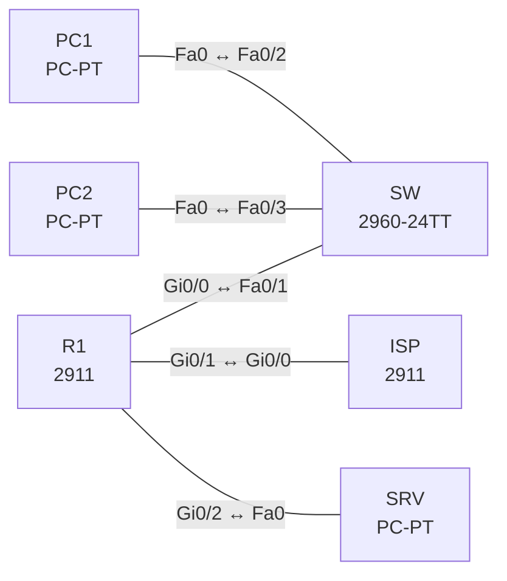

# Lab 10 – ACLs und Control-Plane Policing

**Dauer:** 90 min · **Niveau:** mittel

Layer-3/4-Filter mit Standard-, Extended- und benannten ACLs, `established`, Logging und vty-Schutz, dazu CoPP (MQC auf der Control-Plane) zur Begrenzung von ICMP und Management-Verkehr.

| ENCOR-Ziel (`Ziel::…`) | Thema |
|---|---|
| 5.2.a | ACLs |
| 5.2.b | CoPP |

**So arbeitest du:** Teil A = Bauen, Teil B = Reparieren, Teil C = Üben. Die Konfigurationsdateien liegen in `build/` (Ausgangszustand zum Einfügen in die CLI), `repair/` (fertig gebaut, mit Fehlern) und `solutions/` (Musterlösung und Fehlerliste, erst nach eigenem Versuch öffnen). Anleitung zum Einfügen: siehe [Arbeiten mit den Dateien](../README.md#arbeiten-mit-den-dateien).

## Topologie



**Entwurfsskizze (aus dem CML-Lab; Portnamen der Switches siehe Verkabelungstabelle):**

```
 PC1 ─┐
      ├─ SW ── R1 (Gi0/0 inside) ──Gi0/1── ISP (Lo0 8.8.8.8)
 PC2 ─┘        └ Gi0/2 ─ SRV (DMZ)
```

### Geräte

| Gerät | Modell in Packet Tracer | Rolle |
|---|---|---|
| SW | 2960-24TT | Switch (im CML-Lab unmanaged; ohne Konfiguration) |
| PC1 | PC-PT | Host |
| PC2 | PC-PT | Host |
| R1 | 2911 | Router |
| ISP | 2911 | Router |
| SRV | PC-PT | Host |

### Verkabelung

| Von | Port | Nach | Port | Kabel |
|---|---|---|---|---|
| R1 | Gi0/0 | SW | Fa0/1 | Copper Straight-Through |
| PC1 | Fa0 | SW | Fa0/2 | Copper Straight-Through |
| PC2 | Fa0 | SW | Fa0/3 | Copper Straight-Through |
| R1 | Gi0/1 | ISP | Gi0/0 | Copper Cross-Over |
| R1 | Gi0/2 | SRV | Fa0 | Copper Cross-Over |

### Adressplan (Ausgangszustand)

| Gerät | Interface | Adresse | Maske | Gateway | DNS |
|---|---|---|---|---|---|
| PC1 | Fa0 (GUI) | 192.168.10.11 | 255.255.255.0 | 192.168.10.1 |  |
| PC2 | Fa0 (GUI) | 192.168.10.12 | 255.255.255.0 | 192.168.10.1 |  |
| R1 | Gi0/0 | 192.168.10.1 | 255.255.255.0 | | |
| R1 | Gi0/1 | 203.0.113.1 | 255.255.255.252 | | |
| R1 | Gi0/2 | 172.16.0.1 | 255.255.255.0 | | |
| ISP | Loopback0 | 8.8.8.8 | 255.255.255.255 | | |
| ISP | Gi0/0 | 203.0.113.2 | 255.255.255.252 | | |
| SRV | Fa0 (GUI) | 172.16.0.10 | 255.255.255.0 | 172.16.0.1 |  |

| Gerät | Interface | Adresse |
|---|---|---|
| R1 | Gi0/0 / Gi0/1 / Gi0/2 | 192.168.10.1/24 / 203.0.113.1/30 / 172.16.0.1/24 |
| ISP | Gi0/0 / Lo0 | 203.0.113.2/30 / 8.8.8.8/32 |
| PC1/PC2 | – | 192.168.10.11/.12 |
| SRV | – | 172.16.0.10 (HTTP an) |

Alle Netze sind ohne NAT erreichbar (der ISP routet das Kundennetz statisch zurück). Die vty-Lines von R1 erlauben Telnet nur für dieses Lab, in Produktion immer SSH.

### Portzuordnung der Switches (CML → Packet Tracer)

Die Aufgabentexte nennen Switch-Ports in der CML-Schreibweise (`Gi…`). Verkabelung, Konfigurationen und Fehlerlisten verwenden die Packet-Tracer-Ports. Umrechnung: `GiX/Y` → `Fa0/(X·4+Y+1)`.

| Switch | CML-Port | PT-Port |
|---|---|---|
| SW | Gi0/0 | Fa0/1 |
| SW | Gi0/1 | Fa0/2 |
| SW | Gi0/2 | Fa0/3 |

> **Packet-Tracer-Hinweis:** **Eignung: teilweise.** Nach meinem Kenntnisstand zu Packet Tracer 8.x gilt: CoPP: nicht vorhanden. `control-plane` und `service-policy` darunter fehlen. QoS (MQC): eingeschränkt. Klassen und Richtlinien lassen sich anlegen, `police`/`shape`/`priority` je nach Gerät nur teilweise; Messwerte nicht aussagekräftig. Akzeptiert PT einen Befehl nicht, ist das ein PT-Limit und kein Fehler von dir; solche Schritte machst du in CML oder EVE-NG. Die CML-Switches (Gi-Ports) sind hier 3560-24PS bzw. 2960 mit FastEthernet-Ports: Die Portzuordnung steht unter dem Adressplan; die Aufgabentexte nennen noch die CML-Ports.

## Teil A – Bauen

1. **Ausgangslage.** Alles ist erreichbar: PC1 → SRV (HTTP), PC1 → 8.8.8.8, ISP → PC1.
2. **Standard-ACL für vty.** `ip access-list standard MGMT` (nur 192.168.10.0/24), `line vty 0 4` → `access-class MGMT in`. Teste Telnet von PC1 (erlaubt) und vom ISP (blockiert). Warum gehört `access-class` an die Line und nicht an ein Interface?
3. **Extended ACL inbound am Edge.** Auf Gi0/1 inbound nur erlauben: ICMP echo-reply, `established` TCP, TCP 80 zu SRV, UDP-DNS-Antworten (src 53). Am Ende explizit `deny ip any any log`. Wie wirkt die implizite Deny-Regel, wann ist ein explizites `deny … log` nützlich?
4. **Richtung und Ort.** Welche Wirkung hat dieselbe ACL `out` an Gi0/1? Welche Faustregel gilt für Standard- (nah am Ziel) und Extended-ACLs (nah an der Quelle)?
5. **DMZ-Regeln.** SRV (DMZ) darf nicht ins LAN initiieren (Gi0/2 inbound `deny ip 172.16.0.0 0.0.0.255 192.168.10.0 0.0.0.255`), LAN → DMZ nur TCP 80 und ICMP (Gi0/0 inbound).
6. **ACL-Reihenfolge & Zähler.** Verschiebe eine Zeile mit Sequenznummern (`ip access-list extended … / 15 permit …`). Lies `show access-lists`: Matches pro Zeile. Wie findest du Shadowed Rules?
7. **CoPP.** Baue `class-map` für ICMP (ACL), für Management (Telnet/SSH von LAN) und OSPF/BGP, `policy-map COPP` mit `police rate 64000 bps conform transmit exceed drop` für ICMP, anschließend `control-plane` → `service-policy input COPP`. Teste Pings vom ISP mit `repeat 500 size 1500` und beobachte `show policy-map control-plane`.
8. **Diskussion.** Warum CoPP nicht für Transitverkehr wirkt (nur Control Plane), und worin liegt der Unterschied zu CoPP-Alternativen (CPPr, Port-Filtering)?

## Teil B – Reparieren

Baue die Topologie wie oben (oder behalte deine aus Teil A), setze alle Geräte zurück (`erase startup-config`, `reload` bzw. neues Gerät) und füge dann die Dateien aus `repair/` ein. Es stecken **4 Fehler** drin. Behandle jede Meldung als Ticket: erst Symptom nachstellen, dann Layer für Layer eingrenzen, beheben und beweisen. Ändere nur, was kaputt ist.

**Ticket 1:** Seit der ACL am Edge funktioniert aus dem LAN nichts mehr (kein Ping nach 8.8.8.8, kein HTTP von außen), Zähler der ersten Zeile steigt.

**Ticket 2:** SRV kann trotz `deny` ins LAN pingen.

**Ticket 3:** `show policy-map control-plane` zeigt bei `CM-ICMP` null Treffer, Ping-Flut wird nicht begrenzt.

**Ticket 4:** Telnet von PC1 auf R1 wird sofort getrennt, obwohl PC1 im Management-Netz liegen soll.

## Verifikation

```
show access-lists
show ip interface Gi0/1 | include access list
show policy-map control-plane
show class-map
telnet 192.168.10.1                 ! von PC1 und vom ISP
```
Erwartet: ACL-Zähler steigen bei Tests, CoPP zeigt `conformed`/`exceeded`, Telnet vom ISP bricht ab.

## Teil C – Üben

Beantworte zuerst selbst, dann klappe die Antwort auf.

1. Eine ACL hat als letzte Zeile `permit ip any any`, ganz oben aber `deny ip any any`. Was passiert?
<details><summary>Antwort</summary>

Alles wird verworfen; spätere Zeilen werden nie erreicht (Shadowing).

</details>

2. Wie unterscheidet sich `established` von einer zustandsbehafteten Firewall?
<details><summary>Antwort</summary>

`established` prüft nur ACK/RST-Flags im Paket und führt keine Verbindungstabelle: Gefälschte Pakete mit gesetztem ACK passieren.

</details>

3. Warum verwirft CoPP den Transit-Ping nicht?
<details><summary>Antwort</summary>

CoPP wirkt nur auf Pakete, die an die Control Plane (Router selbst) gerichtet sind. Transit-Pakete laufen über die Data Plane.

</details>

## Prüfungsbezug

ACL werden von oben nach unten ausgewertet, die erste Übereinstimmung gewinnt, am Ende steht ein implizites `deny any`. Standard-ACLs filtern nur nach Quelle, Extended nach Protokoll/Ports. `established` prüft ACK/RST-Flags (kein Zustandsmodell). `access-class` für Lines, `ip access-group` für Interfaces. CoPP schützt nur den Control Plane (Verkehr zum Router), nicht den Transit.

## Lösungen

- `solutions/<Gerät>.cfg`: Konfiguration zu Teil A (ohne Basis-Adressen)
- `solutions/FAULTS.md`: Fehlerliste zu Teil B (Spoiler!)
