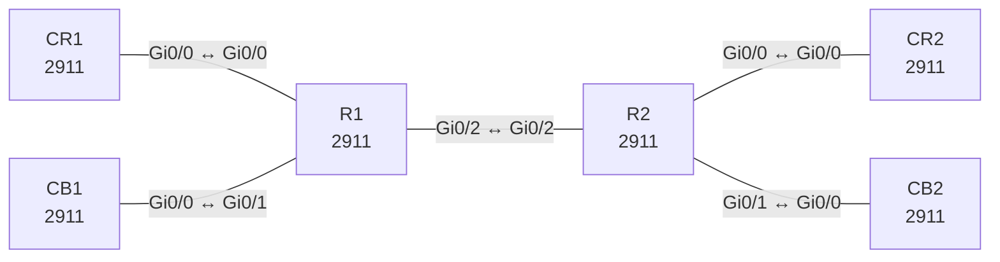

# Lab 13 – VRF-Lite mit überlappenden Adressen

**Dauer:** 75 min · **Niveau:** mittel

Zwei Kunden (RED, BLUE) teilen sich zwei Router und einen Link, nutzen aber dieselben IP-Bereiche. Mit VRF-Lite trennst du Routing-Tabellen, nutzt Subinterfaces als Trunk und OSPF pro VRF.

| ENCOR-Ziel (`Ziel::…`) | Thema |
|---|---|
| 2.2.a | VRF |

**So arbeitest du:** Teil A = Bauen, Teil B = Reparieren, Teil C = Üben. Die Konfigurationsdateien liegen in `build/` (Ausgangszustand zum Einfügen in die CLI), `repair/` (fertig gebaut, mit Fehlern) und `solutions/` (Musterlösung und Fehlerliste, erst nach eigenem Versuch öffnen). Anleitung zum Einfügen: siehe [Arbeiten mit den Dateien](../README.md#arbeiten-mit-den-dateien).

## Topologie



**Entwurfsskizze (aus dem CML-Lab; Portnamen der Switches siehe Verkabelungstabelle):**

```
 CR1 ─┐                              ┌─ CR2
      ├─ R1 ════ (Gi0/2.100 RED / .200 BLUE) ════ R2 ─┤
 CB1 ─┘                              └─ CB2
```
RED = CR1 ↔ CR2, BLUE = CB1 ↔ CB2.

### Geräte

| Gerät | Modell in Packet Tracer | Rolle |
|---|---|---|
| R1 | 2911 | Router |
| R2 | 2911 | Router |
| CR1 | 2911 | Router |
| CB1 | 2911 | Router |
| CR2 | 2911 | Router |
| CB2 | 2911 | Router |

### Verkabelung

| Von | Port | Nach | Port | Kabel |
|---|---|---|---|---|
| CR1 | Gi0/0 | R1 | Gi0/0 | Copper Cross-Over |
| CB1 | Gi0/0 | R1 | Gi0/1 | Copper Cross-Over |
| R1 | Gi0/2 | R2 | Gi0/2 | Copper Cross-Over |
| R2 | Gi0/0 | CR2 | Gi0/0 | Copper Cross-Over |
| R2 | Gi0/1 | CB2 | Gi0/0 | Copper Cross-Over |

### Adressplan (Ausgangszustand)

| Gerät | Interface | Adresse | Maske | Gateway | DNS |
|---|---|---|---|---|---|
| R1 | Gi0/0 | 10.1.1.1 | 255.255.255.252 | | |
| R1 | Gi0/1 | 10.1.1.1 | 255.255.255.252 | | |
| R1 | Gi0/2.100 | 10.0.12.1 | 255.255.255.252 | | |
| R1 | Gi0/2.200 | 10.0.12.1 | 255.255.255.252 | | |
| R2 | Gi0/0 | 10.2.2.1 | 255.255.255.252 | | |
| R2 | Gi0/1 | 10.2.2.1 | 255.255.255.252 | | |
| R2 | Gi0/2.100 | 10.0.12.2 | 255.255.255.252 | | |
| R2 | Gi0/2.200 | 10.0.12.2 | 255.255.255.252 | | |
| CR1 | Gi0/0 | 10.1.1.2 | 255.255.255.252 | | |
| CR1 | Loopback100 | 192.168.1.1 | 255.255.255.0 | | |
| CB1 | Gi0/0 | 10.1.1.2 | 255.255.255.252 | | |
| CB1 | Loopback100 | 192.168.1.1 | 255.255.255.0 | | |
| CR2 | Gi0/0 | 10.2.2.2 | 255.255.255.252 | | |
| CR2 | Loopback100 | 192.168.2.1 | 255.255.255.0 | | |
| CB2 | Gi0/0 | 10.2.2.2 | 255.255.255.252 | | |
| CB2 | Loopback100 | 192.168.2.1 | 255.255.255.0 | | |

| Link | Netz (in beiden VRFs identisch!) |
|---|---|
| R1 Gi0/0 – CR1 Gi0/0 (RED) | 10.1.1.0/30 (R1 .1, CR1 .2) |
| R1 Gi0/1 – CB1 Gi0/0 (BLUE) | 10.1.1.0/30 (R1 .1, CB1 .2) |
| R1 Gi0/2.100 / .200 – R2 Gi0/2.100 / .200 | 10.0.12.0/30 (R1 .1, R2 .2) je VRF |
| R2 Gi0/0 – CR2 Gi0/0 (RED) | 10.2.2.0/30 (R2 .1, CR2 .2) |
| R2 Gi0/1 – CB2 Gi0/0 (BLUE) | 10.2.2.0/30 (R2 .1, CB2 .2) |

Kunden-LANs: Site 1 = 192.168.1.0/24 (Lo100 auf CR1/CB1), Site 2 = 192.168.2.0/24 (Lo100 auf CR2/CB2), in RED und BLUE identisch.
> **Packet-Tracer-Hinweis:** **Eignung: teilweise.** Nach meinem Kenntnisstand zu Packet Tracer 8.x gilt: VRF-Lite: eingeschränkt. Je nach PT-Version nur teilweise oder gar nicht vorhanden. Wenn `ip vrf` nicht akzeptiert wird: Lab in CML/EVE-NG. Akzeptiert PT einen Befehl nicht, ist das ein PT-Limit und kein Fehler von dir; solche Schritte machst du in CML oder EVE-NG.

## Teil A – Bauen

1. **VRFs anlegen.** Auf R1 und R2 `vrf definition RED`/`BLUE` mit `address-family ipv4`. Weise die Kunden-Interfaces (`vrf forwarding`) zu. Beachte: Die IP-Adresse wird beim Zuweisen gelöscht und muss neu gesetzt werden. Welche Routing-Tabelle zeigt `show ip route` ohne VRF?
2. **Trunk-Subinterfaces.** Auf dem Link R1–R2 je Subinterface `.100` (RED) und `.200` (BLUE) mit `encapsulation dot1Q`, `vrf forwarding`, IP `10.0.12.1/.2`. Warum dürfen beide Subinterfaces dieselbe IP-Adresse tragen?
3. **OSPF pro VRF.** `router ospf 1 vrf RED`, `router ospf 2 vrf BLUE` auf R1/R2, dazu OSPF auf den CEs (Prozess 1, Area 0). Prüfe `show ip route vrf RED ospf` und die Router-IDs (VRF-spezifisch!).
4. **Ende-zu-Ende.** `ping vrf RED 192.168.2.1 source Loopback100` von R1 aus bzw. von CR1 aus `ping 192.168.2.1 source Lo100`. Zeige, dass dieselben Netze in beiden VRFs existieren und sich nicht in die Quere kommen.
5. **Trennung beweisen.** Pinge aus VRF RED eine BLUE-only-Adresse. Erkläre das Ergebnis (`% No route`, VRF-Tabellen sind getrennt).
6. **Route-Leaking.** Erzeuge auf R1 eine globale Loopback 10.99.99.1/32 und lasse VRF RED sie erreichen: `ip route vrf RED 10.99.99.1 255.255.255.255 Loopback99 global` plus Rückroute. Welche Sicherheitsfolgen hat Leaking, und wie macht man es sauber (Route-Target-Import/Export bei MP-BGP, Firewall-Fusion)?
7. **Konzepte.** Unterschied VRF-Lite ↔ MPLS-VRF: RD (unterscheidet gleiche Präfixe in MP-BGP), RT (steuert Import/Export), MPLS-Label. Wann reicht VRF-Lite?

## Teil B – Reparieren

Baue die Topologie wie oben (oder behalte deine aus Teil A), setze alle Geräte zurück (`erase startup-config`, `reload` bzw. neues Gerät) und füge dann die Dateien aus `repair/` ein. Es stecken **4 Fehler** drin. Behandle jede Meldung als Ticket: erst Symptom nachstellen, dann Layer für Layer eingrenzen, beheben und beweisen. Ändere nur, was kaputt ist.

**Ticket 1:** Im Log steht `Address 10.1.1.1 overlaps with GigabitEthernet0/0`, BLUE-Site 1 (CB1) ist nicht erreichbar.

**Ticket 2:** RED läuft Ende zu Ende, BLUE hat zwischen R1 und R2 keine OSPF-Nachbarschaft.

**Ticket 3:** CB2 bildet keinen Nachbarn zu R2, die BLUE-Site 2 (192.168.2.0/24) fehlt in der Routing-Tabelle von R1.

**Ticket 4:** RED-Site 2 ist nicht erreichbar (192.168.2.0/24 fehlt in VRF RED auf R1), BLUE funktioniert.

## Verifikation

```
show vrf
show ip route vrf RED
show ip ospf 1 neighbor        ! Prozess pro VRF
show ip vrf interfaces
ping vrf RED 192.168.2.1 source Loopback100
```
Erwartet: In jeder VRF auf R1 eine OSPF-Route nach 192.168.2.0/24, Pings Ende-zu-Ende in RED und in BLUE.

## Teil C – Üben

Beantworte zuerst selbst, dann klappe die Antwort auf.

1. Zwei VRFs haben dasselbe Präfix 192.168.1.0/24. Warum entsteht kein Konflikt?
<details><summary>Antwort</summary>

Jede VRF führt ihre eigene Routing-Tabelle und FIB, die Präfixe liegen in getrennten Tabellen.

</details>

2. Wozu dient der Route Distinguisher, wenn VRF-Lite ohne ihn auskommt?
<details><summary>Antwort</summary>

In MP-BGP müssen identische Präfixe verschiedener Kunden im selben BGP-Prozess eindeutig sein: RD (64 Bit) + Präfix = VPNv4-Adresse. VRF-Lite braucht das nicht, weil jede Tabelle getrennt bleibt.

</details>

3. Ping aus VRF RED zeigt `Success rate 0`, aber `show ip route vrf RED` hat die Route. Warum?
<details><summary>Antwort</summary>

Typisch: Quellinterface/-adresse fehlt (`source` nicht in der VRF), Rückroute im Gegenüber fehlt, oder die Gegenseite hat das Interface in der falschen VRF.

</details>

## Prüfungsbezug

VRF-Lite ist lokal signifikant, keine Labels. RD macht Präfixe eindeutig (nur in MP-BGP), RT steuert Import/Export. `vrf forwarding` löscht die IP-Adresse. OSPF-Prozesse laufen pro VRF, Interfaces gehören genau einer VRF.

## Lösungen

- `solutions/<Gerät>.cfg`: Konfiguration zu Teil A (ohne Basis-Adressen)
- `solutions/FAULTS.md`: Fehlerliste zu Teil B (Spoiler!)
