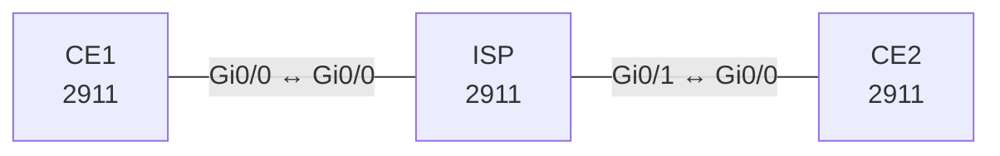

# Lab 14 – GRE, IPsec und VTI

**Dauer:** 90 min · **Niveau:** mittel bis schwer

Standortvernetzung über ein unsicheres Transportnetz: GRE-Tunnel, OSPF darüber, IPsec Tunnel Protection (IKEv1), anschließend IKEv2 und VTI. Dazu MTU/MSS und das typische Rekursiv-Routing-Problem.

**Lernziele:** Nach diesem Lab kannst du …

- Einen GRE-Tunnel mit IPsec schützen und OSPF darüber laufen lassen.
- IKE Phase 1 und Phase 2 an ihren Zuständen unterscheiden.
- Rekursives Routing über den eigenen Tunnel erkennen und vermeiden.

| ENCOR-Ziel (`Ziel::…`) | Thema |
|---|---|
| 2.2.b | GRE und IPsec |

**So arbeitest du:** Teil A = Bauen, Teil B = Reparieren, Teil C = Üben. Die Konfigurationsdateien liegen in `build/` (Ausgangszustand zum Einfügen in die CLI), `repair/` (fertig gebaut, mit Fehlern) und `solutions/` (Musterlösung und Fehlerliste, erst nach eigenem Versuch öffnen). Anleitung zum Einfügen: siehe [Arbeiten mit den Dateien](../README.md#arbeiten-mit-den-dateien).

## Topologie



**Entwurfsskizze (aus dem CML-Lab; Portnamen der Switches siehe Verkabelungstabelle):**

```
 LAN1 ── CE1 ─────── ISP ─────── CE2 ── LAN2
 192.168.1.0/24  198.51.100.1/30 .2 | .2  203.0.113.1/30  192.168.2.0/24
        Tunnel0 (GRE, 172.16.0.0/30)  CE1 .1 / CE2 .2   Tunnel1 (VTI, 172.16.1.0/30)
```

### Geräte

| Gerät | Modell in Packet Tracer | Rolle |
|---|---|---|
| CE1 | 2911 | Router |
| ISP | 2911 | Router |
| CE2 | 2911 | Router |

### Verkabelung

| Von | Port | Nach | Port | Kabel |
|---|---|---|---|---|
| CE1 | Gi0/0 | ISP | Gi0/0 | Copper Cross-Over |
| ISP | Gi0/1 | CE2 | Gi0/0 | Copper Cross-Over |

### Adressplan (Ausgangszustand)

| Gerät | Interface | Adresse | Maske | Gateway | DNS |
|---|---|---|---|---|---|
| CE1 | Loopback0 | 1.1.1.1 | 255.255.255.255 | | |
| CE1 | Loopback100 | 192.168.1.1 | 255.255.255.0 | | |
| CE1 | Gi0/0 | 198.51.100.1 | 255.255.255.252 | | |
| CE1 | Tunnel0 | 172.16.0.1 | 255.255.255.252 | | |
| ISP | Loopback0 | 8.8.8.8 | 255.255.255.255 | | |
| ISP | Gi0/0 | 198.51.100.2 | 255.255.255.252 | | |
| ISP | Gi0/1 | 203.0.113.2 | 255.255.255.252 | | |
| CE2 | Loopback0 | 2.2.2.2 | 255.255.255.255 | | |
| CE2 | Loopback100 | 192.168.2.1 | 255.255.255.0 | | |
| CE2 | Gi0/0 | 203.0.113.1 | 255.255.255.252 | | |
| CE2 | Tunnel0 | 172.16.0.2 | 255.255.255.252 | | |

| Gerät | Interface | Adresse |
|---|---|---|
| CE1 | Gi0/0 / Lo0 / Lo100 (LAN1) | 198.51.100.1/30 / 1.1.1.1/32 / 192.168.1.1/24 |
| ISP | Gi0/0 / Gi0/1 / Lo0 | 198.51.100.2/30 / 203.0.113.2/30 / 8.8.8.8/32 |
| CE2 | Gi0/0 / Lo0 / Lo100 (LAN2) | 203.0.113.1/30 / 2.2.2.2/32 / 192.168.2.1/24 |

CE1/CE2 haben je eine Default-Route zum ISP. Der ISP kennt nur die zwei Transfernetze.
> **Packet-Tracer-Hinweis:** **Eignung: teilweise.** Stand Packet Tracer 8.x: IPsec mit Crypto-Map: eingeschränkt. Braucht `securityk9`-Lizenz am 2911 (`license boot module c2900 technology-package securityk9`). IPsec-VTI (Tunnel Protection): nicht vorhanden. VTI/Profile gibt es nicht; stattdessen Crypto-Map (siehe Lab 14/25 im CCNA-Paket). Akzeptiert PT einen Befehl nicht, ist das ein PT-Limit und kein Fehler von dir; solche Schritte machst du in CML oder EVE-NG.

## Teil A – Bauen

1. **Underlay.** `ping 203.0.113.1 source Gi0/0` von CE1: ok. Ping Lo100 ↔ Lo100: erfolglos. Warum? (Private LAN-Netze kennt der ISP nicht.)
2. **GRE-Tunnel.** `Tunnel0` mit Quelle Gi0/0, Ziel Gegenstelle, IP 172.16.0.1/.2 (/30). Prüfe `show interfaces tunnel0`: Tunnelprotokoll, Keepalive, Header-Overhead (GRE 24 Byte), Tunnel-MTU 1476. Was ist GRE (IP-Protokoll 47) und was kann es nicht (Verschlüsselung, Authentifizierung)?
3. **Routing über den Tunnel.** OSPF 1 auf Tunnel0 und den LAN-Loopbacks (Area 0, `ip ospf network point-to-point` auf dem Tunnel). LAN1 ↔ LAN2 muss pingen. Prüfe `show ip route 192.168.2.0` (Next-Hop über Tunnel0).
4. **Rekursiv-Routing-Falle.** Kündige testweise das Transfernetz (203.0.113.0/30) in OSPF an und beobachte `%TUN-5-RECURDOWN`: Der Tunnelzielpfad führt plötzlich über den Tunnel. Wie verhinderst du das (Netze nicht in den Overlay-IGP, Tunnel-VRF, Filter)?
5. **IPsec auf GRE (IKEv1).** ISAKMP-Policy (AES-256, SHA-256, DH 14, Pre-Shared Key), Transform-Set `esp-aes 256 esp-sha256-hmac` im **Transport-Mode**, `crypto ipsec profile`, `tunnel protection ipsec profile` auf Tunnel0. Prüfe `show crypto isakmp sa` (QM_IDLE), `show crypto ipsec sa` (encaps/decaps steigen). Warum Transport-Mode bei GRE (die GRE-Header sind schon der äußere IP-Header)?
6. **MTU/MSS.** Setze `ip mtu 1400` und `ip tcp adjust-mss 1360` auf dem Tunnel. Rechne den Overhead (IP 20 + GRE 4 + ESP ≈ 50–60) nach. Warum bricht sonst große TCP-Übertragung ab (Black-Hole bei DF-Bit/ICMP)?
7. **IKEv2 und VTI.** Baue `Tunnel1` als IPsec-VTI: `tunnel mode ipsec ipv4`, IKEv2 Proposal/Policy/Keyring/Profile, Transform-Set im **Tunnel-Mode**. Vergleiche mit GRE-over-IPsec (Multicast/Routing-Protokolle ohne GRE: VTI trägt nur IP-Unicast, aber dank IP-Tunnel auch IGP).
8. **IKEv1 vs. IKEv2.** Phase 1/2 vs. IKE_SA_INIT/IKE_AUTH, Main-/Aggressive-Mode, Authentifizierung, Resilienz (DPD, MOBIKE), Sicherheit, Standard (RFC 7296).

## Teil B – Reparieren

Baue die Topologie wie oben (oder behalte deine aus Teil A), setze alle Geräte zurück (`erase startup-config`, `reload` bzw. neues Gerät) und füge dann die Dateien aus `repair/` ein. Es stecken **5 Fehler** drin. Behandle jede Meldung als Ticket: erst Symptom nachstellen, dann Layer für Layer eingrenzen, beheben und beweisen. Ändere nur, was kaputt ist.

**Ticket 1:** Tunnel0 ist up/up, aber OSPF-Nachbar bleibt aus. `show crypto isakmp sa` zeigt MM_NO_STATE bzw. nichts.

**Ticket 2:** `QM_IDLE` steht, aber `encaps` steigt ohne `decaps` auf der Gegenseite; OSPF fällt aus.

**Ticket 3:** Tunnel0 zeigt up/up (Keepalive nicht aktiv), aber nichts kommt an; `show crypto isakmp sa` bleibt leer.

**Ticket 4:** Tunnel und IPsec stehen, aber OSPF-Nachbarschaft fehlt, LANs sind nicht erreichbar.

**Ticket 5:** Tunnel flappt zyklisch, das Log zeigt `%TUN-5-RECURDOWN` (Tunnel Interface is Down, recursive routing).

## Verifikation

```
show interfaces tunnel0
show crypto isakmp sa            show crypto ikev2 sa
show crypto ipsec sa | include encaps|decaps
show ip ospf neighbor
show ip route 192.168.2.0
ping 192.168.2.1 source Loopback100 size 1400 df-bit
```
Erwartet: OSPF-Nachbar FULL über Tunnel0, `QM_IDLE`, wachsende `encaps/decaps`, Ping mit 1400 Byte ohne Fragmentierung.

## Teil C – Üben

Beantworte zuerst selbst, dann klappe die Antwort auf.

1. `show crypto isakmp sa` zeigt `MM_NO_STATE`. Was heißt das?
<details><summary>Antwort</summary>

**Phase 1 kommt nicht zustande.** Mögliche Gründe: Die Gegenstelle ist nicht erreichbar, die ISAKMP-Policies passen nicht (Verschlüsselung, Hash, DH-Gruppe, Authentisierung) oder der Pre-Shared Key ist verschieden.

</details>

2. Phase 1 steht (`QM_IDLE`), aber keine Daten. Was prüfst du?
<details><summary>Antwort</summary>

**Phase 2.** Passen die Transform-Sets und der Modus (Tunnel oder Transport)? Stimmt das Profil oder die Crypto-ACL? Steigt auf einer Seite `encaps`, auf der anderen aber kein `decaps`, kommt der Verkehr nicht an: ESP blockiert oder Rückrichtung prüfen.

</details>

3. Warum fließt ohne GRE kein OSPF durch klassisches Crypto-Map-IPsec?
<details><summary>Antwort</summary>

**Weil klassisches IPsec mit Crypto-Map nur Unicast transportiert.** OSPF nutzt Multicast. GRE oder ein VTI schafft ein Interface, über das auch Multicast laufen kann.

</details>

## Prüfungsbezug

GRE = IP-Protokoll 47. IPsec: ESP = 50, AH = 51, IKE = UDP 500 (NAT-T 4500). Transport-Mode schützt nur Payload, Tunnel-Mode kapselt das ganze Paket. VTI ist routbar, Crypto-Map nicht. IKEv1: Phase 1 (ISAKMP SA), Phase 2 (IPsec SA).

## Lösungen

- `solutions/<Gerät>.cfg`: Konfiguration zu Teil A (ohne Basis-Adressen)
- `solutions/FAULTS.md`: Fehlerliste zu Teil B (Spoiler!)
