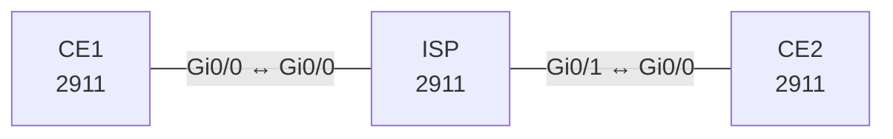

# Lab 14 – GRE, IPsec und VTI

**Dauer:** 90 min · **Niveau:** mittel bis schwer

Standortvernetzung über ein unsicheres Transportnetz: GRE-Tunnel, OSPF darüber, IPsec Tunnel Protection (IKEv1), anschließend IKEv2 und VTI. Dazu MTU/MSS und das typische Rekursiv-Routing-Problem.

**Lernziele:** Nach diesem Lab kannst du …

- Einen GRE-Tunnel mit IPsec schützen und OSPF darüber laufen lassen.
- IKE Phase 1 und Phase 2 an ihren Zuständen unterscheiden.
- Rekursives Routing über den eigenen Tunnel erkennen und vermeiden.

| ENCOR-Ziel (`Ziel::…`) | Thema |
|---|---|
| 2.2.b | GRE und IPsec |

**So arbeitest du:** Teil A = Bauen, Teil B = Reparieren, Teil C = Üben. Die Konfigurationsdateien liegen in `build/` (Ausgangszustand zum Einfügen in die CLI), `repair/` (fertig gebaut, mit Fehlern) und `solutions/` (Musterlösung und Fehlerliste, erst nach eigenem Versuch öffnen). Anleitung zum Einfügen: siehe [Arbeiten mit den Dateien](../README.md#arbeiten-mit-den-dateien).

## Topologie



**Entwurfsskizze (aus dem CML-Lab; Portnamen der Switches siehe Verkabelungstabelle):**

```
 LAN1 ── CE1 ─────── ISP ─────── CE2 ── LAN2
 192.168.1.0/24  198.51.100.1/30 .2 | .2  203.0.113.1/30  192.168.2.0/24
        Tunnel0 (GRE, 172.16.0.0/30)  CE1 .1 / CE2 .2   Tunnel1 (VTI, 172.16.1.0/30)
```

### Geräte

| Gerät | Modell in Packet Tracer | Rolle |
|---|---|---|
| CE1 | 2911 | Router |
| ISP | 2911 | Router |
| CE2 | 2911 | Router |

### Verkabelung

| Von | Port | Nach | Port | Kabel |
|---|---|---|---|---|
| CE1 | Gi0/0 | ISP | Gi0/0 | Copper Cross-Over |
| ISP | Gi0/1 | CE2 | Gi0/0 | Copper Cross-Over |

### Adressplan (Ausgangszustand)

| Gerät | Interface | Adresse | Maske | Gateway | DNS |
|---|---|---|---|---|---|
| CE1 | Loopback0 | 1.1.1.1 | 255.255.255.255 | | |
| CE1 | Loopback100 | 192.168.1.1 | 255.255.255.0 | | |
| CE1 | Gi0/0 | 198.51.100.1 | 255.255.255.252 | | |
| CE1 | Tunnel0 | 172.16.0.1 | 255.255.255.252 | | |
| ISP | Loopback0 | 8.8.8.8 | 255.255.255.255 | | |
| ISP | Gi0/0 | 198.51.100.2 | 255.255.255.252 | | |
| ISP | Gi0/1 | 203.0.113.2 | 255.255.255.252 | | |
| CE2 | Loopback0 | 2.2.2.2 | 255.255.255.255 | | |
| CE2 | Loopback100 | 192.168.2.1 | 255.255.255.0 | | |
| CE2 | Gi0/0 | 203.0.113.1 | 255.255.255.252 | | |
| CE2 | Tunnel0 | 172.16.0.2 | 255.255.255.252 | | |

| Gerät | Interface | Adresse |
|---|---|---|
| CE1 | Gi0/0 / Lo0 / Lo100 (LAN1) | 198.51.100.1/30 / 1.1.1.1/32 / 192.168.1.1/24 |
| ISP | Gi0/0 / Gi0/1 / Lo0 | 198.51.100.2/30 / 203.0.113.2/30 / 8.8.8.8/32 |
| CE2 | Gi0/0 / Lo0 / Lo100 (LAN2) | 203.0.113.1/30 / 2.2.2.2/32 / 192.168.2.1/24 |

CE1/CE2 haben je eine Default-Route zum ISP. Der ISP kennt nur die zwei Transfernetze.
> **Packet-Tracer-Hinweis:** **Eignung: teilweise.** Stand Packet Tracer 8.x: IPsec mit Crypto-Map: eingeschränkt. Braucht `securityk9`-Lizenz am 2911 (`license boot module c2900 technology-package securityk9`). IPsec-VTI (Tunnel Protection): nicht vorhanden. VTI/Profile gibt es nicht; stattdessen Crypto-Map (siehe Lab 14/25 im CCNA-Paket). Akzeptiert PT einen Befehl nicht, ist das ein PT-Limit und kein Fehler von dir; solche Schritte machst du in CML oder EVE-NG.

## Teil A – Bauen
Arbeite die Schritte der Reihe nach ab. Jeder Schritt sagt dir, was du tust, woran du den Erfolg erkennst (**Prüfen**) und worüber du nachdenken sollst (**Denkfrage**). Die Antworten auf die Denkfragen stehen am Ende von Teil A.

1. **Underlay prüfen.** Pinge auf CE1 `ping 203.0.113.1 source Gi0/0`, danach `ping 192.168.2.1 source Loopback100`.
   - **Prüfen:** Der erste Ping klappt, der zweite nicht.
   - **Denkfrage:** Warum scheitert der zweite Ping?
2. **GRE-Tunnel bauen.** Lege auf beiden Seiten `interface Tunnel0` an: Quelle Gi0/0, Ziel die Gi0/0-Adresse der Gegenseite, IP 172.16.0.1/30 bzw. .2/30.
   - **Prüfen:** `show interfaces Tunnel0` zeigt up/up, „Tunnel protocol/transport GRE/IP“ und eine Tunnel-MTU von 1476. Ein Ping auf 172.16.0.2 klappt.
   - **Denkfrage:** Woher kommen die 1476 Byte, und was kann GRE nicht?
3. **Routing über den Tunnel.** Starte OSPF 1 in Area 0 auf Tunnel0 und auf Lo100. Setze am Tunnel `ip ospf network point-to-point`.
   - **Prüfen:** `show ip route 192.168.2.0` auf CE1 zeigt Tunnel0 als Ausgang. Der Ping von Lo100 zu Lo100 klappt jetzt.
4. **Die Falle mit rekursivem Routing.** Nimm testweise das Transfernetz 203.0.113.0/30 auf CE2 in OSPF auf.
   - **Prüfen:** Nach kurzer Zeit meldet das Log `%TUN-5-RECURDOWN`, der Tunnel geht down und wieder up. Nimm das Netz danach wieder heraus.
   - **Denkfrage:** Was passiert hier genau, und wie verhinderst du es dauerhaft?
5. **IPsec über GRE (IKEv1).** Lege an: eine ISAKMP-Policy mit AES-256, SHA-256, DH-Gruppe 14 und Pre-Shared Key, ein Transform-Set `esp-aes 256 esp-sha256-hmac` mit `mode transport`, ein `crypto ipsec profile` und `tunnel protection ipsec profile …` an Tunnel0.
   - **Prüfen:** `show crypto isakmp sa` zeigt QM_IDLE. Bei einem Ping steigen in `show crypto ipsec sa` die Zähler encaps und decaps.
   - **Denkfrage:** Warum reicht hier der Transport-Mode?
6. **MTU und MSS.** Setze an Tunnel0 `ip mtu 1400` und `ip tcp adjust-mss 1360`.
   - **Prüfen:** `ping 192.168.2.1 source Loopback100 size 1400 df-bit` klappt, mit `size 1450` nicht.
   - **Denkfrage:** Wie viel Overhead kommt durch GRE und ESP dazu? Was passiert ohne diese Einstellungen bei großen TCP-Übertragungen?
7. **IKEv2 mit VTI.** Baue zusätzlich `Tunnel1` als reines IPsec-Interface: `tunnel mode ipsec ipv4`, dazu IKEv2 Proposal, Policy, Keyring und Profile und ein Transform-Set im Tunnel-Mode. Adressen 172.16.1.1/.2.
   - **Prüfen:** `show crypto ikev2 sa` zeigt den Status READY. Ein Ping über 172.16.1.2 klappt.
   - **Denkfrage:** Was unterscheidet einen VTI von GRE über IPsec?
8. **IKEv1 und IKEv2 vergleichen.**
   - **Denkfrage:** Wie laufen die beiden Versionen ab, und warum ist IKEv2 heute der Standard?

<details><summary>Antworten zu den Denkfragen</summary>

- **Zu 1:** Der ISP kennt nur die beiden Transfernetze, nicht die privaten LANs. Das Paket an 192.168.2.1 geht per Default-Route zum ISP, und der hat keine Route dafür.
- **Zu 2:** 1500 − 20 Byte neuer IP-Header − 4 Byte GRE-Header = 1476 Byte. GRE verpackt nur. Es verschlüsselt nichts und prüft weder Herkunft noch Unverfälschtheit.
- **Zu 4:** CE1 lernt das Transfernetz von CE2 jetzt per OSPF über den Tunnel. Die Route zum Tunnelziel zeigt dann in den Tunnel selbst. Der Tunnel kann sich so nicht tragen und geht down. Danach verschwindet die OSPF-Route, der Tunnel kommt hoch, und das Spiel beginnt von vorn. Dauerhaft verhinderst du das, indem Transfernetze nie ins Overlay-Routing kommen, oder per Filter bzw. eigener VRF für das Underlay.
- **Zu 5:** GRE hat das Paket schon mit einem neuen äußeren IP-Header versehen. Der Tunnel-Mode würde noch einen weiteren IP-Header davorsetzen, also 20 Byte mehr ohne Nutzen.
- **Zu 6:** GRE kostet 24 Byte (IP 20 + GRE 4), ESP je nach Algorithmus und Auffüllung etwa 30 bis 60 Byte. 1400 lässt genug Reserve. MSS 1360 = 1400 − 20 Byte IP − 20 Byte TCP. Ohne diese Werte sind große Pakete mit gesetztem DF-Bit zu groß. Wird die ICMP-Meldung „Fragmentation needed“ unterwegs blockiert, verschwinden sie spurlos: Kleine Pings gehen, große Übertragungen hängen.
- **Zu 7:** Ein VTI ist ein IPsec-Tunnel ohne GRE-Header, er spart also 4 Byte. Er ist ein normales Interface, über das man routen kann. Auch OSPF läuft darüber. Er trägt aber nur IP. GRE kann zusätzlich andere Protokolle verpacken.
- **Zu 8:** IKEv1 braucht Phase 1 (Main Mode mit 6 Nachrichten oder Aggressive Mode mit 3) und Phase 2 (Quick Mode). IKEv2 erledigt beides mit 4 Nachrichten (IKE_SA_INIT und IKE_AUTH). Dazu bringt IKEv2 Dead Peer Detection, NAT-Traversal, EAP und MOBIKE schon mit (RFC 7296).

</details>

## Teil B – Reparieren

Baue die Topologie wie oben (oder behalte deine aus Teil A), setze alle Geräte zurück (`erase startup-config`, `reload` bzw. neues Gerät) und füge dann die Dateien aus `repair/` ein. Es stecken **5 Fehler** drin. Behandle jede Meldung als Ticket: erst Symptom nachstellen, dann Layer für Layer eingrenzen, beheben und beweisen. Ändere nur, was kaputt ist.

**Ticket 1:** Tunnel0 ist up/up, aber OSPF-Nachbar bleibt aus. `show crypto isakmp sa` zeigt MM_NO_STATE bzw. nichts.

**Ticket 2:** `QM_IDLE` steht, aber `encaps` steigt ohne `decaps` auf der Gegenseite; OSPF fällt aus.

**Ticket 3:** Tunnel0 zeigt up/up (Keepalive nicht aktiv), aber nichts kommt an; `show crypto isakmp sa` bleibt leer.

**Ticket 4:** Tunnel und IPsec stehen, aber OSPF-Nachbarschaft fehlt, LANs sind nicht erreichbar.

**Ticket 5:** Tunnel flappt zyklisch, das Log zeigt `%TUN-5-RECURDOWN` (Tunnel Interface is Down, recursive routing).

## Verifikation
```
show interfaces tunnel0
show crypto isakmp sa            show crypto ikev2 sa
show crypto ipsec sa | include encaps|decaps
show ip ospf neighbor
show ip route 192.168.2.0
ping 192.168.2.1 source Loopback100 size 1400 df-bit
```

| Befehl | Das solltest du sehen |
|---|---|
| `show ip ospf neighbor` | CE2 im Zustand FULL über Tunnel0 |
| `show crypto isakmp sa` | QM_IDLE |
| `show crypto ipsec sa` | encaps und decaps steigen bei jedem Ping |
| Ping mit 1400 Byte und DF-Bit | erfolgreich, ohne Fragmentierung |

## Teil C – Üben

Beantworte zuerst selbst, dann klappe die Antwort auf.

1. `show crypto isakmp sa` zeigt `MM_NO_STATE`. Was heißt das?
<details><summary>Antwort</summary>

**Phase 1 kommt nicht zustande.** Mögliche Gründe: Die Gegenstelle ist nicht erreichbar, die ISAKMP-Policies passen nicht (Verschlüsselung, Hash, DH-Gruppe, Authentisierung) oder der Pre-Shared Key ist verschieden.

</details>

2. Phase 1 steht (`QM_IDLE`), aber keine Daten. Was prüfst du?
<details><summary>Antwort</summary>

**Phase 2.** Passen die Transform-Sets und der Modus (Tunnel oder Transport)? Stimmt das Profil oder die Crypto-ACL? Steigt auf einer Seite `encaps`, auf der anderen aber kein `decaps`, kommt der Verkehr nicht an: ESP blockiert oder Rückrichtung prüfen.

</details>

3. Warum fließt ohne GRE kein OSPF durch klassisches Crypto-Map-IPsec?
<details><summary>Antwort</summary>

**Weil klassisches IPsec mit Crypto-Map nur Unicast transportiert.** OSPF nutzt Multicast. GRE oder ein VTI schafft ein Interface, über das auch Multicast laufen kann.

</details>

## Prüfungsbezug
- GRE = IP-Protokoll 47, ESP = 50, AH = 51, IKE = UDP 500, NAT-T = UDP 4500.
- Transport-Mode schützt nur die Nutzlast, Tunnel-Mode verpackt das ganze Paket neu.
- Ein VTI ist ein routbares Interface, eine Crypto Map nicht.
- IKEv1: Phase 1 baut die ISAKMP-SA, Phase 2 die IPsec-SA.

## Lösungen

- `solutions/<Gerät>.cfg`: Konfiguration zu Teil A (ohne Basis-Adressen)
- `solutions/FAULTS.md`: Fehlerliste zu Teil B (Spoiler!)
