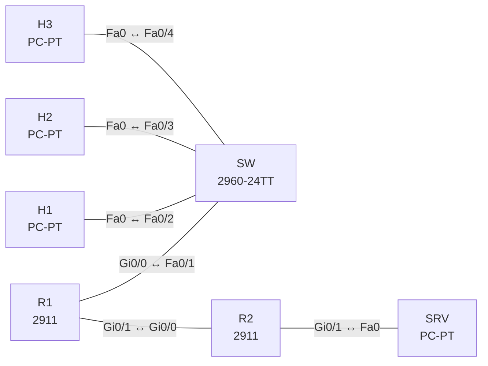

# Lab 17 – QoS mit MQC: Markieren, Policing, Shaping, LLQ

**Dauer:** 90 min · **Niveau:** mittel bis schwer

Branch-Router mit schmaler WAN-Strecke (2 Mbit/s): Klassifizieren und Markieren am Rand, Hierarchical Shaping mit Child-Queueing (LLQ/CBWFQ) am WAN-Ausgang, Policing auf dem Gast-Netz und WRED. Verkehr erzeugst du mit Pings und DSCP-Werten (`tos`).

| ENCOR-Ziel (`Ziel::…`) | Thema |
|---|---|
| 1.4 | QoS-Konfigurationen |

**So arbeitest du:** Teil A = Bauen, Teil B = Reparieren, Teil C = Üben. Die Konfigurationsdateien liegen in `build/` (Ausgangszustand zum Einfügen in die CLI), `repair/` (fertig gebaut, mit Fehlern) und `solutions/` (Musterlösung und Fehlerliste, erst nach eigenem Versuch öffnen). Anleitung zum Einfügen: siehe [Arbeiten mit den Dateien](../README.md#arbeiten-mit-den-dateien).

## Topologie



**Entwurfsskizze (aus dem CML-Lab; Portnamen der Switches siehe Verkabelungstabelle):**

```
 H1 (Voice) ─┐
 H2 (Video) ─┼─ SW ── R1 ═══ WAN (shaped 2 Mbit/s) ═══ R2 ── SRV
 H3 (Gast)  ─┘      Gi0/0    Gi0/1                       Gi0/0
```

### Geräte

| Gerät | Modell in Packet Tracer | Rolle |
|---|---|---|
| SW | 2960-24TT | Switch (im CML-Lab unmanaged; ohne Konfiguration) |
| H1 | PC-PT | Host |
| H2 | PC-PT | Host |
| H3 | PC-PT | Host |
| R1 | 2911 | Router |
| R2 | 2911 | Router |
| SRV | PC-PT | Host |

### Verkabelung

| Von | Port | Nach | Port | Kabel |
|---|---|---|---|---|
| R1 | Gi0/0 | SW | Fa0/1 | Copper Straight-Through |
| H1 | Fa0 | SW | Fa0/2 | Copper Straight-Through |
| H2 | Fa0 | SW | Fa0/3 | Copper Straight-Through |
| H3 | Fa0 | SW | Fa0/4 | Copper Straight-Through |
| R1 | Gi0/1 | R2 | Gi0/0 | Copper Cross-Over |
| R2 | Gi0/1 | SRV | Fa0 | Copper Cross-Over |

### Adressplan (Ausgangszustand)

| Gerät | Interface | Adresse | Maske | Gateway | DNS |
|---|---|---|---|---|---|
| H1 | Fa0 (GUI) | 192.168.10.11 | 255.255.255.0 | 192.168.10.1 |  |
| H2 | Fa0 (GUI) | 192.168.10.12 | 255.255.255.0 | 192.168.10.1 |  |
| H3 | Fa0 (GUI) | 192.168.10.13 | 255.255.255.0 | 192.168.10.1 |  |
| R1 | Gi0/0 | 192.168.10.1 | 255.255.255.0 | | |
| R1 | Gi0/1 | 10.0.12.1 | 255.255.255.252 | | |
| R2 | Gi0/0 | 10.0.12.2 | 255.255.255.252 | | |
| R2 | Gi0/1 | 10.0.20.1 | 255.255.255.0 | | |
| SRV | Fa0 (GUI) | 10.0.20.10 | 255.255.255.0 | 10.0.20.1 |  |

| Link | Netz |
|---|---|
| LAN | 192.168.10.0/24 (R1 .1, H1 .11, H2 .12, H3 .13) |
| R1 Gi0/1 – R2 Gi0/0 | 10.0.12.0/30 (R1 .1, R2 .2) |
| R2 Gi0/1 – SRV | 10.0.20.0/24 (R2 .1, SRV .10) |

Statische Routen sind vorhanden. Ping-Quellen: H1 Ping mit `tos 184` (EF, DSCP 46), H2 mit `tos 136` (AF41), H3 ohne Markierung.

### Portzuordnung der Switches (CML → Packet Tracer)

Die Aufgabentexte nennen Switch-Ports in der CML-Schreibweise (`Gi…`). Verkabelung, Konfigurationen und Fehlerlisten verwenden die Packet-Tracer-Ports. Umrechnung: `GiX/Y` → `Fa0/(X·4+Y+1)`.

| Switch | CML-Port | PT-Port |
|---|---|---|
| SW | Gi0/0 | Fa0/1 |
| SW | Gi0/1 | Fa0/2 |
| SW | Gi0/2 | Fa0/3 |
| SW | Gi0/3 | Fa0/4 |

> **Packet-Tracer-Hinweis:** **Eignung: teilweise.** Nach meinem Kenntnisstand zu Packet Tracer 8.x gilt: QoS (MQC): eingeschränkt. Klassen und Richtlinien lassen sich anlegen, `police`/`shape`/`priority` je nach Gerät nur teilweise; Messwerte nicht aussagekräftig. Akzeptiert PT einen Befehl nicht, ist das ein PT-Limit und kein Fehler von dir; solche Schritte machst du in CML oder EVE-NG. Die CML-Switches (Gi-Ports) sind hier 3560-24PS bzw. 2960 mit FastEthernet-Ports: Die Portzuordnung steht unter dem Adressplan; die Aufgabentexte nennen noch die CML-Ports.

## Teil A – Bauen

1. **Trust Boundary.** Entscheide, welchen Hosts du die Markierung glaubst. H1 und H2 sind vertrauenswürdig (DSCP bleibt), H3 (Gast) wird auf DSCP 0 umgeschrieben. Baue am LAN-Interface (Gi0/0, input) `policy-map MARK`: `class-map` per ACL für H3 → `set dscp default`.
2. **Klassen.** `class-map match-any VOICE` (`match dscp ef`), `VIDEO` (`match dscp af41`), `CRIT` (`match dscp af31`). Warum `match-any`, wenn mehrere Kriterien alternativ gelten (und was macht `match-all` bei zwei sich ausschließenden DSCP-Werten)?
3. **Child-Policy (Queueing).** `policy-map QUEUE`: VOICE `priority percent 20` (LLQ, impliziter Policer), VIDEO `bandwidth percent 30`, CRIT `bandwidth percent 25`, `class class-default` `fair-queue` mit `random-detect dscp-based`. Wie wirkt LLQ gegenüber CBWFQ (strikte Priorität, aber begrenzt)?
4. **Parent-Shaper.** `policy-map WAN`: `class class-default` → `shape average 2000000` (2 Mbit/s!) und `service-policy QUEUE`. Wende an: `interface Gi0/1` → `service-policy output WAN`. Warum muss man shapen, wenn die physische Schnittstelle schneller ist als der gebuchte Provider-Rate?
5. **Policing Gast.** Am LAN-Interface zusätzlich H3-Verkehr mit `police rate 256000 bps conform-action transmit exceed-action drop` begrenzen. Unterschied Policing (verwerfen/remarken, kein Puffer) und Shaping (puffern, glätten).
6. **Testen.** Von H1, H2, H3 Pings (`repeat 1000 size 1200`) mit den DSCP-Werten Richtung SRV, gleichzeitig. Lies `show policy-map interface Gi0/1`: Pakete pro Klasse, Drops, Queue-Tiefe. Wann tritt Verlust in `class-default` vor dem in VIDEO auf?
7. **Konzepte.** Erkläre DiffServ-PHBs (EF, AF, CS, BE), DSCP/IP-Precedence/CoS, Tail Drop vs. WRED, Congestion Avoidance vs. Congestion Management, Trust-Modelle in Campus (Trust Boundary am Access-Port, `mls qos trust`/AutoQoS).

## Teil B – Reparieren

Baue die Topologie wie oben (oder behalte deine aus Teil A), setze alle Geräte zurück (`erase startup-config`, `reload` bzw. neues Gerät) und füge dann die Dateien aus `repair/` ein. Es stecken **4 Fehler** drin. Behandle jede Meldung als Ticket: erst Symptom nachstellen, dann Layer für Layer eingrenzen, beheben und beweisen. Ändere nur, was kaputt ist.

**Ticket 1:** Die Klasse VOICE bleibt in `show policy-map interface` bei null Paketen, obwohl H1 mit DSCP 46 sendet.

**Ticket 2:** Der WAN-Link wird überfüllt, Voice leidet, `show policy-map interface Gi0/1` zeigt keine Policy.

**Ticket 3:** Der Durchsatz Richtung SRV bricht auf einen winzigen Bruchteil ein, Pings dauern extrem lang.

**Ticket 4:** Der Gast (H3) wird als Voice klassifiziert und nimmt der echten Sprache die Priority-Queue weg.

## Verifikation

```
show policy-map interface GigabitEthernet0/1
show policy-map interface GigabitEthernet0/0
show class-map
show ip interface Gi0/1 | include service
```
Erwartet: Klasse VOICE zählt Pakete (DSCP 46), Priorität nie gedroppt, `class-default` droppt bei Überlast, Gast-Verkehr als `exceed` im Policer.

## Teil C – Üben

Beantworte zuerst selbst, dann klappe die Antwort auf.

1. Warum sind EF-Pakete in der LLQ trotzdem nicht unbegrenzt?
<details><summary>Antwort</summary>

Ein impliziter Policer begrenzt die Priority-Queue auf die konfigurierte Rate, sonst würde sie alle anderen Klassen aushungern.

</details>

2. `show policy-map interface` zeigt in der Klasse VIDEO null Pakete, obwohl Video läuft. Was prüfst du?
<details><summary>Antwort</summary>

Die Match-Bedingung (match-all vs. match-any, DSCP-Wert), ob der Verkehr vor dem Ausgang noch umgeschrieben wird, und ob die Policy an der richtigen Schnittstelle in der richtigen Richtung hängt.

</details>

3. Wann `police` statt `shape` für das Gästenetz?
<details><summary>Antwort</summary>

Wenn Überschuss ohne Puffer verworfen werden soll (Durchsetzung einer Obergrenze). Shaping würde Gast-Pakete puffern und Latenz hinzufügen.

</details>

## Prüfungsbezug

DSCP: EF = 46, AF41 = 34, AF31 = 26, CS3 = 24, BE = 0. Policing wirkt in/out, Shaping nur out. LLQ = `priority`, immer mit Policer. `bandwidth` summiert max. 75 % der Interface-Bandbreite (Default `max-reserved-bandwidth`). Queueing greift nur bei Überlast, auf Ethernet-Interfaces braucht man oft einen Shaper als Parent.

## Lösungen

- `solutions/<Gerät>.cfg`: Konfiguration zu Teil A (ohne Basis-Adressen)
- `solutions/FAULTS.md`: Fehlerliste zu Teil B (Spoiler!)
