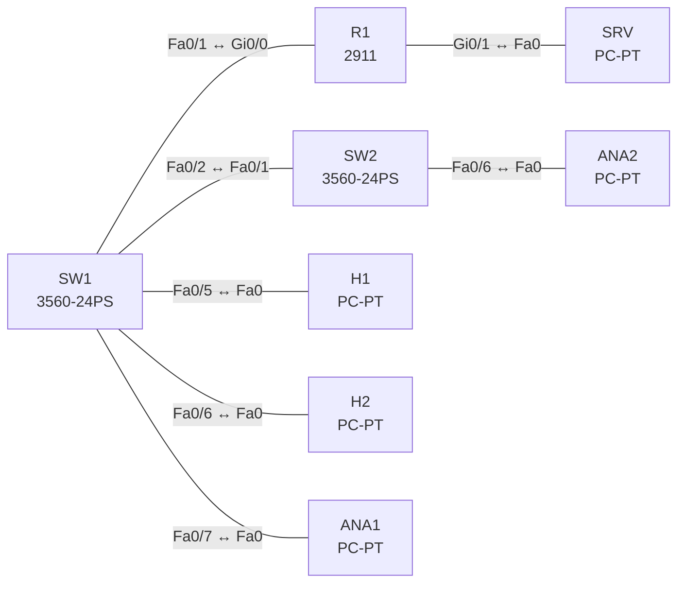

# Lab 18 – Flexible NetFlow, SPAN und RSPAN

**Dauer:** 75 min · **Niveau:** mittel

Verkehr sichtbar machen: Flexible NetFlow auf einem Router (Record, Exporter, Monitor), lokales SPAN und RSPAN über einen Trunk zwischen zwei Switches. ERSPAN wird als Konfigurationsübung ohne CML-Test behandelt.

**Lernziele:** Nach diesem Lab kannst du …

- Flexible NetFlow mit Record, Exporter und Monitor einrichten.
- Lokales SPAN und RSPAN aufbauen.
- Erklären, was NetFlow und SPAN zeigen und wo ihre Grenzen liegen.

| ENCOR-Ziel (`Ziel::…`) | Thema |
|---|---|
| 4.2 | Flexible NetFlow |
| 4.3 | SPAN, RSPAN und ERSPAN |

**So arbeitest du:** Teil A = Bauen, Teil B = Reparieren, Teil C = Üben. Die Konfigurationsdateien liegen in `build/` (Ausgangszustand zum Einfügen in die CLI), `repair/` (fertig gebaut, mit Fehlern) und `solutions/` (Musterlösung und Fehlerliste, erst nach eigenem Versuch öffnen). Anleitung zum Einfügen: siehe [Arbeiten mit den Dateien](../README.md#arbeiten-mit-den-dateien).

## Topologie



**Entwurfsskizze (aus dem CML-Lab; Portnamen der Switches siehe Verkabelungstabelle):**

```
 H1 ─┐                                        ┌─ ANA2 (RSPAN-Ziel)
     SW1 ── Gi0/0 ── R1 ── Gi0/1 ── SRV        SW2
 H2 ─┘      │ Gi0/1 ────────────────────────── Gi0/0
            └ Gi1/2 ── ANA1 (lokales SPAN-Ziel)
```

### Geräte

| Gerät | Modell in Packet Tracer | Rolle |
|---|---|---|
| SW1 | 3560-24PS | Switch |
| SW2 | 3560-24PS | Switch |
| R1 | 2911 | Router |
| H1 | PC-PT | Host |
| H2 | PC-PT | Host |
| SRV | PC-PT | Host |
| ANA1 | PC-PT | Host |
| ANA2 | PC-PT | Host |

### Verkabelung

| Von | Port | Nach | Port | Kabel |
|---|---|---|---|---|
| SW1 | Fa0/1 | R1 | Gi0/0 | Copper Straight-Through |
| R1 | Gi0/1 | SRV | Fa0 | Copper Cross-Over |
| SW1 | Fa0/2 | SW2 | Fa0/1 | Copper Cross-Over |
| SW1 | Fa0/5 | H1 | Fa0 | Copper Straight-Through |
| SW1 | Fa0/6 | H2 | Fa0 | Copper Straight-Through |
| SW1 | Fa0/7 | ANA1 | Fa0 | Copper Straight-Through |
| SW2 | Fa0/6 | ANA2 | Fa0 | Copper Straight-Through |

### Adressplan (Ausgangszustand)

| Gerät | Interface | Adresse | Maske | Gateway | DNS |
|---|---|---|---|---|---|
| R1 | Gi0/0 | 10.10.10.1 | 255.255.255.0 | | |
| R1 | Gi0/1 | 10.20.20.1 | 255.255.255.0 | | |
| H1 | Fa0 (GUI) | 10.10.10.11 | 255.255.255.0 | 10.10.10.1 |  |
| H2 | Fa0 (GUI) | 10.10.10.12 | 255.255.255.0 | 10.10.10.1 |  |
| SRV | Fa0 (GUI) | 10.20.20.10 | 255.255.255.0 | 10.20.20.1 |  |
| ANA1 | Fa0 (GUI) | 10.10.10.21 | 255.255.255.0 | 10.10.10.1 |  |
| ANA2 | Fa0 (GUI) | 10.10.10.22 | 255.255.255.0 | 10.10.10.1 |  |

| Gerät | Interface | Adresse |
|---|---|---|
| R1 | Gi0/0 / Gi0/1 | 10.10.10.1/24 / 10.20.20.1/24 |
| H1 / H2 | Gi0/0 | 10.10.10.11 / 10.10.10.12 |
| SRV | Gi0/0 | 10.20.20.10 |
| ANA1 / ANA2 | Gi0/0 | Sniffer-Hosts (passiv) |

SW1 Port-Belegung: Fa0/1 → R1 (Access VLAN 10), Fa0/2 → SW2 (Trunk), Fa0/5 → H1, Fa0/6 → H2, Fa0/7 → ANA1. SW2: Fa0/1 → SW1 (Trunk), Fa0/6 → ANA2.

### Portzuordnung der Switches (CML → Packet Tracer)

Aufgaben, Verkabelung, Konfigurationen und Fehlerlisten verwenden die Packet-Tracer-Ports. Die Tabelle zeigt, welcher Port der CML-Vorlage dazu gehört. Nur die Skizze nennt noch die CML-Ports. Umrechnung: `GiX/Y` → `Fa0/(X·4+Y+1)`.

| Switch | CML-Port | PT-Port |
|---|---|---|
| SW1 | Gi0/0 | Fa0/1 |
| SW1 | Gi0/1 | Fa0/2 |
| SW1 | Gi1/0 | Fa0/5 |
| SW1 | Gi1/1 | Fa0/6 |
| SW1 | Gi1/2 | Fa0/7 |
| SW2 | Gi0/0 | Fa0/1 |
| SW2 | Gi1/1 | Fa0/6 |

> **Packet-Tracer-Hinweis:** **Eignung: teilweise.** Stand Packet Tracer 8.x: Flexible NetFlow: nicht vorhanden. Nicht vorhanden. SPAN (lokal): eingeschränkt. Lokales SPAN auf Switches, Ausgabe weicht ab. RSPAN/ERSPAN: nicht vorhanden. Nicht vorhanden. Akzeptiert PT einen Befehl nicht, ist das ein PT-Limit und kein Fehler von dir; solche Schritte machst du in CML oder EVE-NG. Die CML-Switches (Gi-Ports) sind hier 3560-24PS bzw. 2960 mit FastEthernet-Ports: Die Portzuordnung steht unter dem Adressplan.

## Teil A – Bauen

**Teil 1 – Flexible NetFlow auf R1**

1. **Record.** `flow record REC`: `match ipv4 source address`, `match ipv4 destination address`, `match ipv4 protocol`, `match transport source-port`, `match transport destination-port`, `collect counter bytes`, `collect counter packets`. Was ist ein Flow (Key-Felder, Siebener-Tupel)?
2. **Exporter.** `flow exporter EXP`: `destination 10.20.20.10`, `transport udp 2055`, `source Gi0/1`, `export-protocol netflow-v9`. Wozu Templates in v9/IPFIX?
3. **Monitor und Anwendung.** `flow monitor MON` (record + exporter), `interface Gi0/0` → `ip flow monitor MON input` (und `output`). Erzeuge Traffic (Ping H1 → SRV, `telnet`) und lies `show flow monitor MON cache`.
4. **Vergleich.** Traditional NetFlow (`ip flow ingress`) vs. Flexible NetFlow (frei definierbare Records), NetFlow vs. sFlow (Sampling) vs. IPFIX (IETF).

**Teil 2 – Lokales SPAN**

5. Auf SW1 `monitor session 1 source interface Fa0/5 both`, `destination interface Fa0/7`. Prüfe `show monitor session 1`. Was passiert mit dem Ziel-Port (nimmt keinen normalen Verkehr mehr, kein STP)?

**Teil 3 – RSPAN**

6. VLAN 999 als `remote-span` auf **beiden** Switches, im Trunk erlaubt. SW1: `monitor session 2 source interface Fa0/6 both`, `destination remote vlan 999`. SW2: `monitor session 2 source remote vlan 999`, `destination interface Fa0/6`. Prüfe die Sicht auf ANA2.
7. **Konzept.** Vergleiche SPAN, RSPAN (Layer 2, ein VLAN), ERSPAN (GRE, geroutet). Gib die ERSPAN-Konfiguration (IOS-XE) an: `monitor session 3 type erspan-source / source interface Gi1 both / destination / erspan-id 10 / ip address 10.1.1.1 / origin ip address 10.1.1.2`.

## Teil B – Reparieren

Baue die Topologie wie oben (oder behalte deine aus Teil A), setze alle Geräte zurück (`erase startup-config`, `reload` bzw. neues Gerät) und füge dann die Dateien aus `repair/` ein. Es stecken **4 Fehler** drin. Behandle jede Meldung als Ticket: erst Symptom nachstellen, dann Layer für Layer eingrenzen, beheben und beweisen. Ändere nur, was kaputt ist.

**Ticket 1:** **[in PT nicht prüfbar: Flexible NetFlow]** `show flow monitor MON cache` ist leer, obwohl Verkehr läuft; der Exporter zählt keine Pakete.

**Ticket 2:** Im Flow-Cache stehen nur noch Einträge je Host-Paar und Protokoll, Anwendungen (Ports) lassen sich nicht unterscheiden.

**Ticket 3:** ANA2 sieht nichts vom RSPAN-Verkehr von H2, lokales SPAN auf SW1 funktioniert.

**Ticket 4:** ANA1 sieht H1-Verkehr nicht, `show monitor session 1` zeigt ein anderes Ziel.

## Verifikation

```
show flow monitor MON cache
show flow exporter EXP statistics
show monitor session all
show vlan remote-span
```
Erwartet: Cache mit Flows H1 → SRV, Exporter-Statistik zählt Flow-Records, ANA1 sieht H1-Verkehr, ANA2 sieht H2-Verkehr per RSPAN.

## Teil C – Üben

Beantworte zuerst selbst, dann klappe die Antwort auf.

1. Was sind Key-Felder und Non-Key-Felder in einem NetFlow-Record?
<details><summary>Antwort</summary>

**Key-Felder bestimmen, was ein Flow ist, Non-Key-Felder werden nur mitgezählt.** Key (`match`): z. B. Quell- und Ziel-IP, Protokoll, Ports. Pakete mit gleichen Key-Werten gehören zum selben Flow. Non-Key (`collect`): Bytes, Pakete, Zeitstempel, TCP-Flags.

</details>

2. RSPAN-Session steht, aber ANA2 sieht nichts. Typische Ursachen?
<details><summary>Antwort</summary>

**Das Remote-VLAN fehlt, ist nicht erlaubt oder die Sessions sind falsch.** Ist das VLAN als `remote-span` angelegt? Ist es auf allen Trunks dazwischen erlaubt? Hat der Ziel-Switch eine Session mit `source remote vlan`?

</details>

3. Warum kann man das Gerät bei hoher Last im SPAN-Betrieb falsch interpretieren?
<details><summary>Antwort</summary>

**Weil SPAN bei Überlast Pakete verliert und NetFlow nur Statistik liefert.** SPAN-Kopien haben niedrige Priorität. Wird es eng, verwirft der Switch sie. NetFlow zählt Flows, zeigt aber keine Paketinhalte. Merke: Fehlt etwas im Mitschnitt, fehlt es nicht unbedingt im echten Verkehr.

</details>

## Prüfungsbezug

Flow = Paketfolge mit gleichen Key-Feldern. Flexible NetFlow nutzt Record/Exporter/Monitor. NetFlow v9 und IPFIX sind template-basiert. SPAN: Quelle(Ports/VLANs), Ziel-Port; RSPAN über spezielles Remote-VLAN; ERSPAN kapselt per GRE zu einem IP-Ziel. Ein SPAN-Ziel-Port nimmt keinen normalen Verkehr entgegen.

## Lösungen

- `solutions/<Gerät>.cfg`: Konfiguration zu Teil A (ohne Basis-Adressen)
- `solutions/FAULTS.md`: Fehlerliste zu Teil B (Spoiler!)
