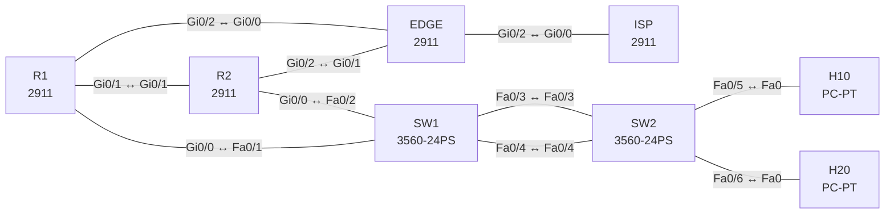

# Lab 23 – Capstone: Campus und Edge, Fehlersuche im Gesamtnetz

**Dauer:** 150 min · **Niveau:** schwer

Ein komplettes kleines Campus-Netz mit Internet-Edge: Access-Switch mit EtherChannel, Distribution-Router mit HSRP, OSPF, NAT, ACL, NTP und SSH. Der Schwerpunkt liegt auf der Reparatur: Zehn Fehler aus allen Schichten, teils voneinander verdeckt, wie in einem echten Troubleshooting-Ticket der Prüfung.

| ENCOR-Ziel (`Ziel::…`) | Thema |
|---|---|
| 3.1.a | 802.1Q und Trunks |
| 3.1.b | EtherChannel |
| 3.1.c | RSTP, MST und Schutzfunktionen |
| 3.2.b | OSPFv2 und OSPFv3 |
| 3.3.a | NTP und PTP |
| 3.3.b | NAT und PAT |
| 3.3.c | HSRP und VRRP |
| 5.1.a | Lines und lokale Anmeldung |
| 5.2.a | ACLs |

**So arbeitest du:** Teil A = Bauen, Teil B = Reparieren, Teil C = Üben. Die Konfigurationsdateien liegen in `build/` (Ausgangszustand zum Einfügen in die CLI), `repair/` (fertig gebaut, mit Fehlern) und `solutions/` (Musterlösung und Fehlerliste, erst nach eigenem Versuch öffnen). Anleitung zum Einfügen: siehe [Arbeiten mit den Dateien](../README.md#arbeiten-mit-den-dateien).

## Topologie



**Entwurfsskizze (aus dem CML-Lab; Portnamen der Switches siehe Verkabelungstabelle):**

```
                          ISP (8.8.8.8)
                             │ 203.0.113.0/30
                           EDGE (NAT, NTP-Master, Lo0 10.255.0.3)
                     Gi0/0 /          \ Gi0/1
                10.0.13.0/30          10.0.23.0/30
                     R1 ──────────── R2        R1/R2 Gi0/1 ↔ Gi0/1 (10.0.12.0/30)
                  Gi0/0 \            / Gi0/0    HSRP v2, V10 + V20
                          SW1 (Root)
                       Gi0/2-3 ║ Po1 (LACP)
                          SW2 (Access)
                      Gi1/0 │      │ Gi1/1
                       H10 (V10)  H20 (V20)
```

### Geräte

| Gerät | Modell in Packet Tracer | Rolle |
|---|---|---|
| R1 | 2911 | Router |
| R2 | 2911 | Router |
| EDGE | 2911 | Router |
| ISP | 2911 | Router |
| SW1 | 3560-24PS | Switch |
| SW2 | 3560-24PS | Switch |
| H10 | PC-PT | Host |
| H20 | PC-PT | Host |

### Verkabelung

| Von | Port | Nach | Port | Kabel |
|---|---|---|---|---|
| EDGE | Gi0/2 | ISP | Gi0/0 | Copper Cross-Over |
| R1 | Gi0/2 | EDGE | Gi0/0 | Copper Cross-Over |
| R2 | Gi0/2 | EDGE | Gi0/1 | Copper Cross-Over |
| R1 | Gi0/1 | R2 | Gi0/1 | Copper Cross-Over |
| R1 | Gi0/0 | SW1 | Fa0/1 | Copper Straight-Through |
| R2 | Gi0/0 | SW1 | Fa0/2 | Copper Straight-Through |
| SW1 | Fa0/3 | SW2 | Fa0/3 | Copper Cross-Over |
| SW1 | Fa0/4 | SW2 | Fa0/4 | Copper Cross-Over |
| SW2 | Fa0/5 | H10 | Fa0 | Copper Straight-Through |
| SW2 | Fa0/6 | H20 | Fa0 | Copper Straight-Through |

### Adressplan (Ausgangszustand)

| Gerät | Interface | Adresse | Maske | Gateway | DNS |
|---|---|---|---|---|---|
| R1 | Loopback0 | 10.255.0.1 | 255.255.255.255 | | |
| R1 | Gi0/1 | 10.0.12.1 | 255.255.255.252 | | |
| R1 | Gi0/2 | 10.0.13.1 | 255.255.255.252 | | |
| R1 | Gi0/0.10 | 10.10.10.2 | 255.255.255.0 | | |
| R1 | Gi0/0.20 | 10.10.20.2 | 255.255.255.0 | | |
| R2 | Loopback0 | 10.255.0.2 | 255.255.255.255 | | |
| R2 | Gi0/1 | 10.0.12.2 | 255.255.255.252 | | |
| R2 | Gi0/2 | 10.0.23.1 | 255.255.255.252 | | |
| R2 | Gi0/0.10 | 10.10.10.3 | 255.255.255.0 | | |
| R2 | Gi0/0.20 | 10.10.20.3 | 255.255.255.0 | | |
| EDGE | Loopback0 | 10.255.0.3 | 255.255.255.255 | | |
| EDGE | Gi0/0 | 10.0.13.2 | 255.255.255.252 | | |
| EDGE | Gi0/1 | 10.0.23.2 | 255.255.255.252 | | |
| EDGE | Gi0/2 | 203.0.113.2 | 255.255.255.252 | | |
| ISP | Loopback0 | 8.8.8.8 | 255.255.255.255 | | |
| ISP | Gi0/0 | 203.0.113.1 | 255.255.255.252 | | |
| H10 | Fa0 (GUI) | 10.10.10.11 | 255.255.255.0 | 10.10.10.1 |  |
| H20 | Fa0 (GUI) | 10.10.20.12 | 255.255.255.0 | 10.10.20.1 |  |

| Netz | Verwendung |
|---|---|
| 10.10.10.0/24 | VLAN 10, VIP .1, R1 .2, R2 .3, H10 .11 |
| 10.10.20.0/24 | VLAN 20, VIP .1, R1 .2, R2 .3, H20 .12 |
| 10.0.12.0/30 | R1 .1 – R2 .2 |
| 10.0.13.0/30 | R1 .1 – EDGE .2 |
| 10.0.23.0/30 | R2 .1 – EDGE .2 |
| 203.0.113.0/30 | ISP .1 – EDGE .2 |
| Loopbacks | R1 10.255.0.1, R2 10.255.0.2, EDGE 10.255.0.3 (NTP-Server), ISP 8.8.8.8 |

**Design-Vorgaben:** SW1 ist STP-Root für VLAN 10 und 20 (Priorität 4096), SW2 hat 61440. Po1 ist ein LACP-Trunk (nur VLAN 10, 20). R1 ist HSRP-Active (Priorität 110, preempt) für beide VLANs, R2 Standby. OSPF 1 Area 0 mit `passive-interface default`. EDGE originiert die Default-Route per OSPF und macht PAT (Quell-Netz 10.10.0.0/16) auf Gi0/2. VLAN 20 darf VLAN 10 nicht erreichen (ACL auf R1/R2, eingehend am VLAN-20-Subinterface). NTP-Quelle ist EDGE. Verwaltung nur per SSH (Benutzer `admin`, Passwort `Lab-Passw0rd!`).

### Portzuordnung der Switches (CML → Packet Tracer)

Die Aufgabentexte nennen Switch-Ports in der CML-Schreibweise (`Gi…`). Verkabelung, Konfigurationen und Fehlerlisten verwenden die Packet-Tracer-Ports. Umrechnung: `GiX/Y` → `Fa0/(X·4+Y+1)`.

| Switch | CML-Port | PT-Port |
|---|---|---|
| SW1 | Gi0/0 | Fa0/1 |
| SW1 | Gi0/1 | Fa0/2 |
| SW1 | Gi0/2 | Fa0/3 |
| SW1 | Gi0/3 | Fa0/4 |
| SW2 | Gi0/2 | Fa0/3 |
| SW2 | Gi0/3 | Fa0/4 |
| SW2 | Gi1/0 | Fa0/5 |
| SW2 | Gi1/1 | Fa0/6 |

> **Packet-Tracer-Hinweis:** **Eignung: geeignet.** Alle verwendeten Funktionen gibt es in Packet Tracer; Ausgabeformate einzelner `show`-Befehle weichen leicht ab. Die CML-Switches (Gi-Ports) sind hier 3560-24PS bzw. 2960 mit FastEthernet-Ports: Die Portzuordnung steht unter dem Adressplan; die Aufgabentexte nennen noch die CML-Ports.

## Teil A – Bauen

Dieses Lab ist vor allem zum **Reparieren** gedacht (Teil B). Wer es bauen will, geht in dieser Reihenfolge vor und prüft nach jeder Stufe:

1. **Layer 2.** VLAN 10/20 auf SW1/SW2, LACP-Po1 (`channel-group 1 mode active` auf SW1, `passive` auf SW2), Trunks zu R1/R2 (`switchport mode trunk`, `nonegotiate`, Allowed 10,20), Access-Ports für H10/H20 mit PortFast. Root-Design per `spanning-tree vlan 10,20 priority 4096` (SW1) bzw. 61440 (SW2). Prüfe `show etherchannel summary`, `show spanning-tree root`.
2. **Gateway-Redundanz.** Subinterfaces `Gi0/0.10/.20` auf R1/R2, HSRP **Version 2**, Gruppen 10 und 20, R1 Priorität 110 mit `preempt`. Prüfe `show standby brief` und dass H10/H20 ihr Gateway erreichen.
3. **Routing.** OSPF 1 mit `passive-interface default`, Gi0/1 und Gi0/2 (EDGE: Gi0/0 und Gi0/1) aktivieren; `network 10.0.0.0 0.255.255.255 area 0`. Auf EDGE Default-Route zum ISP und `default-information originate`.
4. **NAT.** EDGE: `access-list 1 permit 10.10.0.0 0.0.255.255`, `ip nat inside` auf Gi0/0 und Gi0/1, `ip nat outside` auf Gi0/2, `ip nat inside source list 1 interface GigabitEthernet0/2 overload`. Test: H10 und H20 pingen 8.8.8.8.
5. **ACL.** `ip access-list extended V20-IN` mit `deny ip 10.10.20.0 0.0.0.255 10.10.10.0 0.0.0.255` vor `permit ip any any`, am Subinterface .20 eingehend (R1 und R2).
6. **Zeit und Verwaltung.** EDGE `ntp master 3`, R1/R2 `ntp server 10.255.0.3`. Auf allen Routern `ip domain-name lab.local`, lokaler Benutzer, `crypto key generate rsa modulus 2048` (manuell, steht nicht in der Startkonfiguration), `ip ssh version 2`, vty `login local` und `transport input ssh`.
7. **Abnahme.** H10 pingt 8.8.8.8, H20 pingt 8.8.8.8, H20 pingt H10 **nicht**, `show ntp status` auf R1 und R2 zeigt synchronisiert, SSH von R1 zu R2 klappt, Abschalten von R1 lässt H10 und H20 über R2 im Internet.

## Teil B – Reparieren

Baue die Topologie wie oben (oder behalte deine aus Teil A), setze alle Geräte zurück (`erase startup-config`, `reload` bzw. neues Gerät) und füge dann die Dateien aus `repair/` ein. Es stecken **10 Fehler** drin. Behandle jede Meldung als Ticket: erst Symptom nachstellen, dann Layer für Layer eingrenzen, beheben und beweisen. Ändere nur, was kaputt ist.

**Ticket 1:** H20 erreicht seinen Gateway nicht, H10 schon. Von R1 aus ist 10.10.20.12 nicht erreichbar.

**Ticket 2:** Nach dem Reparieren des Trunks melden in VLAN 10 beide Router `Active`. `show standby brief` auf R1 und R2 zeigt jeweils `Active` und keinen Standby-Partner; Hosts erhalten ARP-Antworten verschiedener Router.

**Ticket 3:** Alles funktioniert, aber beim Test (Abschalten von R1) verlieren alle Hosts das Internet, obwohl R2 HSRP Active wird. `show ip ospf neighbor` auf EDGE zeigt nur R1.

**Ticket 4:** H10 erreicht 8.8.8.8, H20 nicht, obwohl das Routing stimmt. `show ip nat translations` enthält nur Einträge aus 10.10.10.x.

**Ticket 5:** H20 kann H10 anpingen, obwohl die Segmente getrennt sein sollen. `show access-lists` zeigt keine Treffer auf der deny-Zeile.

**Ticket 6:** `show spanning-tree root` zeigt für VLAN 10 und 20 SW2 als Root, Design verlangt SW1. Der Verkehr der Hosts nimmt einen Umweg, SW1 hat `Root port Po1`.

**Ticket 7:** Po1 bündelt nicht: `show etherchannel summary` zeigt auf SW1 `(s)`/`(I)`-Ports, die Verbindung zu H10 und H20 ist unzuverlässig oder fällt ganz aus.

**Ticket 8:** `show ntp status` auf R2: `Clock is unsynchronized`, R1 ist synchron. `show ntp associations` zeigt Reach 0.

**Ticket 9:** SSH von R1 auf R2 wird abgewiesen (`Connection refused by remote host`), Telnet dagegen geht.

**Ticket 10:** H10/H20 erreichen 8.8.8.8 nicht. EDGE erreicht den ISP, R1 und R2 haben aber keine Default-Route (`show ip route 0.0.0.0` → `Network not in table`).

## Verifikation

```
show etherchannel summary          show spanning-tree root
show standby brief                 show ip ospf neighbor
show ip route ospf | include O\*   show ip nat translations
show access-lists                  show ntp status
show ip ssh                        ping 8.8.8.8 source 10.10.10.2
```
Erwartet: Po1 `SU` mit `Gi0/2(P) Gi0/3(P)`, SW1 Root, R1 Active für beide VLANs, EDGE hat zwei OSPF-Nachbarn, R1 und R2 haben eine `O*E2` Default-Route, NAT-Einträge für 10.10.x.x.

## Teil C – Üben

Beantworte zuerst selbst, dann klappe die Antwort auf.

1. H20 erreicht sein Gateway nicht, H10 schon. Welche Kommandos in welcher Reihenfolge?
<details><summary>Antwort</summary>

`show vlan brief` und `show interfaces trunk` auf SW2 und SW1 (Allowed-Liste, Mitglied im Trunk, Native), dann `show spanning-tree vlan 20` (blockiert?), dann `show standby brief` auf R1. Erst wenn Layer 2 stimmt, lohnt der Blick auf die Router.

</details>

2. Wozu `passive-interface default` im Campus-Design, und was ist die Nebenwirkung eines vergessenen `no passive-interface`?
<details><summary>Antwort</summary>

Passiv unterdrückt Hellos auf LAN- und Edge-Ports, sodass sich keine unerwünschten Nachbarn bilden (Sicherheit, weniger CPU-Last). Vergisst man ein Uplink-Interface, fehlt die Nachbarschaft still: Alles läuft, bis der redundante Pfad gebraucht wird.

</details>

3. Warum zeigt `show ip nat translations` nichts, obwohl `ip nat inside source` konfiguriert ist?
<details><summary>Antwort</summary>

Typisch: Inside-/Outside-Markierung auf Interfaces fehlt, die ACL passt nicht auf das Quellnetz oder die Default-Route fehlt, sodass das Paket das Outside-Interface nie erreicht.

</details>

## Prüfungsbezug

Eine Troubleshooting-Aufgabe in der Prüfung gibt dir selten den Fehler, sondern ein Symptom. Arbeitsmethode: Layer 1/2 (Interface, VLAN, Trunk, Channel, STP), Layer 3 (Adressen, Gateway/FHRP, Routing), Dienste (NAT, ACL, NTP, SSH). Prüfe immer **beide Seiten** einer Verbindung, und denke an verdeckende Fehler: Ein Fehler weiter unten im Stack kann die Wirkung eines weiter oben liegenden verbergen.

## Lösungen

- `solutions/<Gerät>.cfg`: Konfiguration zu Teil A (ohne Basis-Adressen)
- `solutions/FAULTS.md`: Fehlerliste zu Teil B (Spoiler!)
