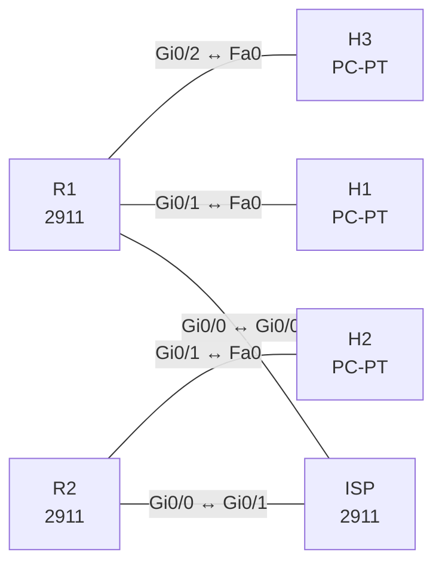

# Lab 24 – Capstone: WAN, eBGP und IPsec-Overlay, Fehlersuche

**Dauer:** 150 min · **Niveau:** schwer

Zwei Standorte sind per eBGP an einen ISP angebunden und über einen GRE-Tunnel mit IPsec-Schutz verbunden. Darüber läuft OSPF mit Authentifizierung. Dazu ein VRF-Lite für Gäste am Standort 1. Neun Fehler quer durch Underlay, Overlay und Virtualisierung.

| ENCOR-Ziel (`Ziel::…`) | Thema |
|---|---|
| 2.2.a | VRF |
| 2.2.b | GRE und IPsec |
| 3.2.b | OSPFv2 und OSPFv3 |
| 3.2.c | Direktes eBGP |

**So arbeitest du:** Teil A = Bauen, Teil B = Reparieren, Teil C = Üben. Die Konfigurationsdateien liegen in `build/` (Ausgangszustand zum Einfügen in die CLI), `repair/` (fertig gebaut, mit Fehlern) und `solutions/` (Musterlösung und Fehlerliste, erst nach eigenem Versuch öffnen). Anleitung zum Einfügen: siehe [Arbeiten mit den Dateien](../README.md#arbeiten-mit-den-dateien).

## Topologie



**Entwurfsskizze (aus dem CML-Lab; Portnamen der Switches siehe Verkabelungstabelle):**

```
   H1 ── R1 (AS 65001) ── Gi0/0 ──┐                 ┌── Gi0/0 ── R2 (AS 65002) ── H2
   H3 ─ (VRF GUEST)                ISP (AS 65000, Lo0 192.0.2.1)
                                  Gi0/0 ↔ R1, Gi0/1 ↔ R2

   Overlay:  R1 Tunnel0 (10.99.0.1) ═══ GRE + IPsec ═══ Tunnel0 (10.99.0.2) R2
```

### Geräte

| Gerät | Modell in Packet Tracer | Rolle |
|---|---|---|
| R1 | 2911 | Router |
| R2 | 2911 | Router |
| ISP | 2911 | Router |
| H1 | PC-PT | Host |
| H3 | PC-PT | Host |
| H2 | PC-PT | Host |

### Verkabelung

| Von | Port | Nach | Port | Kabel |
|---|---|---|---|---|
| R1 | Gi0/0 | ISP | Gi0/0 | Copper Cross-Over |
| R2 | Gi0/0 | ISP | Gi0/1 | Copper Cross-Over |
| R1 | Gi0/1 | H1 | Fa0 | Copper Cross-Over |
| R1 | Gi0/2 | H3 | Fa0 | Copper Cross-Over |
| R2 | Gi0/1 | H2 | Fa0 | Copper Cross-Over |

### Adressplan (Ausgangszustand)

| Gerät | Interface | Adresse | Maske | Gateway | DNS |
|---|---|---|---|---|---|
| R1 | Gi0/0 | 198.51.100.1 | 255.255.255.252 | | |
| R1 | Gi0/1 | 192.168.1.1 | 255.255.255.0 | | |
| R1 | Gi0/2 | 192.168.3.1 | 255.255.255.0 | | |
| R1 | Tunnel0 | 10.99.0.1 | 255.255.255.252 | | |
| R2 | Gi0/0 | 203.0.113.1 | 255.255.255.252 | | |
| R2 | Gi0/1 | 192.168.2.1 | 255.255.255.0 | | |
| R2 | Tunnel0 | 10.99.0.2 | 255.255.255.252 | | |
| ISP | Loopback0 | 192.0.2.1 | 255.255.255.255 | | |
| ISP | Gi0/0 | 198.51.100.2 | 255.255.255.252 | | |
| ISP | Gi0/1 | 203.0.113.2 | 255.255.255.252 | | |
| H1 | Fa0 (GUI) | 192.168.1.10 | 255.255.255.0 | 192.168.1.1 |  |
| H3 | Fa0 (GUI) | 192.168.3.10 | 255.255.255.0 | 192.168.3.1 |  |
| H2 | Fa0 (GUI) | 192.168.2.10 | 255.255.255.0 | 192.168.2.1 |  |

| Link | Netz |
|---|---|
| R1 Gi0/0 – ISP Gi0/0 | 198.51.100.0/30 (R1 .1, ISP .2) |
| R2 Gi0/0 – ISP Gi0/1 | 203.0.113.0/30 (R2 .1, ISP .2) |
| R1 Gi0/1 – H1 | 192.168.1.0/24 (R1 .1, H1 .10) |
| R2 Gi0/1 – H2 | 192.168.2.0/24 (R2 .1, H2 .10) |
| R1 Gi0/2 – H3 | 192.168.3.0/24 in **VRF GUEST** (R1 .1, H3 .10) |
| Tunnel0 | 10.99.0.0/30 (R1 .1, R2 .2), MTU 1400 |

eBGP: R1 (AS 65001) und R2 (AS 65002) sprechen mit dem ISP (AS 65000) und kündigen ihr Transportnetz an (R1 `198.51.100.0/30`, R2 `203.0.113.0/30`). Der ISP filtert eingehend nach Kunden-Prefix-Listen und kündigt zusätzlich `192.0.2.1/32` an. Das Overlay (GRE, IPsec-Profil `PROF`, PSK `LabKey123`) trägt OSPF 1 Area 0 mit MD5-Authentifizierung (Key 1 `OspfKey`) und die beiden Kunden-LANs.
> **Packet-Tracer-Hinweis:** **Eignung: teilweise.** Nach meinem Kenntnisstand zu Packet Tracer 8.x gilt: VRF-Lite: eingeschränkt. Je nach PT-Version nur teilweise oder gar nicht vorhanden. Wenn `ip vrf` nicht akzeptiert wird: Lab in CML/EVE-NG. IPsec mit Crypto-Map: eingeschränkt. Braucht `securityk9`-Lizenz am 2911 (`license boot module c2900 technology-package securityk9`). IPsec-VTI (Tunnel Protection): nicht vorhanden. VTI/Profile gibt es nicht; stattdessen Crypto-Map (siehe Lab 14/25 im CCNA-Paket). Akzeptiert PT einen Befehl nicht, ist das ein PT-Limit und kein Fehler von dir; solche Schritte machst du in CML oder EVE-NG.

## Teil A – Bauen

1. **Underlay (eBGP).** Interface-IPs sind gesetzt. Konfiguriere auf ISP, R1, R2 die eBGP-Sessions (`router bgp`, `neighbor … remote-as`) und kündige die Transportnetze per `network … mask …` an. Der ISP bekommt je Kunde eine eingehende Prefix-Liste, die nur dessen Transportnetz erlaubt (`ip prefix-list FROM-R1 seq 5 permit 198.51.100.0/30`), plus `network 192.0.2.1 mask 255.255.255.255`. Prüfe `show ip bgp summary` und dass R1 `203.0.113.1` und R2 `198.51.100.1` per Ping erreichen.
2. **IPsec-Profil.** Auf R1 und R2: `crypto isakmp policy 10` (AES 256, SHA, pre-share, Gruppe 2), `crypto isakmp key LabKey123 address <Gegenstelle>`, `crypto ipsec transform-set TS esp-aes 256 esp-sha-hmac` mit `mode transport`, `crypto ipsec profile PROF` mit dem Transform-Set. Warum reicht Transport-Mode, wenn GRE ohnehin kapselt?
3. **GRE-Tunnel.** `interface Tunnel0`, IP 10.99.0.1/.2 mit /30, `tunnel source GigabitEthernet0/0`, `tunnel destination <Gegenstelle>`, `ip mtu 1400`, `tunnel protection ipsec profile PROF`. Prüfe `show crypto isakmp sa`, `show crypto ipsec sa` (Zähler encaps/decaps) und `show interfaces tunnel0`.
4. **Overlay-Routing.** OSPF 1 auf Tunnel0 und dem Kunden-LAN (Gi0/1 passiv). Authentifizierung am Tunnel: `ip ospf authentication message-digest`, `ip ospf message-digest-key 1 md5 OspfKey`. Test: H1 pingt H2 (und umgekehrt), Traceroute zeigt den Tunnel, nicht den ISP.
5. **VRF-Lite.** Auf R1 `ip vrf GUEST` mit `rd 65001:100`, Gi0/2 per `ip vrf forwarding GUEST` einbinden (danach IP neu setzen), H3 steht dahinter. Prüfe `show ip route vrf GUEST`: H3 erreicht nur seinen Gateway, **nicht** 192.168.1.10 und nicht 10.99.0.2. Wie würdest du kontrolliert einen Default-Route-Leak nach global bauen (`ip route vrf GUEST 0.0.0.0 0.0.0.0 <next-hop> global`)?
6. **Abnahme.** Beide BGP-Sessions `Established`, Tunnel0 up/up, OSPF-Nachbar `FULL`, H1 ↔ H2 klappt, H3 ist isoliert.

## Teil B – Reparieren

Baue die Topologie wie oben (oder behalte deine aus Teil A), setze alle Geräte zurück (`erase startup-config`, `reload` bzw. neues Gerät) und füge dann die Dateien aus `repair/` ein. Es stecken **9 Fehler** drin. Behandle jede Meldung als Ticket: erst Symptom nachstellen, dann Layer für Layer eingrenzen, beheben und beweisen. Ändere nur, was kaputt ist.

**Ticket 1:** Die BGP-Session R1–ISP kommt nicht hoch (`Idle`/`Active`), im Log steht `%BGP-3-NOTIFICATION: sent to neighbor 198.51.100.2 2/2 (peer in wrong AS)`.

**Ticket 2:** R1 lernt das Transportnetz von R2 nicht (`show ip bgp` ohne 203.0.113.0/30), R1 erreicht 203.0.113.1 nicht, der Tunnel kommt von R1 aus nicht hoch.

**Ticket 3:** R2 erreicht 198.51.100.1 nicht: Im BGP-Table von R2 fehlt 198.51.100.0/30, obwohl R1 es ankündigt. Beim ISP steht der Prefix in `show ip bgp neighbors 198.51.100.1 received-routes`, nicht aber im Table.

**Ticket 4:** Nach der Underlay-Korrektur ist Tunnel0 auf R1 `up/up`, aber R2 sieht keinen Tunnel-Verkehr und `show crypto isakmp sa` ist leer.

**Ticket 5:** `show crypto isakmp sa` bleibt in `MM_KEY_EXCH`/`MM_NO_STATE`, der OSPF-Nachbar fehlt, Pings durch den Tunnel scheitern.

**Ticket 6:** Nach der IPsec-Korrektur bleibt der OSPF-Nachbar in `EXSTART`/`EXCHANGE` hängen (`%OSPF-5-ADJCHG` wechselt, `Neighbor ... stuck`).

**Ticket 7:** Nach der MTU-Korrektur kommt noch immer kein OSPF-Nachbar hoch; das Log meldet `%OSPF-4-ERRRCV: Received invalid packet: Mismatch Authentication Key`.

**Ticket 8:** OSPF-Nachbar `FULL`, aber H1 erreicht H2 nicht; R1 hat keine Route nach 192.168.2.0/24.

**Ticket 9:** H3 (Gast) pingt H1 erfolgreich und sogar 10.99.0.2. `show ip route vrf GUEST` ist leer, die Gast-LAN liegt in der globalen Routing-Tabelle.

## Verifikation

```
show ip bgp summary           show ip bgp
show crypto isakmp sa         show crypto ipsec sa | include encaps|decaps
show interfaces tunnel0       show ip ospf neighbor
show ip route                 show ip route vrf GUEST
ping 192.168.2.10 source 192.168.1.1
```
Erwartet: R1 lernt `203.0.113.0/30` und R2 `198.51.100.0/30` per BGP, ISAKMP `QM_IDLE`, OSPF `FULL/-` über Tunnel0, R1 hat `192.168.2.0/24` per OSPF.

## Teil C – Üben

Beantworte zuerst selbst, dann klappe die Antwort auf.

1. Tunnel0 steht auf `up/up`, aber das OSPF-Nachbarschaftsfeld bleibt in `INIT`. Welche Ursachen kommen in Frage?
<details><summary>Antwort</summary>

Der Tunnel selbst trägt Pakete nur in eine Richtung (IPsec-Mismatch, ACL, Routing zurück), oder OSPF-Parameter passen nicht (Authentifizierung, Area, Hello/Dead, Netztyp). `INIT` heißt: Hellos kommen an, die eigene Router-ID ist beim Nachbarn nicht aufgeführt, also fehlt der Rückweg.

</details>

2. Warum ist `network 198.51.100.0 mask 255.255.255.252` im BGP wirkungslos, wenn das Interface heruntergefahren ist?
<details><summary>Antwort</summary>

BGP kündigt nur Prefixe an, die **exakt** in der Routing-Tabelle liegen. Ohne aktives Interface fehlt die verbundene Route, und der `network`-Befehl erzeugt keine Ankündigung.

</details>

3. Was ist der Unterschied zwischen VRF-Lite und MPLS-L3VPN?
<details><summary>Antwort</summary>

VRF-Lite trennt nur lokal Routing-Tabellen (Interfaces/Subinterfaces pro VRF, kein MPLS, Routing-Protokolle pro VRF). MPLS-L3VPN transportiert VRF-Routen zwischen PE-Routern über MP-BGP mit Route Distinguisher/Target und Labels.

</details>

## Prüfungsbezug

Faustregeln: Ein GRE-Tunnel ohne Keepalive bleibt `up/up`, solange das Tunnel-Quell-Interface oben ist, auch wenn die Gegenstelle fehlt. Ist die Tunnel-Destination nicht im Underlay erreichbar, fällt der Tunnel (`up/down`). OSPF über einen Tunnel scheitert in `EXSTART`, wenn die MTU der Seiten verschieden ist. IPsec: Phase 1 (ISAKMP/IKE, PSK, Policy) und Phase 2 (Transform-Set, Profil) müssen auf beiden Seiten übereinstimmen. eBGP: AS-Nummer, Peer-Adresse und Filter (Prefix-Liste, Route-Map) prüfen, danach `network`-Statement (muss exakt in der RIB liegen).

## Lösungen

- `solutions/<Gerät>.cfg`: Konfiguration zu Teil A (ohne Basis-Adressen)
- `solutions/FAULTS.md`: Fehlerliste zu Teil B (Spoiler!)
