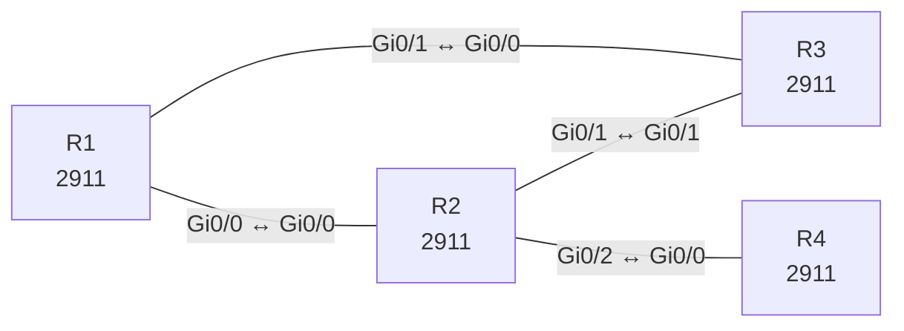

# Lab 25 – EIGRP klassisch: Nachbarschaft, Authentifizierung, Summary und Stub

**Dauer:** 90 min · **Niveau:** mittel

EIGRP im klassischen Modus über vier Router: Nachbarschaftsbedingungen (AS, K-Werte, Authentifizierung), Summarisierung, Stub-Router und das Lesen der Topology Table (Feasible Successor, FD/RD). Dazu die Abgrenzung zu OSPF.

| ENCOR-Ziel (`Ziel::…`) | Thema |
|---|---|
| 3.2.a | EIGRP und OSPF vergleichen |

**So arbeitest du:** Teil A = Bauen, Teil B = Reparieren, Teil C = Üben. Die Konfigurationsdateien liegen in `build/` (Ausgangszustand zum Einfügen in die CLI), `repair/` (fertig gebaut, mit Fehlern) und `solutions/` (Musterlösung und Fehlerliste, erst nach eigenem Versuch öffnen). Anleitung zum Einfügen: siehe [Arbeiten mit den Dateien](../README.md#arbeiten-mit-den-dateien).

## Topologie



**Entwurfsskizze (aus dem CML-Lab; Portnamen der Switches siehe Verkabelungstabelle):**

```
              172.16.0.0/22 (Lo10-13)
                    R1
          Gi0/0 /       \ Gi0/1
        10.0.12.0/30    10.0.13.0/30
              R2 ─────── R3        R2 Gi0/1 ↔ R3 Gi0/1 (10.0.23.0/30)
       Gi0/2 │
        10.0.24.0/30
              R4 (Stub, Lo1 192.168.4.0/24)
```

### Geräte

| Gerät | Modell in Packet Tracer | Rolle |
|---|---|---|
| R1 | 2911 | Router |
| R2 | 2911 | Router |
| R3 | 2911 | Router |
| R4 | 2911 | Router |

### Verkabelung

| Von | Port | Nach | Port | Kabel |
|---|---|---|---|---|
| R1 | Gi0/0 | R2 | Gi0/0 | Copper Cross-Over |
| R1 | Gi0/1 | R3 | Gi0/0 | Copper Cross-Over |
| R2 | Gi0/1 | R3 | Gi0/1 | Copper Cross-Over |
| R2 | Gi0/2 | R4 | Gi0/0 | Copper Cross-Over |

### Adressplan (Ausgangszustand)

| Gerät | Interface | Adresse | Maske | Gateway | DNS |
|---|---|---|---|---|---|
| R1 | Loopback0 | 10.255.0.1 | 255.255.255.255 | | |
| R1 | Loopback10 | 172.16.0.1 | 255.255.255.0 | | |
| R1 | Loopback11 | 172.16.1.1 | 255.255.255.0 | | |
| R1 | Loopback12 | 172.16.2.1 | 255.255.255.0 | | |
| R1 | Loopback13 | 172.16.3.1 | 255.255.255.0 | | |
| R1 | Gi0/0 | 10.0.12.1 | 255.255.255.252 | | |
| R1 | Gi0/1 | 10.0.13.1 | 255.255.255.252 | | |
| R2 | Loopback0 | 10.255.0.2 | 255.255.255.255 | | |
| R2 | Gi0/0 | 10.0.12.2 | 255.255.255.252 | | |
| R2 | Gi0/1 | 10.0.23.1 | 255.255.255.252 | | |
| R2 | Gi0/2 | 10.0.24.1 | 255.255.255.252 | | |
| R3 | Loopback0 | 10.255.0.3 | 255.255.255.255 | | |
| R3 | Gi0/0 | 10.0.13.2 | 255.255.255.252 | | |
| R3 | Gi0/1 | 10.0.23.2 | 255.255.255.252 | | |
| R4 | Loopback0 | 10.255.0.4 | 255.255.255.255 | | |
| R4 | Loopback1 | 192.168.4.1 | 255.255.255.0 | | |
| R4 | Gi0/0 | 10.0.24.2 | 255.255.255.252 | | |

| Link | Netz |
|---|---|
| R1 Gi0/0 – R2 Gi0/0 | 10.0.12.0/30 (.1/.2) |
| R1 Gi0/1 – R3 Gi0/0 | 10.0.13.0/30 (.1/.2) |
| R2 Gi0/1 – R3 Gi0/1 | 10.0.23.0/30 (.1/.2) |
| R2 Gi0/2 – R4 Gi0/0 | 10.0.24.0/30 (.1/.2) |

Loopback0: R1 10.255.0.1, R2 .2, R3 .3, R4 .4 (jeweils /32). R1 hat zusätzlich Lo10 bis Lo13 mit 172.16.0.1 bis 172.16.3.1 (je /24), R4 hat Lo1 192.168.4.1/24. AS-Nummer: **100**.
> **Packet-Tracer-Hinweis:** **Eignung: geeignet.** Alle verwendeten Funktionen gibt es in Packet Tracer; Ausgabeformate einzelner `show`-Befehle weichen leicht ab.

## Teil A – Bauen

1. **Grundkonfiguration.** `router eigrp 100`, `eigrp router-id` (= Loopback0), `network` je Link mit Wildcard-Maske, `no auto-summary`, `passive-interface default` und auf den Router-Links `no passive-interface`. Prüfe `show ip eigrp neighbors` (Hold Time, SRTT, Q Cnt) und `show ip protocols`.
2. **Topology Table lesen.** `show ip eigrp topology` auf R3 für 172.16.0.0/24: FD und RD, Successor und Feasible Successor. Warum ist ein Pfad mit RD < FD des Successors ein FS (Feasibility Condition)? Schalte den Successor-Link ab und beobachte, dass es ohne Query umschaltet.
3. **Metrik.** Berechne die klassische Metrik (K1 und K3 aktiv): `256 × (10^7/kleinste Bandbreite in kbit/s + Summe Delay/10)`. Ändere `bandwidth` und `delay` an einem Link und vergleiche mit `show interfaces`. Warum nimmt man bevorzugt `delay` statt `bandwidth` zur Pfadsteuerung?
4. **Unequal-Cost.** `variance 2` unter `router eigrp 100` auf R3 und prüfe, wann zwei Pfade in `show ip route` erscheinen (Bedingung: FD des Feasible Successor < Variance × FD des Successors, und er muss Feasible Successor sein).
5. **Summary.** Auf R1: `ip summary-address eigrp 100 172.16.0.0 255.255.252.0` auf Gi0/0 und Gi0/1. Prüfe auf R2/R3, dass nur noch `172.16.0.0/22` ankommt, und auf R1 die automatische Route nach `Null0` (Distanz 5). Wozu dient sie?
6. **Stub.** R4: `eigrp stub connected`. Prüfe `show ip eigrp neighbors detail` auf R2 (`Stub Peer Advertising ( CONNECTED ) Routes`). Warum fragt R2 den Stub-Router bei einem Ausfall nicht mehr (Query-Scoping, Stuck-in-Active)?
7. **Authentifizierung.** Key-Chain `KC` (Key 1, `EigrpKey`) und `ip authentication mode eigrp 100 md5` plus `ip authentication key-chain eigrp 100 KC` auf dem Link R1–R2. Teste einen falschen Schlüssel.
8. **Vergleich mit OSPF.** Distanzvektor (genauer: Advanced Distance Vector) vs. Link-State, DUAL vs. SPF, Standard-AD (intern 90, extern 170, OSPF 110), Multicast 224.0.0.10 vs. 224.0.0.5/6, Metrik. Wann würdest du eines der beiden wählen?

## Teil B – Reparieren

Baue die Topologie wie oben (oder behalte deine aus Teil A), setze alle Geräte zurück (`erase startup-config`, `reload` bzw. neues Gerät) und füge dann die Dateien aus `repair/` ein. Es stecken **6 Fehler** drin. Behandle jede Meldung als Ticket: erst Symptom nachstellen, dann Layer für Layer eingrenzen, beheben und beweisen. Ändere nur, was kaputt ist.

**Ticket 1:** R1 und R2 bilden keine Nachbarschaft (`show ip eigrp neighbors` leer am Link); `debug eigrp packets` meldet einen Authentifizierungsfehler.

**Ticket 2:** R3 hat keine Nachbarn: `show ip eigrp neighbors` ist leer, auf R1 und R2 steht `K-value mismatch`.

**Ticket 3:** R4 hat keinen Nachbarn zu R2, 192.168.4.0/24 fehlt überall.

**Ticket 4:** R3 zeigt für das 172.16er-Netz zwei verschiedene Routen: `172.16.0.0/22` (über R2) und `172.16.0.0/23` (direkt von R1). Verkehr in 172.16.2.0/24 nimmt den Umweg.

**Ticket 5:** Nach Behebung der Nachbarschaft: R1 erreicht 192.168.4.1 nicht, obwohl R4 Nachbar von R2 ist.

**Ticket 6:** R2 und R3 sind direkt verbunden, aber `show ip eigrp neighbors` auf R2 zeigt R3 nicht (Nachbarschaft nur über R1).

## Verifikation

```
show ip eigrp neighbors
show ip eigrp topology [all-links]
show ip route eigrp
show ip protocols
show ip eigrp interfaces detail
```
Erwartet: R1 hat zwei Nachbarn (R2, R3), R2 drei (R1, R3, R4), R3 sieht `172.16.0.0/22` über beide Wege, R4 erscheint bei R2 als Stub.

## Teil C – Üben

Beantworte zuerst selbst, dann klappe die Antwort auf.

1. Zwei EIGRP-Router bilden keine Nachbarschaft, obwohl alle Interfaces oben sind. Die ersten Prüfungen?
<details><summary>Antwort</summary>

`show ip eigrp neighbors` leer: AS-Nummer, K-Werte (`show ip protocols`), Authentifizierung, `passive-interface`, `network`-Statement (Interface wirklich im Prozess?), Subnetz/Maske. Hello-Timer müssen nicht gleich sein.

</details>

2. Wann wird ein Pfad Feasible Successor?
<details><summary>Antwort</summary>

Wenn seine Reported Distance (die Distanz des Nachbarn zum Ziel) **kleiner** ist als die Feasible Distance des aktuellen Successors. Das garantiert Schleifenfreiheit und erlaubt Umschalten ohne Query.

</details>

3. Was bewirkt `eigrp stub connected` und warum hilft es bei Stuck-in-Active?
<details><summary>Antwort</summary>

Der Router bewirbt nur direkt verbundene Netze und beantwortet Queries nicht weiterreichend: Nachbarn senden ihm keine Queries mehr, die Suche bleibt lokal und SIA wird unwahrscheinlicher.

</details>

## Prüfungsbezug

EIGRP-Nachbarn brauchen gleiche AS-Nummer, gleiche K-Werte, passende Authentifizierung und Adressen im selben Subnetz; Hello/Hold-Timer müssen **nicht** übereinstimmen. Successor = bester Pfad, Feasible Successor = Pfad mit RD < FD des Successors. Query/Reply, Stub und Summarisierung begrenzen die Ausbreitung (SIA). Variance erlaubt ungleiche Lastverteilung nur für FS. Externe Routen AD 170, interne 90, Summary-Null0 AD 5.

## Lösungen

- `solutions/<Gerät>.cfg`: Konfiguration zu Teil A (ohne Basis-Adressen)
- `solutions/FAULTS.md`: Fehlerliste zu Teil B (Spoiler!)
