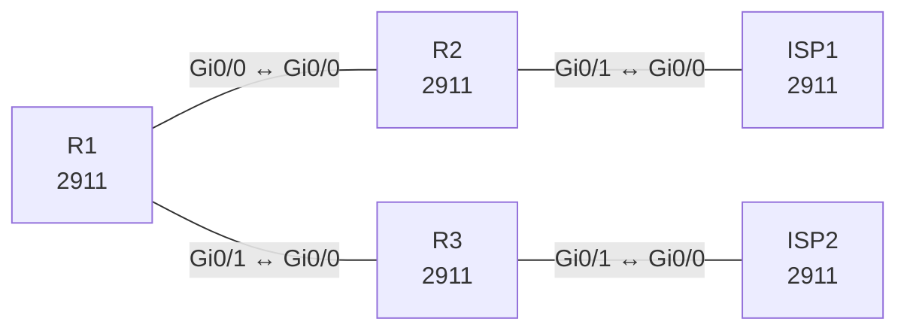

# Lab 26 – iBGP mit Route Reflector, Local Preference und Communities

**Dauer:** 100 min · **Niveau:** schwer

Ein AS mit drei Routern und zwei Upstream-Providern: iBGP über Loopbacks mit Route Reflector, `next-hop-self`, Pfadsteuerung per Local Preference und Markierung per Community. Der OSPF-Underlay liefert die Loopback-Erreichbarkeit.

**Lernziele:** Nach diesem Lab kannst du …

- iBGP mit Route Reflector und Loopback-Peering aufbauen.
- Next-Hop-Probleme in iBGP erkennen und mit `next-hop-self` lösen.
- Mit Local Preference und Communities den Ausgang des ganzen AS steuern.

| ENCOR-Ziel (`Ziel::…`) | Thema |
|---|---|
| 3.2.c | Direktes eBGP |

**So arbeitest du:** Teil A = Bauen, Teil B = Reparieren, Teil C = Üben. Die Konfigurationsdateien liegen in `build/` (Ausgangszustand zum Einfügen in die CLI), `repair/` (fertig gebaut, mit Fehlern) und `solutions/` (Musterlösung und Fehlerliste, erst nach eigenem Versuch öffnen). Anleitung zum Einfügen: siehe [Arbeiten mit den Dateien](../README.md#arbeiten-mit-den-dateien).

## Topologie



**Entwurfsskizze (aus dem CML-Lab; Portnamen der Switches siehe Verkabelungstabelle):**

```
                R1 (RR, AS 65001)
          Gi0/0 /          \ Gi0/1
     10.0.12.0/30        10.0.13.0/30
            R2              R3
       Gi0/1 │              │ Gi0/1
    192.0.2.0/30         192.0.2.4/30
          ISP1 (65100)    ISP2 (65200)
```

### Geräte

| Gerät | Modell in Packet Tracer | Rolle |
|---|---|---|
| R1 | 2911 | Router |
| R2 | 2911 | Router |
| R3 | 2911 | Router |
| ISP1 | 2911 | Router |
| ISP2 | 2911 | Router |

### Verkabelung

| Von | Port | Nach | Port | Kabel |
|---|---|---|---|---|
| R1 | Gi0/0 | R2 | Gi0/0 | Copper Cross-Over |
| R1 | Gi0/1 | R3 | Gi0/0 | Copper Cross-Over |
| R2 | Gi0/1 | ISP1 | Gi0/0 | Copper Cross-Over |
| R3 | Gi0/1 | ISP2 | Gi0/0 | Copper Cross-Over |

### Adressplan (Ausgangszustand)

| Gerät | Interface | Adresse | Maske | Gateway | DNS |
|---|---|---|---|---|---|
| R1 | Loopback0 | 10.255.0.1 | 255.255.255.255 | | |
| R1 | Gi0/0 | 10.0.12.1 | 255.255.255.252 | | |
| R1 | Gi0/1 | 10.0.13.1 | 255.255.255.252 | | |
| R2 | Loopback0 | 10.255.0.2 | 255.255.255.255 | | |
| R2 | Gi0/0 | 10.0.12.2 | 255.255.255.252 | | |
| R2 | Gi0/1 | 192.0.2.1 | 255.255.255.252 | | |
| R3 | Loopback0 | 10.255.0.3 | 255.255.255.255 | | |
| R3 | Gi0/0 | 10.0.13.2 | 255.255.255.252 | | |
| R3 | Gi0/1 | 192.0.2.5 | 255.255.255.252 | | |
| ISP1 | Loopback0 | 1.1.1.1 | 255.255.255.255 | | |
| ISP1 | Loopback10 | 203.0.113.1 | 255.255.255.0 | | |
| ISP1 | Loopback11 | 198.51.100.1 | 255.255.255.0 | | |
| ISP1 | Gi0/0 | 192.0.2.2 | 255.255.255.252 | | |
| ISP2 | Loopback0 | 2.2.2.2 | 255.255.255.255 | | |
| ISP2 | Loopback10 | 203.0.113.1 | 255.255.255.0 | | |
| ISP2 | Loopback11 | 198.18.0.1 | 255.255.255.0 | | |
| ISP2 | Gi0/0 | 192.0.2.6 | 255.255.255.252 | | |

| Link | Netz |
|---|---|
| R1 Gi0/0 – R2 Gi0/0 | 10.0.12.0/30 (.1/.2) |
| R1 Gi0/1 – R3 Gi0/0 | 10.0.13.0/30 (.1/.2) |
| R2 Gi0/1 – ISP1 Gi0/0 | 192.0.2.0/30 (.1/.2) |
| R3 Gi0/1 – ISP2 Gi0/0 | 192.0.2.4/30 (.5/.6) |

Loopback0 (/32): R1 10.255.0.1, R2 10.255.0.2, R3 10.255.0.3. OSPF 1 Area 0 trägt die internen Netze (nicht die Provider-Links). Provider-Prefixe: ISP1 kündigt 203.0.113.0/24 und 198.51.100.0/24 an, ISP2 kündigt 203.0.113.0/24 und 198.18.0.0/24 an (gleicher Prefix von zwei Providern!).
> **Packet-Tracer-Hinweis:** **Eignung: geeignet.** Alle verwendeten Funktionen gibt es in Packet Tracer; Ausgabeformate einzelner `show`-Befehle weichen leicht ab.

## Teil A – Bauen
Arbeite die Schritte der Reihe nach ab. Jeder Schritt sagt dir, was du tust, woran du den Erfolg erkennst (**Prüfen**) und worüber du nachdenken sollst (**Denkfrage**). Die Antworten auf die Denkfragen stehen am Ende von Teil A.

1. **Underlay mit OSPF.** Starte auf R1 bis R3 OSPF 1 in Area 0 für die internen Links und Loopbacks (`network 10.0.0.0 0.255.255.255 area 0`).
   - **Prüfen:** R2 pingt die Loopback von R3 (10.255.0.3).
2. **iBGP mit Route Reflector.** Mache R1 zum Route Reflector: `neighbor 10.255.0.2 remote-as 65001` und `neighbor 10.255.0.3 remote-as 65001`, jeweils mit `update-source Loopback0` und `route-reflector-client`. R2 und R3 peeren nur mit R1, ebenfalls über ihre Loopback.
   - **Prüfen:** `show ip bgp summary` auf R1 zeigt zwei Nachbarn Established.
   - **Denkfrage:** Warum bräuchte iBGP ohne Route Reflector eine Vollvermaschung? Wie verhindern ORIGINATOR_ID und CLUSTER_LIST Schleifen?
3. **eBGP zu den Providern.** Verbinde R2 mit ISP1 (AS 65100) und R3 mit ISP2 (AS 65200).
   - **Prüfen:** `show ip bgp summary` auf R2 und R3 zeigt die Provider Established, mit empfangenen Präfixen.
4. **Next-Hop setzen.** Die Provider-Links stehen nicht im OSPF. Setze auf R2 und R3 `neighbor 10.255.0.1 next-hop-self`.
   - **Prüfen:** `show ip bgp` auf R1 zeigt die Provider-Präfixe jetzt mit Next-Hop 10.255.0.2 bzw. .3 und dem Zeichen `>`.
   - **Denkfrage:** Was passiert ohne `next-hop-self`?
5. **Local Preference.** Lege auf R2 die Route-Map `ISP1-IN` mit `set local-preference 200` an und binde sie eingehend an ISP1.
   - **Prüfen:** `show ip bgp 203.0.113.0` auf R3 zeigt den Pfad über R2 als besten.
   - **Denkfrage:** Warum gewinnt dieser Pfad, obwohl R3 einen direkten Weg zu ISP2 hat? Welchen Weg nimmt ein Ping von R3 an 203.0.113.1?
6. **Communities.** Ergänze in `ISP1-IN` die Zeile `set community 65001:100 additive`. Setze global `ip bgp-community new-format` und auf R1, R2 und R3 `neighbor … send-community`.
   - **Prüfen:** `show ip bgp community 65001:100` auf R3 zeigt die Präfixe von ISP1.
   - **Denkfrage:** Wozu sind Communities gut?
7. **Pfadauswahl wiederholen.** Schreibe die Best-Path-Reihenfolge aus dem Kopf auf und vergleiche mit dem Prüfungsbezug unten.

<details><summary>Antworten zu den Denkfragen</summary>

- **Zu 2:** Ein iBGP-Router gibt Routen, die er per iBGP gelernt hat, nicht an andere iBGP-Nachbarn weiter. So verhindert BGP Schleifen im eigenen AS. Ohne Hilfe muss deshalb jeder mit jedem peeren: n × (n − 1) ÷ 2 Sessions. Der Route Reflector darf Routen an seine Clients weiterreichen. ORIGINATOR_ID trägt die Router-ID des Ursprungs, ein Router verwirft Routen mit seiner eigenen ID. CLUSTER_LIST sammelt die Cluster-IDs der Reflectoren, ein Reflector verwirft Routen, in denen seine ID schon steht.
- **Zu 4:** iBGP gibt den Next-Hop des Providers (192.0.2.2) unverändert weiter. R1 und R3 kennen dieses Netz nicht, die Route ist „inaccessible“ und wird nicht benutzt.
- **Zu 5:** Local Preference steht in der Best-Path-Reihenfolge weit vorne, noch vor der Länge des AS-Pfads. 200 schlägt 100. Ein Ping von R3 geht deshalb über R1 zu R2 und dann zu ISP1, nicht direkt zu ISP2.
- **Zu 6:** Mit einer Community markierst du Routen. Andere Router können dann nach dieser Markierung handeln, etwa Local Preference setzen oder filtern, ohne Prefix-Listen zu pflegen.

</details>

## Teil B – Reparieren

Baue die Topologie wie oben (oder behalte deine aus Teil A), setze alle Geräte zurück (`erase startup-config`, `reload` bzw. neues Gerät) und füge dann die Dateien aus `repair/` ein. Es stecken **6 Fehler** drin. Behandle jede Meldung als Ticket: erst Symptom nachstellen, dann Layer für Layer eingrenzen, beheben und beweisen. Ändere nur, was kaputt ist.

**Ticket 1:** Die iBGP-Session R1–R3 bleibt `Active`/`Idle`, auf R1 steht R3 nicht im Zustand `Established`.

**Ticket 2:** R1 und R3 listen die Prefixe von ISP1 mit Next-Hop 192.0.2.2 ohne `>` (nicht Best), `show ip bgp` zeigt `inaccessible`.

**Ticket 3:** Der Verkehr zu 203.0.113.0/24 verlässt das AS über ISP2, obwohl ISP1 bevorzugt sein soll.

**Ticket 4:** R3 zeigt `show ip bgp community 65001:100` leer, obwohl R2 die Community setzt und R1 sie hat.

**Ticket 5:** Die eBGP-Session R3–ISP2 steht auf `Idle`; im Log `Notification … (peer in wrong AS)`.

**Ticket 6:** R1 und R3 erreichen 10.255.0.2 nicht, die iBGP-Session zu R2 bleibt unten, obwohl der Link steht.

## Verifikation
```
show ip bgp summary
show ip bgp
show ip bgp 203.0.113.0
show ip bgp community 65001:100
show ip route bgp
```

| Befehl | Das solltest du sehen |
|---|---|
| `show ip bgp summary` auf R1 | zwei iBGP-Peers (die Clients) |
| `show ip bgp 203.0.113.0` auf R3 | bester Pfad über R2, Next-Hop 10.255.0.2, LocPrf 200 |
| `show ip route bgp` auf R3 | 198.18.0.0/24 direkt über ISP2 |

## Teil C – Üben

Beantworte zuerst selbst, dann klappe die Antwort auf.

1. R3 sieht Routen von ISP1, markiert als `inaccessible`. Ursache und Fix?
<details><summary>Antwort</summary>

**Der Next-Hop 192.0.2.2 ist im IGP unbekannt.** iBGP gibt den eBGP-Next-Hop unverändert weiter, und R3 kann ihn nicht auflösen. Lösung: `next-hop-self` auf R2 zum RR, oder die Provider-Links ins IGP aufnehmen, z. B. als passives OSPF-Interface.

</details>

2. Warum reicht `route-reflector-client` allein nicht, wenn Communities beim Client ankommen sollen?
<details><summary>Antwort</summary>

**Weil Communities ohne `send-community` gar nicht verschickt werden.** Das gilt pro Nachbar und ist standardmäßig aus. Auch der RR muss `send-community` zum Client gesetzt haben.

</details>

3. Zwei Pfade zum selben Prefix: Local-Pref 200 mit AS-Pfad 3 Hops, Local-Pref 100 mit 1 Hop. Wer gewinnt?
<details><summary>Antwort</summary>

**Der Pfad mit Local Preference 200.** Local Preference steht in der Best-Path-Reihenfolge vor der Länge des AS-Pfads. Die drei Hops spielen also keine Rolle mehr.

</details>

## Prüfungsbezug
- iBGP-Router geben iBGP-Routen nicht an andere iBGP-Nachbarn weiter. Route Reflector oder Confederation lösen das.
- Bei iBGP bleibt der Next-Hop unverändert, außer mit `next-hop-self`.
- Local Preference gilt im eigenen AS (Standard 100, höher gewinnt). MED gilt zwischen benachbarten AS (niedriger gewinnt).
- Communities werden nur mit `send-community` verschickt.
- Administrative Distanz: eBGP 20, iBGP 200.

## Lösungen

- `solutions/<Gerät>.cfg`: Konfiguration zu Teil A (ohne Basis-Adressen)
- `solutions/FAULTS.md`: Fehlerliste zu Teil B (Spoiler!)
