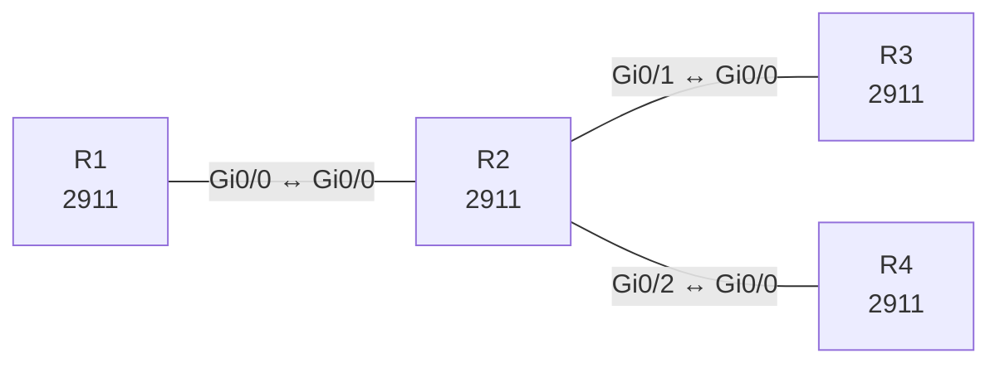

# Lab 28 – OSPF vertieft: Area-Typen, Summarisierung und Authentifizierung

**Dauer:** 100 min · **Niveau:** schwer

Ein ABR verbindet Area 0 mit einer Totally-Stubby-Area und einer NSSA. Dazu Zusammenfassung am ABR, Redistribution im NSSA und MD5-Authentifizierung. Du liest LSA-Typen und verstehst, warum Area-Typen auf beiden Seiten übereinstimmen müssen.

| ENCOR-Ziel (`Ziel::…`) | Thema |
|---|---|
| 3.2.b | OSPFv2 und OSPFv3 |

**So arbeitest du:** Teil A = Bauen, Teil B = Reparieren, Teil C = Üben. Die Konfigurationsdateien liegen in `build/` (Ausgangszustand zum Einfügen in die CLI), `repair/` (fertig gebaut, mit Fehlern) und `solutions/` (Musterlösung und Fehlerliste, erst nach eigenem Versuch öffnen). Anleitung zum Einfügen: siehe [Arbeiten mit den Dateien](../README.md#arbeiten-mit-den-dateien).

## Topologie



**Entwurfsskizze (aus dem CML-Lab; Portnamen der Switches siehe Verkabelungstabelle):**

```
   R1 (Area 0, Lo10 10.1.0.0/24)
      │ Gi0/0 ↔ R2 Gi0/0 (10.0.12.0/30, MD5)
     R2 (ABR)
   Gi0/1 /      \ Gi0/2
 10.0.23.0/30   10.0.24.0/30
   R3 (Area 1, stub)   R4 (Area 2, NSSA, ASBR 172.31.0.0/24)
   Lo10-13 192.168.0-3.0/24
```

### Geräte

| Gerät | Modell in Packet Tracer | Rolle |
|---|---|---|
| R1 | 2911 | Router |
| R2 | 2911 | Router |
| R3 | 2911 | Router |
| R4 | 2911 | Router |

### Verkabelung

| Von | Port | Nach | Port | Kabel |
|---|---|---|---|---|
| R1 | Gi0/0 | R2 | Gi0/0 | Copper Cross-Over |
| R2 | Gi0/1 | R3 | Gi0/0 | Copper Cross-Over |
| R2 | Gi0/2 | R4 | Gi0/0 | Copper Cross-Over |

### Adressplan (Ausgangszustand)

| Gerät | Interface | Adresse | Maske | Gateway | DNS |
|---|---|---|---|---|---|
| R1 | Loopback0 | 10.255.0.1 | 255.255.255.255 | | |
| R1 | Loopback10 | 10.1.0.1 | 255.255.255.0 | | |
| R1 | Gi0/0 | 10.0.12.1 | 255.255.255.252 | | |
| R2 | Loopback0 | 10.255.0.2 | 255.255.255.255 | | |
| R2 | Gi0/0 | 10.0.12.2 | 255.255.255.252 | | |
| R2 | Gi0/1 | 10.0.23.1 | 255.255.255.252 | | |
| R2 | Gi0/2 | 10.0.24.1 | 255.255.255.252 | | |
| R3 | Loopback0 | 10.255.0.3 | 255.255.255.255 | | |
| R3 | Loopback10 | 192.168.0.1 | 255.255.255.0 | | |
| R3 | Loopback11 | 192.168.1.1 | 255.255.255.0 | | |
| R3 | Loopback12 | 192.168.2.1 | 255.255.255.0 | | |
| R3 | Loopback13 | 192.168.3.1 | 255.255.255.0 | | |
| R3 | Gi0/0 | 10.0.23.2 | 255.255.255.252 | | |
| R4 | Loopback0 | 10.255.0.4 | 255.255.255.255 | | |
| R4 | Gi0/0 | 10.0.24.2 | 255.255.255.252 | | |

| Link | Netz | Area |
|---|---|---|
| R1 Gi0/0 – R2 Gi0/0 | 10.0.12.0/30 (.1/.2) | 0 |
| R2 Gi0/1 – R3 Gi0/0 | 10.0.23.0/30 (.1/.2) | 1 |
| R2 Gi0/2 – R4 Gi0/0 | 10.0.24.0/30 (.1/.2) | 2 |

Loopback0: R1 10.255.0.1, R2 10.255.0.2 (Area 0), R3 10.255.0.3 (Area 1), R4 10.255.0.4 (Area 2). R1 Lo10 10.1.0.1/24, R3 Lo10–13 192.168.0.1 bis 192.168.3.1 (je /24), R4 hat eine statische Route 172.31.0.0/24 nach Null0 (wird als extern eingespeist). OSPF-Passwort: `OspfKey` (Key 1).
> **Packet-Tracer-Hinweis:** **Eignung: geeignet.** Alle verwendeten Funktionen gibt es in Packet Tracer; Ausgabeformate einzelner `show`-Befehle weichen leicht ab.

## Teil A – Bauen

1. **Basis.** OSPF 1 auf allen Routern, `passive-interface default` mit `no passive-interface` auf den Links, Interfaces gemäß Tabelle in die Areas (Loopbacks mit `ip ospf network point-to-point`, damit /24 statt /32 kommt). Prüfe `show ip ospf neighbor` und `show ip route ospf`.
2. **Authentifizierung.** Link R1–R2: `ip ospf authentication message-digest`, `ip ospf message-digest-key 1 md5 OspfKey` auf beiden Seiten. Wie unterscheidet sich das von `area 0 authentication`?
3. **Totally Stubby Area 1.** R2: `area 1 stub no-summary`, R3: `area 1 stub`. Vergleiche vorher/nachher `show ip route` auf R3: Statt Inter-Area-Routen (O IA) bleibt nur die Default-Route (`O*IA`). Welche LSA-Typen werden blockiert (3, 4, 5)?
4. **NSSA Area 2.** R2 und R4: `area 2 nssa`. R4: `redistribute static subnets`. Prüfe auf R4 `show ip ospf database nssa-external` (Typ 7) und auf R1 `show ip ospf database external` (Typ 5, vom ABR umgewandelt). Welche Router wandelt Typ 7 in Typ 5 um (ABR mit höchster Router-ID)?
5. **Summarisierung am ABR.** R2: `area 1 range 192.168.0.0 255.255.252.0`. R1 soll nur noch **eine** Route `192.168.0.0/22` sehen. Prüfe, dass in R2 eine Null0-Route mit AD 110 entsteht.
6. **Prüfen und herleiten.** Welche LSA-Typen entstehen wo (1 Router, 2 Network, 3 Summary, 4 ASBR-Summary, 5 External, 7 NSSA)? Warum prüft OSPF das E-Bit/N-Bit im Hello, und was passiert bei Abweichung?

## Teil B – Reparieren

Baue die Topologie wie oben (oder behalte deine aus Teil A), setze alle Geräte zurück (`erase startup-config`, `reload` bzw. neues Gerät) und füge dann die Dateien aus `repair/` ein. Es stecken **6 Fehler** drin. Behandle jede Meldung als Ticket: erst Symptom nachstellen, dann Layer für Layer eingrenzen, beheben und beweisen. Ändere nur, was kaputt ist.

**Ticket 1:** R2 und R3 bilden keine Nachbarschaft; `debug ip ospf adj` zeigt `Hello from … with mismatched Stub/Transit area option bit`.

**Ticket 2:** R1 sieht drei einzelne Routen 192.168.1.0/24, 192.168.2.0/24, 192.168.3.0/24 und nur 192.168.0.0/24 als Summary.

**Ticket 3:** R1 und R2 sind in `INIT`/ohne Nachbarschaft, Log: `Mismatched Authentication key`.

**Ticket 4:** 172.31.0.0/24 fehlt in Area 0, R1 sieht keine externe Route.

**Ticket 5:** R4 hat keinen OSPF-Nachbarn zu R2, obwohl der Link steht.

**Ticket 6:** R3 trägt trotz Stub-Area alle Inter-Area-Routen (O IA) statt nur der Default-Route.

## Verifikation

```
show ip ospf neighbor
show ip route ospf
show ip ospf database summary / external / nssa-external
show ip ospf interface Gi0/0       ! Authentifizierung
show ip protocols
```
Erwartet: R3 hat nur Default und eigene Netze, R1 sieht `O IA 192.168.0.0/22` und `O E2 172.31.0.0/24`, R2 hat `O N2 172.31.0.0/24`.

## Teil C – Üben

Beantworte zuerst selbst, dann klappe die Antwort auf.

1. R3 bildet keine Nachbarschaft zum ABR, beide Hello-Timer sind gleich. Was könnte falsch sein?
<details><summary>Antwort</summary>

Area-Typ: `area 1 stub` fehlt auf einer Seite (E-Bit-Mismatch). Außerdem Authentifizierung, Subnetz/Maske, MTU, Area-ID, passive Interface.

</details>

2. Warum kann eine Stub-Area keinen ASBR enthalten, die NSSA aber schon?
<details><summary>Antwort</summary>

Stub verbietet Typ-5-LSAs und damit externe Routen innerhalb der Area. Die NSSA transportiert externe Routen als Typ 7, die der ABR an der Grenze in Typ 5 umwandelt.

</details>

3. Was ändert `no-summary` bei einer Stub-Area?
<details><summary>Antwort</summary>

Der ABR sendet keine Typ-3-LSAs (Inter-Area-Routen) mehr in die Area, nur noch eine Default-Route: Totally Stubby, kleinste Tabelle.

</details>

## Prüfungsbezug

Stub (kein Typ 5), Totally Stubby (kein Typ 3/4/5, nur Default), NSSA (Typ 7 statt 5, ASBR erlaubt), Totally NSSA. Area-Typ muss auf allen Routern der Area übereinstimmen (E-Bit im Hello). Summarisierung inter-area am ABR (`area range`), extern am ASBR (`summary-address`). Typ-7-zu-Typ-5-Umwandlung durch den ABR. MD5-Authentifizierung über Key-ID und Passwort pro Interface oder Area.

## Lösungen

- `solutions/<Gerät>.cfg`: Konfiguration zu Teil A (ohne Basis-Adressen)
- `solutions/FAULTS.md`: Fehlerliste zu Teil B (Spoiler!)
