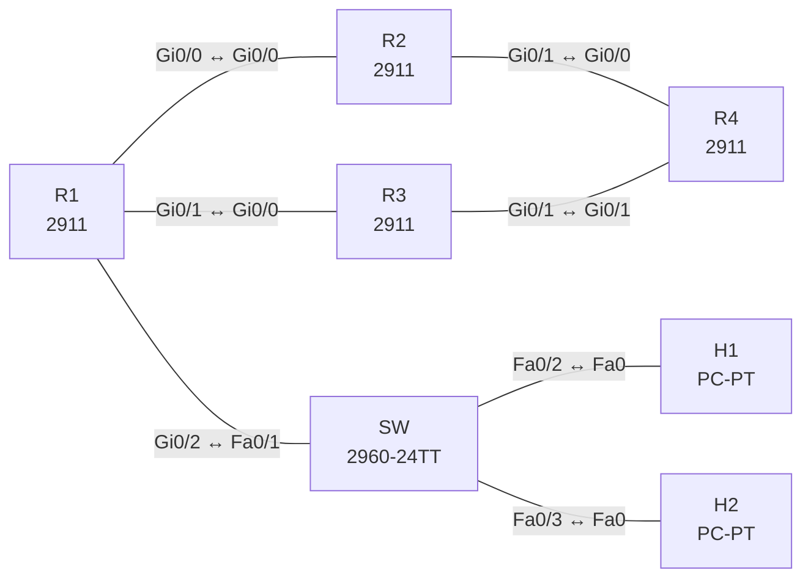

# Lab 29 – Policy-Based Routing nach Quelle und Anwendung

**Dauer:** 75 min · **Niveau:** mittel

Ein Branch-Router mit zwei Providern: Die Routing-Tabelle sendet alles über Provider A, per PBR wird ein bestimmter Host und Web-Verkehr über Provider B geleitet. Dazu die Wirkung von `deny` in einer PBR-Route-Map, die Reihenfolge der Auswertung und der Unterschied zwischen `ip policy` und `ip local policy`.

**Lernziele:** Nach diesem Lab kannst du …

- Verkehr nach Quelle und nach Anwendung (Port) auf verschiedene Provider lenken.
- Die Wirkung von `permit` und `deny` in einer PBR-Route-Map erklären.
- Mit `show route-map` und `show access-lists` nachweisen, welche Sequenz greift.

| ENCOR-Ziel (`Ziel::…`) | Thema |
|---|---|
| 3.2.d | Policy-based Routing |

**So arbeitest du:** Teil A = Bauen, Teil B = Reparieren, Teil C = Üben. Die Konfigurationsdateien liegen in `build/` (Ausgangszustand zum Einfügen in die CLI), `repair/` (fertig gebaut, mit Fehlern) und `solutions/` (Musterlösung und Fehlerliste, erst nach eigenem Versuch öffnen). Anleitung zum Einfügen: siehe [Arbeiten mit den Dateien](../README.md#arbeiten-mit-den-dateien).

## Topologie



**Entwurfsskizze (aus dem CML-Lab; Portnamen der Switches siehe Verkabelungstabelle):**

```
   H1 ─┐                 ┌─ R2 (Provider A) ─┐
       ├─ SW ─ R1 ───────┤                    ├─ R4 (Server 192.0.2.44)
   H2 ─┘   Gi0/2 Gi0/0,Gi0/1└─ R3 (Provider B) ─┘
```

### Geräte

| Gerät | Modell in Packet Tracer | Rolle |
|---|---|---|
| R1 | 2911 | Router |
| R2 | 2911 | Router |
| R3 | 2911 | Router |
| R4 | 2911 | Router |
| SW | 2960-24TT | Switch (im CML-Lab unmanaged; ohne Konfiguration) |
| H1 | PC-PT | Host |
| H2 | PC-PT | Host |

### Verkabelung

| Von | Port | Nach | Port | Kabel |
|---|---|---|---|---|
| R1 | Gi0/0 | R2 | Gi0/0 | Copper Cross-Over |
| R1 | Gi0/1 | R3 | Gi0/0 | Copper Cross-Over |
| R2 | Gi0/1 | R4 | Gi0/0 | Copper Cross-Over |
| R3 | Gi0/1 | R4 | Gi0/1 | Copper Cross-Over |
| R1 | Gi0/2 | SW | Fa0/1 | Copper Straight-Through |
| SW | Fa0/2 | H1 | Fa0 | Copper Straight-Through |
| SW | Fa0/3 | H2 | Fa0 | Copper Straight-Through |

### Adressplan (Ausgangszustand)

| Gerät | Interface | Adresse | Maske | Gateway | DNS |
|---|---|---|---|---|---|
| R1 | Gi0/0 | 10.0.12.1 | 255.255.255.252 | | |
| R1 | Gi0/1 | 10.0.13.1 | 255.255.255.252 | | |
| R1 | Gi0/2 | 10.1.0.1 | 255.255.255.0 | | |
| R2 | Gi0/0 | 10.0.12.2 | 255.255.255.252 | | |
| R2 | Gi0/1 | 10.0.24.1 | 255.255.255.252 | | |
| R3 | Gi0/0 | 10.0.13.2 | 255.255.255.252 | | |
| R3 | Gi0/1 | 10.0.34.1 | 255.255.255.252 | | |
| R4 | Loopback0 | 192.0.2.44 | 255.255.255.255 | | |
| R4 | Gi0/0 | 10.0.24.2 | 255.255.255.252 | | |
| R4 | Gi0/1 | 10.0.34.2 | 255.255.255.252 | | |
| H1 | Fa0 (GUI) | 10.1.0.11 | 255.255.255.0 | 10.1.0.1 |  |
| H2 | Fa0 (GUI) | 10.1.0.12 | 255.255.255.0 | 10.1.0.1 |  |

| Link | Netz |
|---|---|
| R1 Gi0/0 – R2 Gi0/0 | 10.0.12.0/30 (.1/.2) |
| R1 Gi0/1 – R3 Gi0/0 | 10.0.13.0/30 (.1/.2) |
| R2 Gi0/1 – R4 Gi0/0 | 10.0.24.0/30 (.1/.2) |
| R3 Gi0/1 – R4 Gi0/1 | 10.0.34.0/30 (.1/.2) |
| R1 Gi0/2 – SW | 10.1.0.0/24 (R1 .1, H1 .11, H2 .12) |

R4 hat Loopback0 192.0.2.44/32 als Server. R1 hat nur die Default-Route über R2. Soll: H1 normal über Provider A, H2 **immer** über Provider B, Web-Verkehr (TCP 80) aller Hosts über Provider B.

### Portzuordnung der Switches (CML → Packet Tracer)

Aufgaben, Verkabelung, Konfigurationen und Fehlerlisten verwenden die Packet-Tracer-Ports. Die Tabelle zeigt, welcher Port der CML-Vorlage dazu gehört. Nur die Skizze nennt noch die CML-Ports. Umrechnung: `GiX/Y` → `Fa0/(X·4+Y+1)`.

| Switch | CML-Port | PT-Port |
|---|---|---|
| SW | Gi0/0 | Fa0/1 |
| SW | Gi0/1 | Fa0/2 |
| SW | Gi0/2 | Fa0/3 |

> **Packet-Tracer-Hinweis:** **Eignung: geeignet.** Alle verwendeten Funktionen gibt es in Packet Tracer; Ausgabeformate einzelner `show`-Befehle weichen leicht ab. Die CML-Switches (Gi-Ports) sind hier 3560-24PS bzw. 2960 mit FastEthernet-Ports: Die Portzuordnung steht unter dem Adressplan.

## Teil A – Bauen

1. **Ausgangszustand.** Statische Routen sind gesetzt. Prüfe `traceroute 192.0.2.44` von H1 und H2: Beide gehen über R2.
2. **Quellbasiert.** ACL `H2-ONLY` (`permit ip host 10.1.0.12 any`), Route-Map `PBR` Sequenz 10 mit `match ip address H2-ONLY` und `set ip next-hop 10.0.13.2`. Am Interface `Gi0/2` `ip policy route-map PBR`. Traceroute von H2: nun über R3, H1 weiter über R2. Warum wirkt die Policy am **Eingangs**-Interface?
3. **Anwendungsbasiert.** ACL `WEB` (`permit tcp any any eq 80`), Sequenz 20 mit demselben Next-Hop. Prüfe mit `show ip policy` und `show route-map PBR` die Zähler (Matches). Wie testest du TCP 80 ohne Server? (`debug ip policy`, `telnet 192.0.2.44 80`.)
4. **Reihenfolge.** Vertausche testweise Sequenz 10 und 20 (neue Nummern): Was ändert sich, wenn ein Paket auf beide Regeln passt? Was passiert mit Paketen, die auf **keine** Sequenz passen (normale Routing-Entscheidung) und mit `deny`-Sequenzen?
5. **Lokaler Verkehr.** R1-eigene Pakete umgeht `ip policy`. Mit `ip local policy route-map PBR` greift die Policy auch für sie. Wann braucht man das?
6. **Robustheit.** Wie würdest du Ausfall von Provider B abfangen (`set ip next-hop verify-availability` mit Track/IP SLA, oder `set ip next-hop … 10.0.12.2` als zweiter Eintrag)? Siehe Lab 04.

## Teil B – Reparieren

Baue die Topologie wie oben (oder behalte deine aus Teil A), setze alle Geräte zurück (`erase startup-config`, `reload` bzw. neues Gerät) und füge dann die Dateien aus `repair/` ein. Es stecken **5 Fehler** drin. Behandle jede Meldung als Ticket: erst Symptom nachstellen, dann Layer für Layer eingrenzen, beheben und beweisen. Ändere nur, was kaputt ist.

**Ticket 1:** H2 und Web-Verkehr gehen über Provider A; `show ip policy` ist leer.

**Ticket 2:** H2 nimmt den normalen Weg, die Zähler der Sequenz 10 bleiben 0.

**Ticket 3:** H2 verliert die Verbindung zum Server (Timeouts), H1 ist unbeeinträchtigt.

**Ticket 4:** H2 geht über Provider A, obwohl ACL und Next-Hop stimmen; nur Web-Verkehr (Sequenz 20) wird umgeleitet.

**Ticket 5:** H2 (über Provider B) erreicht den Server nicht; die Traceroute endet bei R3.

## Verifikation

```
show ip policy
show route-map PBR
traceroute 192.0.2.44        ! von H1 und H2
debug ip policy              ! kurz, nur im Lab
show ip route 0.0.0.0
```
Erwartet: H1 geht über 10.0.12.2, H2 über 10.0.13.2; Zähler in `show route-map PBR` steigen.

## Teil C – Üben

Beantworte zuerst selbst, dann klappe die Antwort auf.

1. H2 nimmt trotz Policy den Weg über Provider A. Welche vier Dinge prüfst du?
<details><summary>Antwort</summary>

**Interface, Route-Map, ACL und Next-Hop.** 1) Hängt `ip policy route-map` am Eingangs-Interface? 2) Steht die Sequenz auf `permit`, und stimmt die Reihenfolge? 3) Trifft die ACL die Quelle (Zähler in `show access-lists`)? 4) Ist der Next-Hop direkt erreichbar (ARP, Route)?

</details>

2. Was bewirkt `set ip default next-hop` im Unterschied zu `set ip next-hop`?
<details><summary>Antwort</summary>

**`default` greift nur, wenn es keine spezifische Route gibt.** `set ip next-hop` wirkt immer, noch vor der Routing-Tabelle. `set ip default next-hop` wird nur benutzt, wenn die Tabelle für das Ziel keine spezifischere Route als die Default hat.

</details>

3. Warum greift PBR nicht auf Pakete, die der Router selbst erzeugt?
<details><summary>Antwort</summary>

**Weil `ip policy` nur auf Pakete wirkt, die am Interface ankommen.** Pakete, die der Router selbst erzeugt, kommen nirgends an. Für sie gibt es `ip local policy route-map`.

</details>

## Prüfungsbezug

PBR entscheidet vor dem normalen Routing, nur für **eingehenden** Verkehr am Interface (lokal mit `ip local policy`). Match über ACL, Paketlänge; Set: Next-Hop, Interface, DSCP, Default-Next-Hop. Bei `permit` ohne Match auf ein Set wird normal geroutet; `deny` heißt: nicht per Policy, sondern normales Routing. Fehlt der Next-Hop, fällt das Paket auf die Routing-Tabelle zurück (außer `set interface`/`default`-Varianten mit Unterschieden).

## Lösungen

- `solutions/<Gerät>.cfg`: Konfiguration zu Teil A (ohne Basis-Adressen)
- `solutions/FAULTS.md`: Fehlerliste zu Teil B (Spoiler!)
