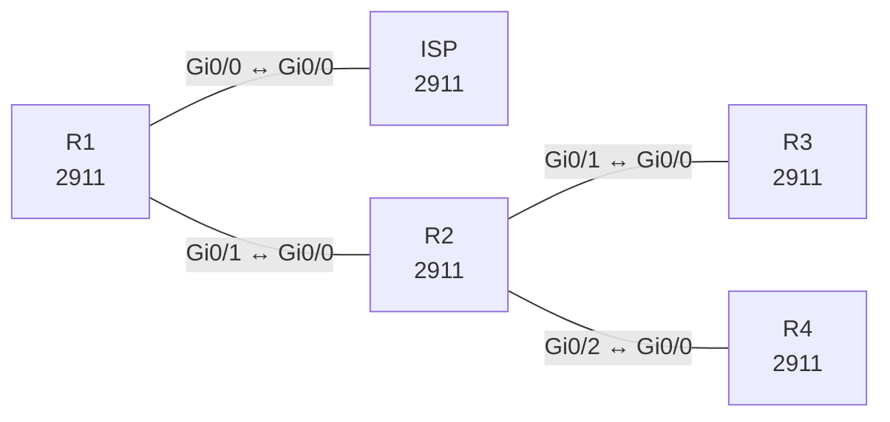

# Lab 30 – Capstone: Routing-Fehlersuche (OSPF, EIGRP, BGP, Redistribution)

**Dauer:** 150 min · **Niveau:** schwer

Ein Unternehmensnetz mit OSPF (Area 0 und Stub-Area 1), einem EIGRP-Standort, eBGP zum Provider und Default-Route-Weitergabe. Acht Fehler quer durch alle Protokolle, teils voneinander verdeckt: Die Aufgabe ist reine Fehlersuche, wie in der Prüfung.

**Lernziele:** Nach diesem Lab kannst du …

- Ein Netz mit BGP, OSPF (inklusive Stub-Area), EIGRP und Redistribution durchgängig verfolgen.
- Hinweg und Rückweg getrennt prüfen.
- Unter Zeitdruck Fehler in der richtigen Reihenfolge abarbeiten.

| ENCOR-Ziel (`Ziel::…`) | Thema |
|---|---|
| 3.2.a | EIGRP und OSPF vergleichen |
| 3.2.b | OSPFv2 und OSPFv3 |
| 3.2.c | Direktes eBGP |

**So arbeitest du:** Teil A = Bauen, Teil B = Reparieren, Teil C = Üben. Die Konfigurationsdateien liegen in `build/` (Ausgangszustand zum Einfügen in die CLI), `repair/` (fertig gebaut, mit Fehlern) und `solutions/` (Musterlösung und Fehlerliste, erst nach eigenem Versuch öffnen). Anleitung zum Einfügen: siehe [Arbeiten mit den Dateien](../README.md#arbeiten-mit-den-dateien).

## Topologie



**Entwurfsskizze (aus dem CML-Lab; Portnamen der Switches siehe Verkabelungstabelle):**

```
   ISP (65000, Lo10 203.0.113.0/24)
     │ 198.51.100.0/30
     R1 (AS 65001, OSPF ASBR, default-originate)
     │ 10.0.12.0/30 (Area 0)
     R2 (ABR + ASBR zu EIGRP)
  Gi0/1 /      \ Gi0/2
 10.0.23.0/30   10.0.24.0/30
 R3 (Area 1 stub)   R4 (EIGRP 100, Lo10 172.20.4.0/24)
 Lo10 192.168.3.0/24
```

### Geräte

| Gerät | Modell in Packet Tracer | Rolle |
|---|---|---|
| ISP | 2911 | Router |
| R1 | 2911 | Router |
| R2 | 2911 | Router |
| R3 | 2911 | Router |
| R4 | 2911 | Router |

### Verkabelung

| Von | Port | Nach | Port | Kabel |
|---|---|---|---|---|
| R1 | Gi0/0 | ISP | Gi0/0 | Copper Cross-Over |
| R1 | Gi0/1 | R2 | Gi0/0 | Copper Cross-Over |
| R2 | Gi0/1 | R3 | Gi0/0 | Copper Cross-Over |
| R2 | Gi0/2 | R4 | Gi0/0 | Copper Cross-Over |

### Adressplan (Ausgangszustand)

| Gerät | Interface | Adresse | Maske | Gateway | DNS |
|---|---|---|---|---|---|
| ISP | Loopback0 | 2.2.2.2 | 255.255.255.255 | | |
| ISP | Loopback10 | 203.0.113.1 | 255.255.255.0 | | |
| ISP | Gi0/0 | 198.51.100.2 | 255.255.255.252 | | |
| R1 | Loopback0 | 10.255.0.1 | 255.255.255.255 | | |
| R1 | Gi0/0 | 198.51.100.1 | 255.255.255.252 | | |
| R1 | Gi0/1 | 10.0.12.1 | 255.255.255.252 | | |
| R2 | Loopback0 | 10.255.0.2 | 255.255.255.255 | | |
| R2 | Gi0/0 | 10.0.12.2 | 255.255.255.252 | | |
| R2 | Gi0/1 | 10.0.23.1 | 255.255.255.252 | | |
| R2 | Gi0/2 | 10.0.24.1 | 255.255.255.252 | | |
| R3 | Loopback0 | 10.255.0.3 | 255.255.255.255 | | |
| R3 | Loopback10 | 192.168.3.1 | 255.255.255.0 | | |
| R3 | Gi0/0 | 10.0.23.2 | 255.255.255.252 | | |
| R4 | Loopback0 | 10.255.0.4 | 255.255.255.255 | | |
| R4 | Loopback10 | 172.20.4.1 | 255.255.255.0 | | |
| R4 | Gi0/0 | 10.0.24.2 | 255.255.255.252 | | |

| Link | Netz |
|---|---|
| ISP Gi0/0 – R1 Gi0/0 | 198.51.100.0/30 (ISP .2, R1 .1), eBGP |
| R1 Gi0/1 – R2 Gi0/0 | 10.0.12.0/30 (.1/.2), OSPF Area 0 |
| R2 Gi0/1 – R3 Gi0/0 | 10.0.23.0/30 (.1/.2), OSPF Area 1 (Stub) |
| R2 Gi0/2 – R4 Gi0/0 | 10.0.24.0/30 (.1/.2), EIGRP 100 |

Loopback0: R1 10.255.0.1, R2 .2, R3 .3 (Area 1), R4 .4 (EIGRP). R3 Lo10 192.168.3.1/24, R4 Lo10 172.20.4.1/24, ISP Lo10 203.0.113.1/24. **Soll:** Alle internen Netze erreichen 203.0.113.1 über eine Default-Route (aus BGP in OSPF, R4 per statischer Default auf R2); R4s Netz ist in OSPF sichtbar; der ISP hat statische Rückrouten für die internen Netze.
> **Packet-Tracer-Hinweis:** **Eignung: geeignet.** Alle verwendeten Funktionen gibt es in Packet Tracer; Ausgabeformate einzelner `show`-Befehle weichen leicht ab.

## Teil A – Bauen

1. **Provider.** eBGP R1 (65001) ↔ ISP (65000); ISP `neighbor 198.51.100.1 default-originate`, kündigt 203.0.113.0/24 an. ISP-Rückrouten: `ip route 10.0.0.0 255.0.0.0 198.51.100.1`, `172.20.0.0 255.255.0.0` und `192.168.0.0 255.255.0.0` ebenfalls zu R1.
2. **OSPF.** Area 0: R1, R2; Area 1 (Stub): R2 und R3 (`area 1 stub` auf beiden). R1 gibt die Default-Route mit `default-information originate` weiter. Loopbacks von R3 mit `ip ospf network point-to-point`.
3. **EIGRP-Standort.** R2/R4 EIGRP 100 auf dem Link und Lo10 (R4), `no auto-summary`. R4: `ip route 0.0.0.0 0.0.0.0 10.0.24.1`.
4. **Redistribution.** R2: `redistribute eigrp 100 subnets` in OSPF und `redistribute ospf 1 metric 10000 100 255 1 1500` in EIGRP. Warum reicht hier ein Redistributionspunkt ohne Tags?
5. **Abnahme.** `ping 203.0.113.1 source Loopback10` von R3 und R4, `show ip route` auf allen Routern (Codes `B`, `O*E2`, `O IA`, `O E2`, `D EX`).

## Teil B – Reparieren

Baue die Topologie wie oben (oder behalte deine aus Teil A), setze alle Geräte zurück (`erase startup-config`, `reload` bzw. neues Gerät) und füge dann die Dateien aus `repair/` ein. Es stecken **8 Fehler** drin. Behandle jede Meldung als Ticket: erst Symptom nachstellen, dann Layer für Layer eingrenzen, beheben und beweisen. Ändere nur, was kaputt ist.

**Ticket 1:** Kein BGP: R1 hat keine Default-Route, R2/R3/R4 erreichen 203.0.113.1 nicht.

**Ticket 2:** BGP steht, R1 hat eine Default-Route, aber R2 und R3 haben keine.

**Ticket 3:** R2 und R3 bilden keine Nachbarschaft; Mismatched Stub/Transit-Option im Debug.

**Ticket 4:** R1 und R3 sehen 172.20.4.0/24 nicht.

**Ticket 5:** Auf R4 fehlen die OSPF-Routen (R3-Loopback, 10.0.12.0/30); nur die statische Default erreicht R2.

**Ticket 6:** R4 erreicht nichts außerhalb des direkten Links; `show ip route` zeigt die Default mit unerreichbarem Next-Hop.

**Ticket 7:** Das Netz 192.168.3.0/24 fehlt auf R1/R2, Pings von R3-Lo10 ins Internet scheitern am Rückweg.

**Ticket 8:** Alle Pings von internen Quellen an 203.0.113.1 scheitern auf dem Rückweg, obwohl das Routing intern stimmt; Traceroute zeigt den Hinweg bis zum ISP.

## Verifikation

```
show ip bgp summary           show ip route bgp
show ip ospf neighbor         show ip route ospf
show ip eigrp neighbors       show ip route eigrp
ping 203.0.113.1 source Loopback10
```
Erwartet: BGP `Established`, R2 und R3 haben `O*E2 0.0.0.0/0`, R1 sieht `O E2 172.20.4.0/24`, R3 hat 192.168.3.0/24 lokal, die Pings vom R3/R4 an 203.0.113.1 klappen.

## Teil C – Üben

Beantworte zuerst selbst, dann klappe die Antwort auf.

1. Alle OSPF-Nachbarschaften sind `FULL`, aber R3 hat keine Default-Route. Prüfpunkte in Reihenfolge?
<details><summary>Antwort</summary>

**Den Weg der Default-Route verfolgen: BGP, dann OSPF, dann Stub.** Auf R1: `show ip route 0.0.0.0` (kommt die Default per BGP?) und ob `default-information originate` gesetzt ist. Auf R2: Steht die Default als `O*E2` in der Tabelle? Ist Area 1 auf beiden Seiten `stub`? Dann erzeugt der ABR die Default für R3.

</details>

2. Ping R4-Loopback → 203.0.113.1 scheitert, `traceroute` endet an R1. Wo liegt vermutlich das Problem?
<details><summary>Antwort</summary>

**Hinter R1, und zwar wahrscheinlich auf dem Rückweg.** Bis R1 ist der Hinweg da. Entweder fehlt die BGP-Default auf R1, oder der ISP kennt 172.20.0.0/16 nicht und schickt die Antwort nicht zurück. Prüfe `show ip route` auf dem ISP.

</details>

3. Warum ist die Redistribution an einem Punkt hier ohne Tags ungefährlich?
<details><summary>Antwort</summary>

**Weil es nur einen Punkt zwischen den Domänen gibt.** Eine Route kann nicht über einen zweiten Punkt zurückfließen. Erst bei zwei Redistributionspunkten braucht man Tags oder Filter (siehe Lab 27).

</details>

## Prüfungsbezug

Arbeitsmethode bei Routing-Fehlern: Nachbarschaft (OSPF/EIGRP/BGP-State), dann Routen (welcher Code, welche Distanz), dann Weiterleitung (Next-Hop, Rückweg). Bei Redistribution immer Metrik (EIGRP: fünf Werte) und `subnets` prüfen. Default-Routen kommen in OSPF nur mit `default-information originate`; in Stub-Areas liefert der ABR die Default automatisch. Den Rückweg nicht vergessen: Bei einem Ping zählt der Weg in beide Richtungen.

## Lösungen

- `solutions/<Gerät>.cfg`: Konfiguration zu Teil A (ohne Basis-Adressen)
- `solutions/FAULTS.md`: Fehlerliste zu Teil B (Spoiler!)
